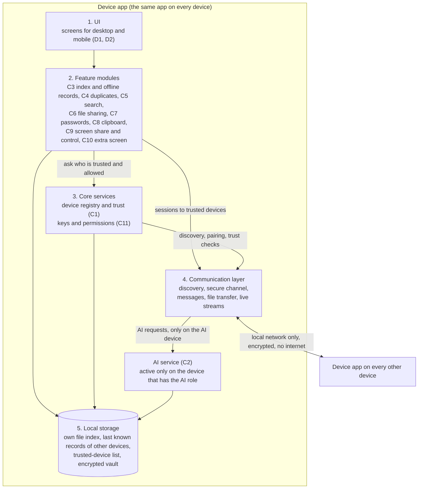

# B1: System architecture (v1, draft for M1)

Owner: Mahmoud. Status: v1 draft, 13 Oct 2026. Replaces `B1-architecture-v0.md`. Final due Wed 21 Oct; milestone M1 is Thu 22 Oct, together with B6 (Ali).
This document names the parts of the system and the rules between them. It does **not** choose technologies (that is B6). Where a choice by someone else changes the picture, it is listed in "Open decisions" with who settles it and what this architecture assumes until then.

## The idea in one sentence
Every device runs the same device app. The apps find each other on the local network, trust each other after pairing, and talk directly (no internet, no cloud server). One device also takes the AI role.

## What changed from v0
- The AI node is now drawn as a **role** of one device app, not a separate program.
- The communication layer offers three kinds of channel (messages, file transfer, live streams), because the features need them.
- Security (C11) is a rule that every layer follows; the trusted-device list (C1) is the one thing that decides who may connect.
- Each device advertises what it can do (capabilities), so features degrade per device instead of failing.
- Added: what happens when something is off, and a list of open decisions with owners and dates.

## Diagram

Reading the diagram: a request goes down (UI, feature, communication layer) and to the other device's communication layer, then up. A feature never opens a network connection itself, and the communication layer only opens a session to a device that core services say is trusted.

## Parts and responsibilities

| Part | Responsibility | Designed in |
|---|---|---|
| UI | Screens; talks only to feature modules | D1, D2 |
| Feature modules | One module per feature. Use core services, local storage and the communication layer; never the network directly; do not call each other, they share data through local storage | C3-C10 |
| Core services | Device registry (who is known, trusted, online, what each can do), pairing, permission checks, revoking a device. Every feature depends on it | C1, C11 |
| Communication layer | Finds devices, authenticates them with their keys, and gives three channel types: small messages, file transfer (large, resumable), live streams (screen, extra screen) | C1, B6 (library) |
| Local storage | Own file index, last known index of other devices (offline records), trusted-device list, encrypted vault if C7 stays in scope | B5, C3 |
| AI service | The AI role: builds similarity data from the shared index, finds similar files, answers search by meaning. Exact duplicates (hash) do not need it | C2, C4, C5 |

## Rules this architecture sets for the other designs
1. **No cloud, no internet.** Everything stays on the user's local network.
2. **Only trusted devices.** An unpaired device can do one thing: start pairing. Everything else is refused (C1 defines pairing, C11 defines what a trusted device may do).
3. **Every device works alone.** Own files and own index keep working with no other device on. Offline devices appear from their last known record, marked with its age (C3).
4. **One AI role at a time.** If the AI device is off, exact duplicates, file sharing, clipboard and the rest keep working; only similar-file detection and search by meaning pause (C2 designs the message the user sees).
5. **Capabilities, not assumptions.** Each device tells the others what it can do (host the AI role, share its screen, accept control, act as extra screen). A feature offers an action only when both devices support it. This is how iPad and phone limits (C10, C9) are handled without separate architectures.
6. **Same names everywhere.** Feature designs and diagrams (B2, B3, B4, C-sequence diagrams) use: device app, UI, feature module, core services, communication layer, local storage, AI service.

## When something is off

| Situation | What still works | What the user sees |
|---|---|---|
| AI device off | Hash duplicates, sharing, clipboard, local search | AI features paused, last results kept (C2) |
| Another device off | Everything between the remaining devices | Its files show from the last record, with the date (C3) |
| Network changes (new Wi-Fi, no Wi-Fi) | Each device alone | Devices reappear when discovery finds them again (C1) |
| Device lost | Trusted list on the other devices | Remove the lost device from any other device; it can no longer connect (C1, C11) |

## Open decisions (waiting)
"Assumed" is what this architecture uses until the decision is made. It is not a decision.

| # | Decision | Settled by | When | Assumed meanwhile |
|---|---|---|---|---|
| 1 | Platforms (iOS, Android, Windows, Linux, macOS) | Professor, then B6 | professor answer; B6 v0 15 Oct | Design is platform-neutral; every feature says its limits per OS |
| 2 | One cross-platform app or native apps per platform | B6 (Ali) | 15 Oct v0, 22 Oct final | Behaviour is identical on all devices, so the architecture holds either way |
| 3 | Communication library and protocol. Must give: discovery, mutual authentication with device keys, encrypted channels, and the three channel types | B6 with C1 | 22 Oct | Sockets-level behaviour only; no library named |
| 4 | AI model and runtime, and the minimum hardware for the AI role. Which similarity method (hash only, image fingerprints, embeddings) | B6 with C2 and C4 | 22 Oct | One AI role, on a laptop or PC; phones do not take it |
| 5 | Local storage technology on each platform, and how the vault is protected | B6 with C3, C7, C11 | 22 Oct | One embedded database per device |
| 6 | Pairing method and trust model (QR, code comparison, what pairing grants, how a third and fourth device join) | C1 (Mahmoud) | draft 5 Nov | Each device has a key pair; the trusted list holds public keys |
| 7 | How the AI device is chosen and replaced, and what happens to its similarity data | C2 (Mohammed) | draft 5 Nov | User picks it; the app suggests the strongest device |
| 8 | Where file indexes live: every device keeps a copy of the others' last known index, or only the AI device does. Size limits | C3 (Mohammed) with C5 | 12 Nov | Every device keeps copies (as in v0) |
| 9 | Which device keeps a duplicate, and who deletes | C4 (Ali) | draft 5 Nov | Nothing is deleted without the user's confirmation, and always by the device that owns the file |
| 10 | Transport for live streams (screen, extra screen) and bulk files: same secure channel or separate | C6, C9, C10 with B6 | 12 Nov | Separate channel types over the same trust |
| 11 | Encryption of data in transit and at rest, permissions per feature, vault sync, lost-device rule | C11 (Ali) with C1, C7 | 19 Nov (see board question on C11 vs M2) | Everything in transit is encrypted; vault never leaves the device unencrypted |
| 12 | Phones and tablets in the background: can the app still answer other devices? Affects offline records and discovery | B6, C3, C10 | 22 Oct; verify, do not assume | Phone and tablet are fully reachable only while the app is open |
| 13 | Scope: C7 passwords, C9 screen sharing, C10 extra screen as design only in Phase 1 | Professor | asked, not answered | All three stay in the diagram; remove a module if it is dropped |

## What B6 has to settle for B1 to be final (Thu 22 Oct)
Decisions 1 to 5 and 12. If B6 v0 (15 Oct) leaves any of them open, B1 final will say so rather than guess.
