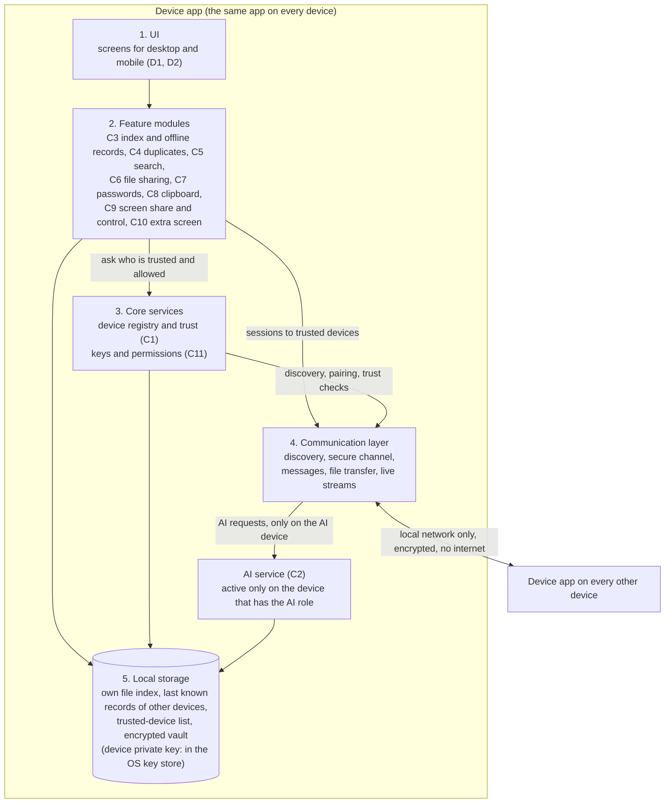

# B1: System architecture (v2, approved by Mahmoud on 26 Oct 2026)

Owner: Mahmoud. Status: **approved by Mahmoud on 26 Oct 2026 as version 2**: Ali's technology choices are the base; the phone limits are stated openly; every device pairs with every other plus an optional one-tap introduce step; small photo previews may go to the AI laptop (local network only, not kept, off switch per device); every feature is off until the user turns it on. It will be refreshed once after the team's designs arrive (Mon 2 Nov and Thu 5 Nov). Replaces `B1-architecture-v1.md` (v1 stays unchanged). Updated with Ali's `B6-technology-v0.md` (21 Oct, merged as PR 37), Mohammed's `C2-ai-node.md`, Ahmed's `C8-clipboard-sync.md` (17 Oct), Samer's `A5-existing-systems.md`, and Mahmoud's own pairing design draft `C1-v1.md` (26 Oct, not yet reviewed by the team). Phase 1 deadline: Sun 15 Nov 2026.
Phase 1 is analysis and design only: no code. Everything here is a decision or a design written for the report.

Marking: **[GUESS]** = a proposal, not checked in a source or tested. **[NOT CHECKED]** = a fact nobody has confirmed in a primary source or by a test. Nothing in this file is verified by a test.

This document names the parts of the system and the rules between them. Since B6 v0, a "how it is built" column names the technology Ali chose. Those choices are Ali's answers; this file only records them.

## The idea in one sentence
Every device runs the same device app. The apps find each other on the local network, trust each other after pairing, and talk directly (no internet, no cloud server). One laptop or PC also takes the AI role.

## What changed from v1
- Technology is now chosen (B6): one Flutter app for all five systems; discovery with mDNS/Bonjour; TLS 1.3 in both directions with a self-signed key per device, pinned at pairing; SQLite per device with an encrypted vault; AI models run inside the device app with ONNX Runtime.
- Local storage no longer holds the device's private key: it sits in the operating system's key store (B6 section 5). The diagram text now says so.
- Pairing (C1 draft): a separate pairing port is what keeps rule 2 true; the normal port never accepts an unknown certificate.
- AI role: laptop or PC only, never a phone or tablet (B6, C2). The app suggests the AI device and the user decides (C2). Similarity data is never copied between devices; a new AI device rebuilds it (C2).
- Phones in the background (decision 12): the v1 assumption is confirmed for iPhone and iPad. Android can optionally stay connected in the background with a visible notification (B6).
- New capability flag: "can sync clipboard in the background" (C8). Clipboard text uses the messages channel, clipboard images use file transfer (C8).
- Photo similarity needs the AI device to see a small preview of photos that live on other devices. C2 stores no thumbnails, so this gap is a new open item (decision 14 below).
- Exact duplicates: B6 proposes a perceptual hash for photos too (finds resized copies). That would run on every device, not only the AI device. It is a proposal for C4 (Ali), not decided.
- Per-system limits are now written down (table "Platforms and limits").

## Diagram

Reading the diagram: a request goes down (UI, feature, communication layer) and to the other device's communication layer, then up. A feature never opens a network connection itself, and the communication layer only opens a session to a device that core services say is trusted. The one exception is the pairing port, which accepts only pairing messages while the user has opened a pairing window (C1 draft).

## Parts and responsibilities

| Part | Responsibility | Designed in | How it is built (B6 v0) |
|---|---|---|---|
| UI | Screens; talks only to feature modules | D1, D2 | Flutter, one code base |
| Feature modules | One module per feature. Use core services, local storage and the communication layer; never the network directly; do not call each other, they share data through local storage | C3-C10 | Dart; screen capture, input control, Android background service and clipboard become small native plugins (not checked whether screen streaming is fast enough from Dart) |
| Core services | Device registry (who is known, trusted, online, what each can do), pairing, permission checks, revoking a device. Every feature depends on it | C1, C11 | Device id = SHA-256 of the device certificate [GUESS, C1 draft]; private key in the OS key store (`flutter_secure_storage`) |
| Communication layer | Finds devices, authenticates them with their keys, and gives three channel types: small messages, file transfer (large, resumable), live streams (screen, extra screen) | C1, B6 | Bonsoir (mDNS/Bonjour) discovery; TLS 1.3 both ways with pinned self-signed keys; our own small protocol; messages on one long-lived connection, files on a separate chunked connection, live streams on their own connection (WebRTC is the alternative, decision 10) |
| Local storage | Own file index, last known index of other devices (offline records), trusted-device list, encrypted vault if C7 stays in scope | B5, C3 | One SQLite file per device; the vault is a second SQLite file encrypted with SQLCipher, key from the master password and never stored |
| AI service | The AI role: builds similarity data from the shared index, finds similar files, answers search by meaning. Exact duplicates (hash) do not need it | C2, C4, C5 | Small embedding models run with ONNX Runtime inside the device app (CLIP multilingual for photos, multilingual-e5-small for names and text); no chat model |

## Platforms and limits (B6 section 1, decision 1)
All five systems are covered. Minimum versions follow what Flutter supports.

| System | Minimum | Main limits |
|---|---|---|
| Windows | 10 | Discovery library needs Windows 10 version 1903 or later |
| macOS | 12 | User must allow Local Network (macOS 15+); screen share and control need Screen Recording and Accessibility permissions, re-approved from time to time |
| Linux | Ubuntu 20.04, Debian 10 | Needs the Avahi service; on Wayland screen share and control go through a system dialog. Test desktop [NOT CHECKED] |
| Android | 7.0 (API 24) | Indexing all files needs "All files access"; screen capture needs a consent prompt; being controlled needs an accessibility service |
| iPhone/iPad | 15 | Sees only its own files, the photo library and folders the user picks; never the AI device; no way found to control it from another device [NOT CHECKED in Apple docs]; screen sharing only through a user-started broadcast [NOT CHECKED] |

## Rules this architecture sets for the other designs
1. **No cloud, no internet.** Everything stays on the user's local network.
2. **Only trusted devices.** An unpaired device can do one thing: start pairing (through the separate pairing port). Everything else is refused (C1 defines pairing, C11 defines what a trusted device may do).
3. **Every device works alone.** Own files and own index keep working with no other device on. Offline devices appear from their last known record, marked with its age (C3).
4. **One AI role at a time.** If the AI device is off, exact duplicates, file sharing, clipboard and the rest keep working; only similar-file detection and search by meaning pause (C2 designs the message the user sees).
5. **Capabilities, not assumptions.** Each device tells the others what it can do (host the AI role, share its screen, accept control, act as extra screen, sync clipboard in the background). A feature offers an action only when both devices support it. This is how iPad and phone limits (C8, C9, C10) are handled without separate architectures.
6. **Same names everywhere.** Feature designs and diagrams (B2, B3, B4, C-sequence diagrams) use: device app, UI, feature module, core services, communication layer, local storage, AI service.

## When something is off

| Situation | What still works | What the user sees |
|---|---|---|
| AI device off | Hash duplicates, sharing, clipboard, local search | "AI paused: *device* is off", last results kept with date; the app offers to move the AI role to another capable device (asks, never switches by itself) (C2) |
| Another device off | Everything between the remaining devices | Its files show from the last record, with the date (C3) |
| Phone or tablet app closed | Everything else; the phone gets nothing while closed (Android only with the optional stay-connected mode on) | Its records show from the last record; clipboard to it is not queued (C8) |
| Network changes (new Wi-Fi, no Wi-Fi) | Each device alone | Devices reappear when discovery finds them again; if the router blocks device-to-device traffic, connect by entering the address or QR (C1 draft) |
| Device lost | Trusted list on the other devices | Remove the lost device from any other device; it can no longer connect. Devices that were offline learn at next contact, so until then they still trust it [open, C1 and C11] |

## Open decisions: status after B6 v0 and the first feature drafts
"Safe assumption" is what this architecture uses until the decision is made. It is not a decision.

| # | Decision | Status | Answer or who must answer | Safe assumption while open |
|---|---|---|---|---|
| 1 | Platforms | **Settled** | Mahmoud, 13 Oct: all five. B6 v0 confirms, with minimum versions. Source: `B6-technology-v0.md` section 1 | - |
| 2 | One cross-platform app or native apps | **Settled** | One Flutter (Dart) app. Source: B6 v0 section 2 (Ali). Not checked: the team's Dart experience, and whether screen streaming is fast enough from Dart | - |
| 3 | Communication library and protocol | **Settled, with one check open** | mDNS/Bonjour discovery (Bonsoir) plus TLS 1.3 in both directions with a pinned self-signed key per device, plus our own small protocol. Source: B6 v0 section 3. [NOT CHECKED] whether Dart's TLS server can verify a self-signed client certificate; the fallback is a signed challenge inside the channel or a native layer, and the C1 design works with either. Ali to check | The design holds either way |
| 4 | AI model and runtime, minimum hardware, similarity method | **Settled (hardware not measured)** | Hash (SHA-256) for exact duplicates on every device; small embedding models with ONNX Runtime for similar files and search by meaning. Minimum AI device: 64-bit laptop or PC, 4 cores, 8 GB RAM, about 3 GB free disk, no GPU. Source: B6 v0 section 4. [NOT CHECKED] CPU time for 100,000 photos, videos, Arabic quality of the larger model, and the CLIP card's "deployed use out of scope" note if the product is ever published | - |
| 5 | Local storage and vault protection | **Settled (two points not checked)** | SQLite per device; vault is a SQLCipher file keyed from the master password; device private key in the OS key store. Source: B6 v0 section 5. [NOT CHECKED] full-text search in the bundled SQLite; which key store is used on Windows; Linux needs a running keyring service | - |
| 6 | Pairing method and trust model | **Still open** | Mahmoud's own draft (`C1-v1.md`): QR code, or a 6-digit code comparison with a commitment step when there is no camera; device id = hash of the certificate; pair every device with every other. Final due Thu 29 Oct. Needs Ali: can Dart check a client certificate (decision 3), is the commitment step sound, where is the C1/C11 line. [GUESS] marks in that draft | Key pair per device; the trusted list holds certificates |
| 7 | How the AI device is chosen and replaced | **Settled in C2 first version** | The app suggests the best laptop or PC; the user confirms; one AI device at a time; replaced by picking another, which rebuilds similarity data from its own file lists. Source: `C2-ai-node.md` Q1 (Mohammed); final due 29 Oct. Rebuild time [NOT CHECKED] | - |
| 8 | Where file indexes live | **Settled in C2 first version** | Every device keeps a copy of the others' lists (path, name, size, date, type, hash; no contents, no thumbnails, no AI data). About 20 to 40 MB per 100,000 files [NOT CHECKED, Mohammed's estimate]. Changes exchanged since the last sync. Source: `C2-ai-node.md` Q2. Final with C3 and C5 (Samer) | - |
| 9 | Which device keeps a duplicate, who deletes | **Still open** | Ali (C4), draft was due 25 Oct, final 29 Oct; nothing delivered yet [NOT CHECKED whether a draft exists elsewhere]. Also decides if photos get a perceptual hash on every device | Nothing is deleted without the user's confirmation, and always by the device that owns the file |
| 10 | Transport for live streams and bulk files | **Partly answered, still open** | B6 v0 proposes: files on a separate chunked connection, live streams on their own connection, WebRTC as the alternative for screen and extra screen. Must be confirmed by Samer (C6, 5 Nov), Ahmed (C9 on 29 Oct, C10 on 5 Nov), with Ali | Separate channel types over the same trust |
| 11 | Encryption in transit and at rest, permissions per feature, vault sync, lost-device rule | **Still open** | Ali (C11), 5 Nov. Already fixed by B6: TLS 1.3 in transit, SQLCipher for the vault, key from master password. Open: per-feature permission boundary with C1 (not agreed yet), vault sync, lost-device rule for devices that were offline | Everything in transit is encrypted; vault never leaves the device unencrypted; every feature is off until the user enables it [GUESS, as in C8 clipboard and C1 draft] |
| 12 | Phones and tablets in the background | **Settled (assumption confirmed), details not checked** | iPhone/iPad: reachable only while the app is open. Android: optional "stay connected" mode with a visible notification (foreground service). Source: B6 v0 section 6. [NOT CHECKED] whether Android power saving still cuts the network, phone makers that kill apps, and whether Apple would allow Local Push Connectivity for us | Phone and tablet are fully reachable only while the app is open |
| 13 | Scope: C7, C9, C10 design only | **Settled** | Mahmoud, 13 Oct: all three stay, as design only | - |
| 14 (new) | How the AI device gets photo content from other devices | **Still open** | B6 says one small thumbnail must be sent to the AI device; C2 says it stores no thumbnails. Mohammed (C2, C3) with Ali (C4) to agree: send a preview on request, keep it only while indexing, per-device switch | [GUESS] The AI device asks for one small preview per photo, over the secure channel, and does not keep it |
| 15 (new) | Who has a Mac with Xcode (iPhone, iPad and Mac builds need one) | **Still open** | The team; Ali raised it in B6. Not needed to write Phase 1 documents | None needed in Phase 1 |

## What is left before B1 can be called final
1. Mahmoud says OK to this v2.
2. Decisions 6, 9, 10, 11, 14 come back from their owners (29 Oct for C1, C2, C3, C4, C9; 5 Nov for C6, C10, C11). B1 is then refreshed once and marked final.
3. Ali answers the [NOT CHECKED] points in decisions 3 to 5 and 12, or the report states them as limits.
