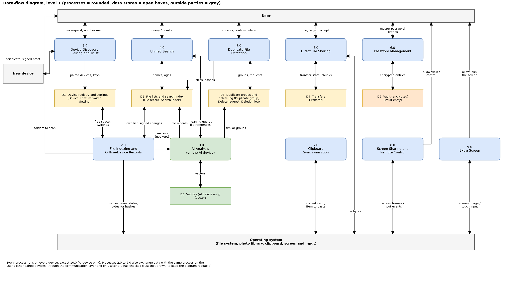

# Data-Flow Diagram, Level 1

## Introduction

The data-flow diagram shows how information moves through the system: what the user and the operating system give it, which processes handle that information, where it is stored, and what comes back to the user. Level 1 opens the single process of the context diagram into the system's main processes. It uses the same three outside parties as the context diagram (the User, the Operating system and a New device), the feature names used throughout this report, and the data stores of the data model.

## 1. Diagram

**Figure: data-flow diagram, level 1.** Source file: `diagrams/B3-dfd-level1.drawio`.

Each process runs on every device, except AI Analysis, which runs only on the AI device. Processes 2.0 to 9.0 also exchange data with the same process on the user's other paired devices, through the communication layer and only after Device Discovery, Pairing and Trust has checked that the other device is paired. These exchanges are not drawn, to keep the diagram readable; the sequence diagrams of each feature show them.

## 2. External entities

The system has three outside parties. The User is the person who owns the devices and makes every decision. The Operating system of each device holds the files, photos, clipboard, screen and keys that the system reads and uses. A New device is a device that has not yet been paired; the only thing it can do is take part in pairing. Table 1 lists what each party gives the system and what it receives.

**Table 1: External entities.**

| External entity | What it gives the system | What it receives from the system |
|---|---|---|
| User | Pairing requests and number confirmations; folders to scan; search words; choices about duplicates and confirmations to delete; files to send and acceptance of received files; the master password and vault entries; permission to view or control a screen and to use a device as an extra screen | Pairing numbers and results; search results; duplicate groups and the space that can be freed; transfer progress; passwords; requests for permission |
| Operating system | File names, sizes, dates and file bytes; photos for previews; copied items; screen images and input events; storage of keys | Files to save or move to the trash; items to paste; screen images and input for the other device; keys to keep |
| New device | Its certificate and the signed proof of its key during pairing | The certificate of this device, the pairing result and, once paired, a place in the device registry |

## 3. Processes

Table 2 lists the processes of level 1. Each process carries the name of the feature it belongs to, and the last column shows whether it runs on every device or only on the AI device.

**Table 2: Processes.**

| No. | Process | Input | Output | Runs on |
|---|---|---|---|---|
| 1.0 | Device Discovery, Pairing and Trust | Pairing request and number confirmation (User); certificate and signed proof (New device, paired devices) | Paired devices, their keys and removals (Device registry and settings) | Every device |
| 2.0 | File Indexing and Offline-Device Records | File names, sizes, dates and bytes for hashes (Operating system); folders to scan (User); signed list changes from paired devices; feature switches (Device registry and settings) | Own list and copies of other lists (File lists and search index); free space (Device registry and settings); signed list changes to paired devices; previews to AI Analysis | Every device |
| 3.0 | Duplicate File Detection | Sizes and hashes (File lists and search index); similar groups (Duplicate groups and delete log); choices and confirmations (User) | Groups, delete requests and the deletion log (Duplicate groups and delete log); a file moved to the trash (Operating system of the owner device) | Every device |
| 4.0 | Unified Search | Search words (User); names and ages (File lists and search index); file references from AI Analysis | Results (User); search by meaning to AI Analysis | Every device |
| 5.0 | Direct File Sharing | File, receiving device and acceptance (User); file bytes (Operating system) | File bytes to the receiving device; transfer state (Transfers) | Every device |
| 6.0 | Password Management | Master password and entries (User) | Encrypted entries (Vault) | Every device that uses it |
| 7.0 | Clipboard Synchronisation | Copied item (Operating system); feature switches (Device registry and settings) | Item to paste (Operating system of the receiving device); nothing stored | Every device |
| 8.0 | Screen Sharing and Remote Control | Permission to view or control (User); screen images and input events (Operating system) | Screen images to the viewing device; input to the shared device; nothing stored | Every device (control is not possible on iPhone and iPad) |
| 9.0 | Extra Screen | Permission and choice of screen (User); screen image and touch input (Operating system) | Screen image to the screen device; touch input to the host device; nothing stored | Every device |
| 10.0 | AI Analysis (on the AI device) | File records (File lists and search index); previews from 2.0, not kept; searches by meaning from 4.0 | Vectors (Vectors); similar groups (Duplicate groups and delete log); file references to 4.0 | AI device only |

## 4. Data stores

| Store | Entities in it | Where |
|---|---|---|
| D1 Device registry and settings | Device, Feature switch, Setting | Every device |
| D2 File lists and search index | File record, Search index | Every device |
| D3 Duplicate groups and delete log | Duplicate group, Delete request, Deletion log | Every device |
| D4 Transfers | Transfer | Every device |
| D5 Vault (encrypted) | Vault entry | Every device that uses Password Management |
| D6 Vectors (AI device only) | Vector | AI device only |

All stores except the vault are kept in the device's main database, which is encrypted with a random key kept in the operating system's key store; the vault is a separate encrypted file. The data model gives the fields of each entity.

## 5. Summary

Level 1 shows ten processes, one for each feature plus AI Analysis, which runs only on the AI device. They exchange data with three outside parties and six data stores. The User decides every action, the Operating system provides the files and the screen, and a New device can only take part in pairing. No process stores clipboard items or screen images, and every exchange between devices happens only after pairing has been checked.

## Sources (opened 10 November 2026)

1. Architecture, version 2: parts and rules (team document).
2. Feature designs: Device Discovery, Pairing and Trust; Duplicate File Detection; Direct File Sharing; Password Management; Clipboard Synchronisation; Screen Sharing and Remote Control; Extra Screen; Security and Privacy (team documents).
3. File Indexing and Offline-Device Records, The AI Device, Unified Search and the Data Model (this report).
