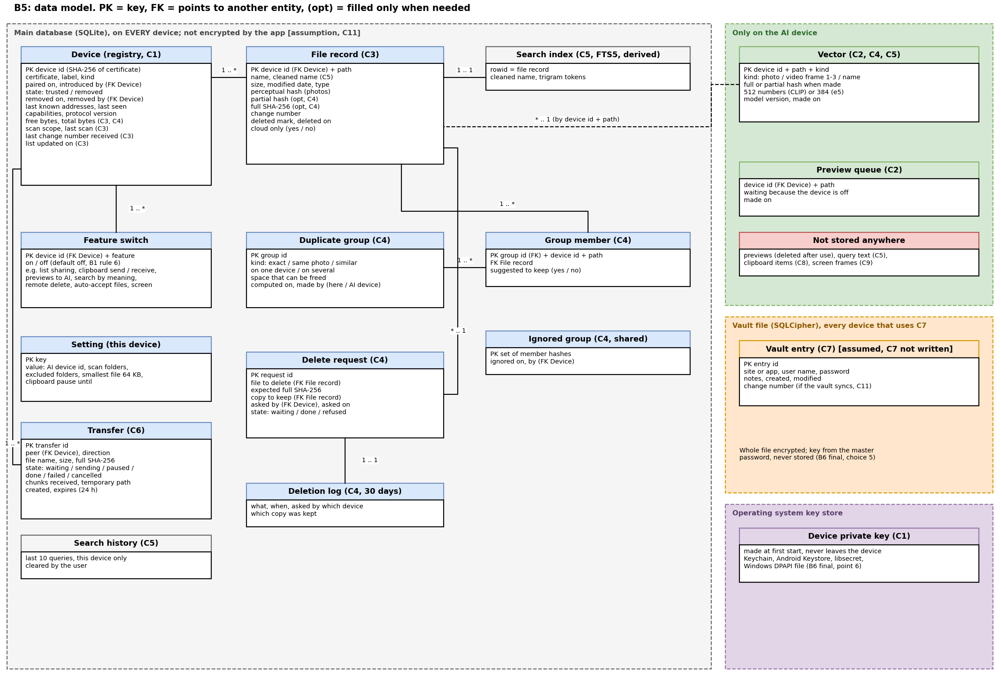

# B5: Data model (first version)

Owner: Mohammed. Status: first version, 8 Nov 2026.
What the system stores, where each piece lives and how the pieces relate. Built from the feature designs: C1 (device registry), C2 and C3 (file lists, AI device), C4 (duplicates), C5 (search), C6 (file transfers), C8 and C9 (what is not stored). C7 (passwords) and C11 (security) are not written yet: what is taken from them is marked **[assumed]** and will be updated when their first versions arrive. Storage technology from `B6-technology-final.md` (choice 5): one SQLite file per device, the vault in a second file encrypted with SQLCipher, the device's private key in the operating system's key store.
Phase 1 is design only: no code. **[PROPOSAL]** = my design choice. **not checked** = not confirmed.

## 1. Where data lives

| Place | What | Encrypted on disk |
|---|---|---|
| **Main database** (SQLite), on every device | device registry, file lists (own and copies), search index, feature switches, settings, duplicate groups, delete requests and log, transfers, search history | Not by the app **[assumed]**; the user's disk encryption if it is on. C11 decides (see open point 1) |
| **Vault file** (SQLCipher), on every device that uses C7 | password entries | Yes: the whole file; key from the master password, never stored (B6 final, choice 5) |
| **Operating system key store** | the device's private key (C1) | Yes, by the system: Keychain, Android Keystore, libsecret; on Windows a DPAPI file that other programs of the same user could read (B6 final, point 6) |
| **AI device only** (in its main database) | vectors of photos, video frames and names; queue of previews waiting for an offline device | Same as the main database **[assumed]** |
| **Nowhere** | previews after use (C2), search query text on the AI device (C5), clipboard items (C8), screen frames (C9), the one-time pairing secret after pairing (C1) | - |
| **In transit** | everything between devices | TLS 1.3 with pinned keys (B6 final, choice 3; C1) |

## 2. Entities

**On every device (main database):**

| Entity | Main fields | Key and relations | From |
|---|---|---|---|
| Device | device id (SHA-256 of its certificate), certificate, label, kind, paired on, introduced by, state (trusted or removed), removed on and by, last known addresses, last seen, capabilities, protocol version, free and total bytes, scan scope, last scan, last change number received, list updated on | key: device id. One row per known device, this one included. A removed device keeps its row as a tombstone (C1) | C1, C3, C4 |
| File record | device id, path, name, cleaned name, size, modified date, type, perceptual hash (photos), partial hash and full SHA-256 (only when needed), change number, deleted mark and date, cloud only | key: device id + path. Many per device | C3, C4, C5 |
| Search index | cleaned name split into trigrams | one per file record; built from the file records, can be rebuilt at any time | C5 |
| Feature switch | device id, feature, on or off | key: device id + feature. Features: list sharing, clipboard send and receive, previews to the AI device, search by meaning, "my other devices may delete duplicates here", auto-accept files, screen view and control. All off by default (B1 rule 6) | C3, C4, C5, C6, C8, C9 |
| Setting | key, value | AI device id, scan folders, excluded folders, smallest file for duplicates (64 KB), clipboard pause | C2, C3, C4, C8 |
| Duplicate group | group id, kind (exact, same photo, similar), on one device or several, space that can be freed, computed on, made by | exact and "same photo" groups are computed on each device; "similar" groups are received from the AI device | C4 |
| Group member | group id, device id, path, suggested to keep | many per group; points to a file record | C4 |
| Ignored group | the set of its members' hashes, ignored on, by | shared with all devices, so "ignore" works everywhere | C4 |
| Delete request | request id, file to delete, expected full hash, copy to keep, asked by, asked on, state | points to two file records; waits while the owner is off | C4 |
| Deletion log | what, when, asked by which device, which copy was kept | kept 30 days | C4 |
| Transfer | transfer id, peer device, direction, file name, size, full hash, state (waiting, sending, paused, done, failed, cancelled), chunks received, temporary path, created, expires | many per device; a waiting transfer expires after 24 hours | C6 |
| Search history | the last 10 queries | only on the device where they were typed | C5 |

**Only on the AI device:**

| Entity | Main fields | Key and relations | From |
|---|---|---|---|
| Vector | device id, path, kind (photo, video frame 1 to 3, name), the file's hash when made, 512 numbers (CLIP) or 384 (e5), model version, made on | key: device id + path + kind; points to a file record of any device | C2, C4, C5 |
| Preview queue | device id, path, since | photos and videos waiting because their device is off | C2 |

**In the vault file:**

| Entity | Main fields | From |
|---|---|---|
| Vault entry **[assumed, C7 not written]** | entry id, site or app, user name, password, notes, created, modified, change number if the vault syncs between devices (C11) | C7, C11 |

## 3. Diagram

Editable source: `diagrams/B5-data-model.drawio`; image: `diagrams/B5-data-model.png`.

Main relations: one device has many file records; one file record has one search index entry and may be in many duplicate groups (through group members) and have up to four vectors on the AI device (photo, or three video frames, plus its name); a delete request points to the file to delete and to the copy to keep; one device has many feature switches and transfers. Vectors point to file records by device id and path, but live in a different database (the AI device's), so the link is checked when lists change, not by the database [PROPOSAL].

## 4. Sizes

| What | Size | Source |
|---|---|---|
| File records | about 20 MB per 100,000 files | measured on made-up names, SQLite 3.42 on a PC, 8 Nov (C3) |
| Search index | about 7 MB per 100,000 files | same test (C5) |
| Lists on one device for 4 devices × 100,000 files | about 110 MB | 4 × 27 MB |
| Photo vectors (AI device) | about 200 MB per 100,000 photos (half with 16-bit numbers) | C4, section 6 |
| Name vectors (AI device) | about 1.5 KB per name, about 600 MB for 400,000 names | estimate, 384 numbers × 4 bytes; not checked (C5, open point 5) |
| AI models (AI device) | about 1.5 GB | B6 v0, section 4 |
| Device registry, switches, settings, groups, logs | under 1 MB for a normal home | estimate |
| Vault | a few hundred KB for a few hundred entries | estimate |

## 5. What happens to the data when...

- **A device is removed (C1):** its row stays as a tombstone; its file records, group members, feature switches and waiting transfers are deleted on every device as soon as each learns of the removal; the AI device deletes its vectors (C3, C4).
- **The AI device changes (C2):** the old AI device deletes its vectors and preview queue; the new one builds them again from the file records it already holds.
- **A file changes:** its partial and full hash are cleared, its perceptual hash is made again, and its vectors are marked old until a new preview arrives (C3, C4).

## 6. Open points and who settles them

| # | Point | Who | What B5 assumes |
|---|---|---|---|
| 1 | Is the main database encrypted on disk? (It holds the names of all files of all devices) | Ali (C11) | Not by the app; the user's disk encryption |
| 2 | Vault entry fields and whether the vault syncs between devices | C7, Ali (C11) | The fields above |
| 3 | Name vectors for all devices' files: needed, and how big | Ali (B6), me (C5) | Kept, about 600 MB for 400,000 names |
| 4 | Whether the ignore list and delete requests need a permission entity of their own | Ali (C11, C4) | Feature switches are enough |
| 5 | Pairing data (C1) is in pull request 38, not yet approved | Mahmoud (C1) | Its entry fields, section 1.4 |

## Sources (opened 8 Nov 2026)

1. Mahmoud, `C1-device-discovery-pairing-trust.md`, entry fields and sections 1.5 and 1.7 (pull request 38).
2. Ali, `B6-technology-final.md`, choices 3 and 5, point 6 (pull request 42).
3. Ali, `C4-duplicate-detection.md`, sections 2, 5 and 6 (pull request 43).
4. Samer, `research/C6-file-sharing.md`, sections 3 and 4 (on main).
5. Ahmed, `C8-clipboard-sync.md`, section 4 (pull request 39), and `C9-screen-sharing-notes.md` (pull request 40).
6. Mohammed, `C2-ai-node.md`, `C3-file-indexing.md`, `C5-unified-search.md`.
