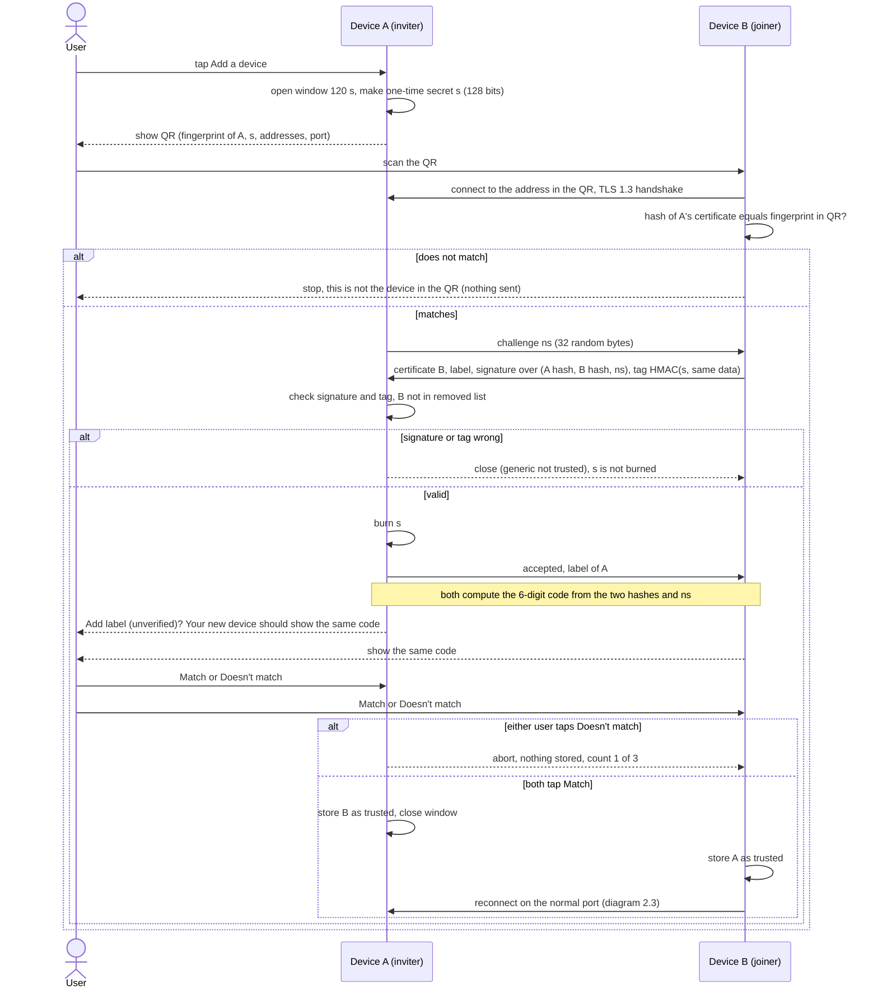
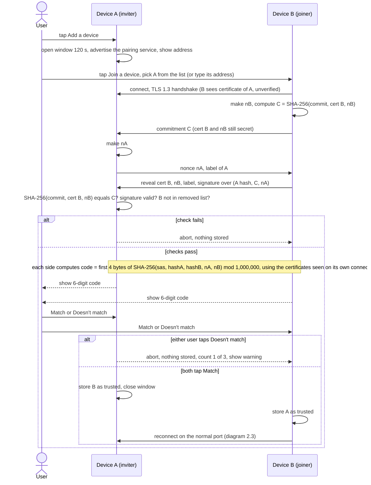
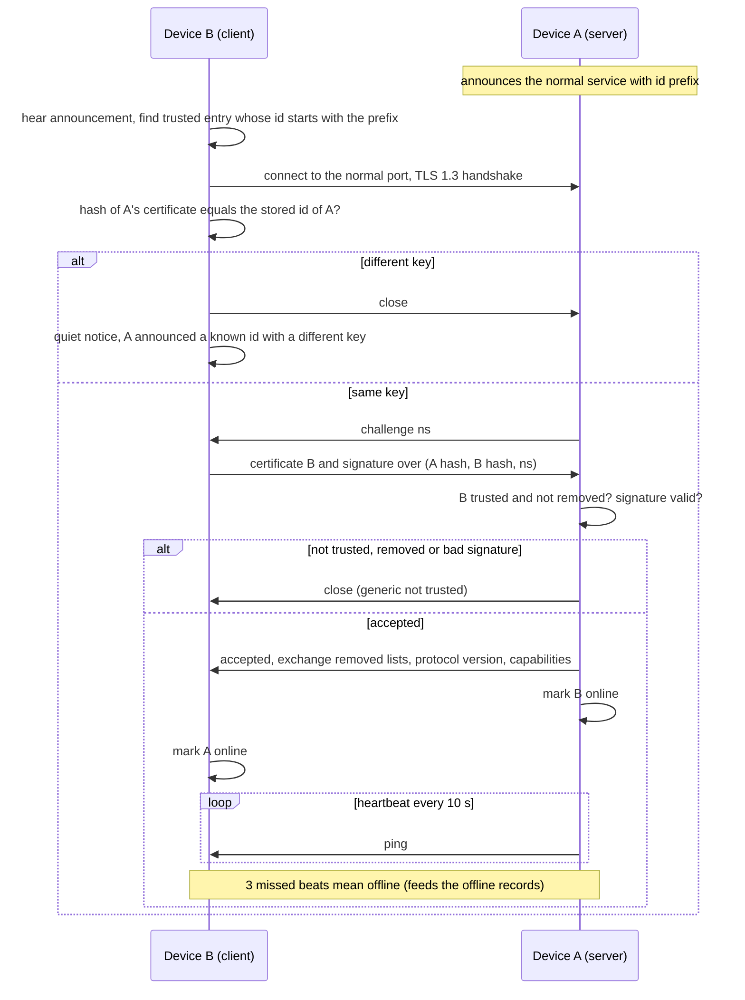
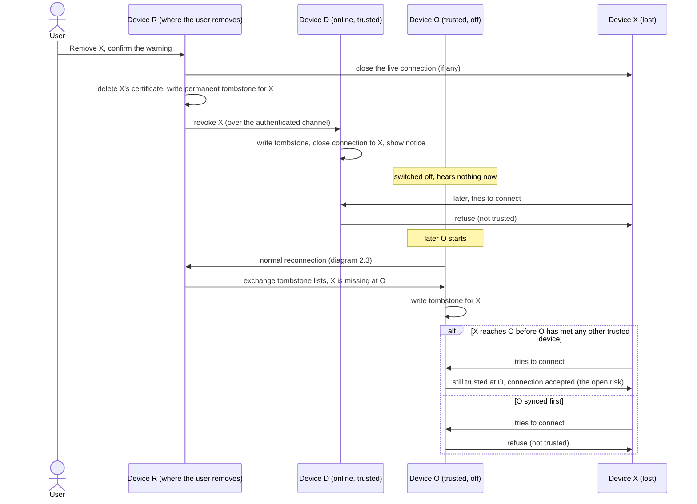
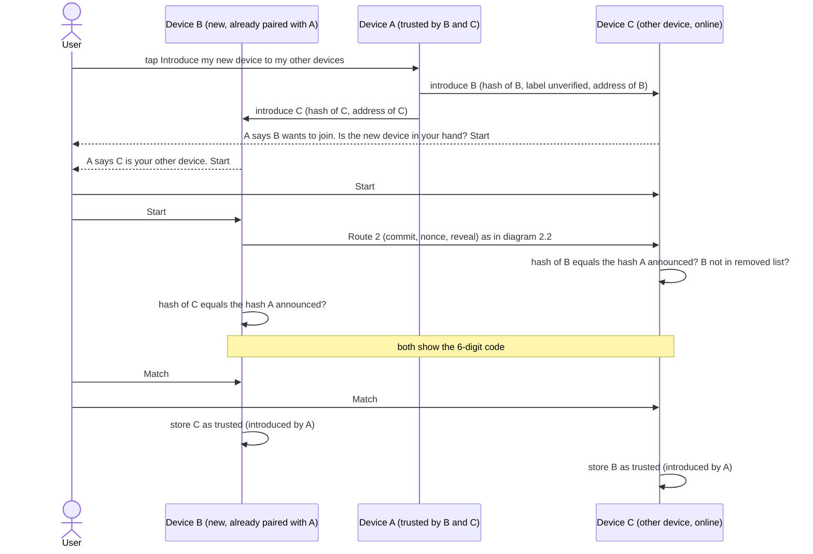

# C1: Device discovery, pairing and trust (v2)

Owner: Mahmoud. Status: second version, written 26 Oct 2026 by a cloud agent from the owner's brief (`PAIRING-TASK-BRIEF.md`). It replaces the first agent draft (`C1-v1-agent-draft.md`, which stays unchanged) and builds on `B1-architecture-v2.md` (approved by the owner on 26 Oct) and Ali's `B6-technology-v0.md`. **Not yet reviewed by the owner or the team.** Phase 1 is design only: no code (pseudocode of message order is fine).

## 0. How to read this file

**Marking.** **[PROPOSAL]** = my own design choice, not a fact from a source. **[NOT CHECKED]** = a fact I could not confirm in a primary source or by a test. Everything else in the text carries a source tag like [S3] (list at the end, section 11). Nothing in this file is tested.

**What I could and could not open (web access on 26 Oct 2026).** The sandbox reached GitHub raw files, pub.dev, Apple Developer and Android Developer pages. It did **not** reach rfc-editor.org, ietf.org, invent.kde.org, docs.syncthing.net, openwall.com or the Bluetooth/Signal sites. So:
- I read the **project's own files on GitHub** (KDE Connect protocol page and source, Syncthing documentation sources, LocalSend protocol, Dart SDK source, a ZRTP implementation, the Linux Bluetooth code, the Signal library, Apple's local-network note). These are primary sources for what those programs do.
- I could **not** read the RFC texts (mDNS RFC 6762, DNS-SD RFC 6763, TLS 1.3 RFC 8446, ZRTP RFC 6189) or the security advisory pages. Statements about them are marked [NOT CHECKED] or come from search-result summaries, and say so.

**Terms.** *Inviter* (Device A) = the device whose user taps "Add a device" and opens the pairing window. *Joiner* (Device B) = the device that joins. *Certificate* = the self-signed certificate a device makes for itself; it is only a container for the device's public key (Syncthing says the same [S4]). *Fingerprint / device id* = SHA-256 of the certificate.

## 1. The design in plain steps

### 1.1 Identity of a device
- At first start the app makes a key pair and a self-signed certificate and **never replaces them**. The **device id** is the SHA-256 hash of the certificate bytes (32 bytes), the same idea as Syncthing [S4] and LocalSend [S5]. If the key or certificate is lost or replaced, the device is a **new device** and must be paired again.
- Key type: ECDSA with the P-256 curve **[PROPOSAL]** (widely supported in TLS and key stores; B6 names none). Certificate validity: from one day before creation to the year 2099 **[PROPOSAL]**, because TLS libraries check the dates even for self-signed certificates and we never want a pinned certificate to expire silently.
- The private key is kept in the operating system's key store (B6 section 5, `flutter_secure_storage`). **Limit [NOT CHECKED]:** Dart's TLS needs the key bytes loaded into memory (`usePrivateKeyBytes` in the Dart SDK [S6]); I found no way to use a hardware-bound key that never leaves the Secure Enclave, StrongBox or TPM. So the key is protected at rest, not against malware in the running app. Two settings matter and are Ali's to check: the key must **not** be copied to a cloud backup or another device (the plugin's README says Android backs data up to Google Drive by default and shows how to disable it; on iOS it offers "this device" accessibility options) [S12], and which store the plugin uses on Windows is not stated (B6).
- The **label** ("Mahmoud's iPad") is typed by the owner and is **never** used to decide trust. Rules copied from KDE Connect's protocol page [S1]: 1 to 32 characters, strip punctuation that could confuse, always show it in quotes; I add: strip control and right-to-left characters **[PROPOSAL]**, and always draw it next to the word "unverified" until the device is trusted.
- What the user sees to tell devices apart: label, icon (phone, tablet, laptop, desktop) and a short form of the id (first 12 hex characters in groups of 4, for orientation only). The full id is in the device details.

### 1.2 Discovery
- Each running app announces two kinds of service over mDNS/DNS-SD with Bonsoir (B6 section 3). Names are placeholders **[PROPOSAL]**:
  - `_xdevice._tcp` on the **normal port**, always while the app is open. TXT records: `v` = protocol version (1) and `id` = the first 8 bytes of the device id as 16 hex characters. Nothing else.
  - `_xdevice-pair._tcp` on the **pairing port**, **only while a pairing window is open**. Same two TXT records.
- Bonsoir can store text attributes (TXT records) in a service; the keys follow RFC 6763 rules, each string is limited to 255 bytes, and a key should be at most nine characters [S11]. Our two keys are short.
- **What a stranger on the same Wi-Fi learns before pairing:** that our app is installed and running, the addresses and ports, the 8-byte id prefix (which stays the same, so the device can be recognised over time), and whether a pairing window is open. mDNS also exposes the host name that the operating system gives the device; on Apple devices that is often built from the owner's name **[NOT CHECKED]**, and whether Bonsoir lets the app choose the host name is not known **[NOT CHECKED]**. By connecting to the normal port a stranger can also read the device's certificate, so he learns the **full** device id (Syncthing documents the same exposure for its sync port [S4]). He learns **no** label, no capabilities, no file names: these travel only inside a connection that has passed the trust check.
- Announcements are not authenticated. The mDNS RFCs say mDNS has no built-in authentication **[NOT CHECKED: RFC 6762 section 21 not opened]**; KDE Connect, Syncthing and LocalSend all treat discovery the same way, and Syncthing lists spoofed local discovery as a known issue [S4]. So the rule is: **an announcement is only a hint where to try; trust comes only from the certificate checked after connecting** (section 1.4).
- iPhone and iPad: both service types must be listed in the app's Info.plist (key `NSBonjourServices`), the app needs a usage text (`NSLocalNetworkUsageDescription`), and the first local-network access shows a system alert; registering, browsing and resolving Bonjour services all count as local network access [S10]. If the user denies it, connections stay "waiting" and the app must say so (section 1.8). The special multicast entitlement is needed for raw multicast or broadcast on iOS, not for Bonjour itself [S10]; this is why B6 chose mDNS.
- Each port has a **default number** (placeholders: normal port 52800, pairing port 52801 **[PROPOSAL]**) and falls back to any free port if it is taken; the real port is always announced in mDNS and in the QR code. A fixed default helps Linux firewalls such as `ufw`, which need a port rule (LocalSend's README gives its firewall rules for its fixed port 53317 [S5]); a random port would be blocked there. Whether Windows and macOS prompt per application is Ali's to check (section 1.8).

### 1.3 Pairing
Pairing is the only moment a human proves "this is really my device". It has two routes. Both end the same way: each device stores the other's certificate in its trusted-device list **only after the user confirmed on that device**.

**The pairing window.** Opened only by the user on the inviter. Lasts **120 seconds [PROPOSAL]** (a QR scan takes seconds and a code comparison about ten; 120 s leaves a margin of several times, and it caps how long an attacker can try: section 4). It closes at once on success, on cancel, after **3 failed human confirmations**, when the app goes to the background on iOS, and when the screen locks. While it is open the pairing listener accepts **one** pairing session at a time and speaks nothing but pairing messages. On every connection the pairing listener allows 10 seconds per step; a session that does not finish a step is dropped.

**Route 1: QR code (preferred; both devices have a camera, or at least the joiner has).**
1. User taps "Add a device" on A. A opens the window and makes a **one-time secret s** of 16 random bytes (128 bits).
2. A shows a QR code containing: format version, A's **full certificate fingerprint** (32 bytes), s (16 bytes), A's IPv4 addresses on its active networks and the pairing port. About 70 bytes, a small QR code **[PROPOSAL; QR capacity not checked]**.
3. User scans it with B ("Join a device"). B connects to the address in the QR (no mDNS needed), starts TLS 1.3 and **stops at once if the certificate A presents does not hash to the fingerprint in the QR** ("this is not the device in the QR code"). B has sent nothing yet. Because the fingerprint arrived through the camera, a person on the Wi-Fi cannot put his own key in the middle.
4. A sends a fresh 32-byte challenge `ns`. B answers with its certificate, its label, a **signature** with its private key over (label "pair-qr-v1", hash of A's certificate, hash of B's certificate, `ns`), and a **tag** = HMAC-SHA-256 keyed with s over the same data. The tag proves B saw the QR without sending s itself.
5. A checks the signature and the tag. A rejects B at once if B's certificate hash is in A's list of removed devices (section 1.7). A burns s only after a **valid** tag, so a stranger cannot waste the QR by guessing.
6. **The human check (new compared with the first draft).** Both screens now show the same 6-digit **confirmation code**, computed as in Route 2 (section 3.2) but from the two certificate hashes and `ns` only; the grinding problem of section 3.1 does not arise here because nobody can sit in the middle of a connection that B pinned from the QR. A's prompt reads: "Add *label (unverified)*? Your new device should show **482 913**." B's screen shows the same number. The user taps **Match** or **Doesn't match** on both. Why this step exists although the QR already authenticates A to B: someone who photographed the QR code (it holds everything except a camera's view of B) could connect first as "Ali's phone" and A would have nobody to compare with. With the code, the real B shows no code or a "busy" message and the user sees that the prompt on A is not from the device in hand.
7. When both users tapped Match, each device stores the other (section 1.4), A closes the window, and both open a normal connection (section 1.5) to prove it works.

**Route 2: code comparison (no camera, e.g. PC with laptop; or when the QR cannot be scanned).**
1. User taps "Add a device" on A. A opens the window and shows "Waiting for a new device", plus its address and pairing port as text for the case where discovery fails.
2. On B the user taps "Join a device". B lists devices that currently advertise `_xdevice-pair._tcp` (label unknown at this point, so it shows the host name and short id), or the user types the address shown on A. The user picks A.
3. B connects and starts TLS 1.3. B now holds A's certificate as presented, **unverified**.
4. B makes a random 16-byte nonce `nB` and sends a **commitment** `C = SHA-256("commit-v1", cert_B, nB)`. B does **not** reveal `cert_B` or `nB` yet.
5. A makes a random 16-byte nonce `nA` and sends it (with A's label).
6. B sends the **reveal**: `cert_B`, `nB`, its label, and a signature (private key of B) over ("pair-code-v1", hash of the A certificate B saw, `C`, `nA`). A checks that `SHA-256("commit-v1", cert_B, nB)` equals `C`, that the signature verifies, and that B is not in the removed list.
7. Both compute the 6-digit **code** = first 4 bytes of `SHA-256("sas-v1", hash(cert_A), hash(cert_B), nA, nB)` read as a number, modulo 1,000,000, written with leading zeros. Each device hashes the A and B certificates **it actually saw on its own connection**; this is what makes a man in the middle show different numbers.
8. Both screens show the number with two equal buttons: **Match** / **Doesn't match**. Match on both: each side stores the other. Doesn't match on either: both abort, nothing is stored, the failed attempt counts toward the limit of 3, and the app shows "The codes did not match. Someone may be interfering with your network. Nothing was added."
9. Window closes, both reconnect on the normal port.

**Why this exact order, and why the first draft's commitment was not enough: section 3.**

### 1.4 Trust and the trusted-device list
- A device is **trusted** if the SHA-256 of the certificate it presents equals the hash of an entry with state *trusted* in the local list, and it passes the key check in section 1.5. Nothing else (name, address, announcement) counts.
- **Entry fields (for the data model):** device id (hash), certificate, label, kind (phone, tablet, laptop, desktop), paired on, introduced by (empty or a device id), last known addresses, last seen, state (*trusted* or *removed*), removed on, removed by. Capabilities are **not** stored at pairing; they are exchanged after each authenticated connection (section 1.5) and kept in the device registry.
- Pairing means only **"may connect"**. All features stay off until the user enables them per device (B1 v2, C8). What a trusted device may do is the security design's job (section 8).
- The list contains public certificates only, so secrecy matters less than integrity: other apps must not be able to edit it. The app's private storage protects it; a keyed checksum is a possible extra **[PROPOSAL, to the security design]**.
- Size: one entry is about 1 KB (a certificate is roughly 400 bytes plus text). With at most 5 devices this is nothing.

### 1.5 Normal reconnection (every later time)
1. A device hears an announcement (or tries its last known addresses at app start), takes the 8-byte id prefix and finds a *trusted* entry that starts with it. No entry: ignore (or, if the pairing window is open, offer it in the join list).
2. It connects to the normal port with TLS 1.3 and checks that the certificate hashes to the **stored full id**. Mismatch: close the connection and put a quiet notice in the device list ("A device announced the id of *label* with a different key. Not connected."); no pop-up, because anyone can announce any id prefix and a pop-up would be a harassment tool **[PROPOSAL]**. The user can remove the old entry and pair again if it is really a reinstall (section 1.9).
3. The server (the side that was connected to) sends a fresh challenge `ns`. The client answers with its certificate and a signature over ("auth-v1", hash of the server certificate, hash of the client certificate, `ns`). The server checks that the certificate is in its list as *trusted*, not removed, and that the signature verifies; otherwise it closes without a reason except a generic "not trusted" code.
4. Only then: both exchange removed-device lists (section 1.7), capabilities and the protocol version (reject a lower version than the one stored for this device: KDE Connect has the same downgrade check in its code [S2]), and the device is marked online.
5. If both sides connect at the same time, keep the connection started by the device with the **lower** id and close the other **[PROPOSAL]**.
6. Online/offline (feeds C3): a heartbeat every 10 s, offline after 3 missed beats **[PROPOSAL]**. Worst case to notice a dead peer: 3 × 10 s = 30 s plus up to 10 s until the next beat = 40 s. Phones and tablets with the app closed are simply offline (B6 section 6).
7. When a trusted device's address changes: mDNS finds it again; in parallel the app tries the stored last addresses; and the user can type an address (section 1.8). The address is only a hint, never trust.

**Server-side check in Dart: the answer for Ali.** B6 left open whether Dart's TLS server can verify a self-signed client certificate. From the Dart SDK source [S6]:
- `SecureServerSocket.bind` / `SecureSocket.secureServer` take `requestClientCertificate` and `requireClientCertificate`, but **no `onBadCertificate` callback**. The callback exists only for the client side (`SecureSocket.connect`/`secure`).
- In the native code, a certificate that fails normal verification is accepted only if a bad-certificate callback is registered and returns true; with none registered it is refused. So a server can accept a self-signed client certificate **only if that certificate is in the server's `SecurityContext` trust store** (`setTrustedCertificatesBytes`). The context has no function to remove a certificate, and its documentation describes the trust store as used by "client connections" [S6], so I could not confirm from the source that the server uses it for client certificates **[NOT CHECKED, needs a test]**.
- Dart has no function to read TLS exported key material (searched `secure_socket.dart` and `security_context.dart`: nothing), so we cannot bind an in-channel proof to the TLS session by that standard method; I bind it to the **server certificate hash** instead.
- The client side is easy: `onBadCertificate` receives the certificate (`der` bytes), and the app can return true only if its SHA-256 equals the pinned one. `SecurityContext.minimumTlsProtocolVersion` can be set to TLS 1.3 [S6].

**Recommendation [PROPOSAL]: use the "signed challenge inside the channel" fallback from B6, on every platform, as the one and only way a device proves it is the paired device.** The TLS layer then pins the **server** certificate (client side callback) and the server never asks for a client certificate. Reasons: (1) it works with the Dart facilities that exist, on all five systems, with one code path; (2) a trust-store design needs a new `SecurityContext` and a rebound listener every time a device is paired or removed, and existing connections of a removed device must be closed by hand; (3) pairing needs the same signed proof anyway (steps above), so reconnection reuses code that has to exist; (4) a native TLS layer would mean five implementations for five students. Costs and cautions: it is our own small protocol, so it needs a reviewer and test vectors; ECDSA P-256 signing and verification and certificate generation need a Dart crypto package (`package:cryptography`, `pointycastle`, `basic_utils`... **[NOT CHECKED which one, and whether it runs on all five]**); and an unknown device can finish TLS with the normal port, so the first message is limited to 2 KB, the whole authentication must finish in 5 s, and the app accepts at most 16 unauthenticated connections at a time **[PROPOSAL]** (KDE Connect caps its unpaired connections at 42 in code [S2]). If Ali's tests (section 9) show the trust-store route works cleanly, it can be added as a second layer; the messages above do not change.

Note: this changes the words in B6 and B1 ("TLS 1.3 in both directions") to "TLS 1.3 with the server certificate pinned in both directions, and the client proving its key inside the channel". It is the fallback B6 itself names.

### 1.6 Adding the third and fourth device
- **Rule:** every device pairs with every other device. Number of pairings for n devices = n(n−1)/2: 3 devices need 3, 4 need 6, 5 need 10. The nth device needs n−1 pairings (the 4th needs 3).
- **Optional convenience: "Introduce my new device to my other devices."** After B has paired with A, B or A offers the step. Mechanism **[PROPOSAL]**:
  1. A (trusted by both) sends to each other online trusted device C a message "introduce B": B's certificate **hash**, B's label (unverified) and B's pairing address; and tells B C's certificate hash and address.
  2. C shows a prompt "*A* says *B (unverified)* wants to join. Is the new device in your hand?" with a **Start** button, and B shows the same for C. The user taps Start on each device.
  3. B and C then run **Route 2 (code comparison) directly with each other**, with one difference: each side also knows the other's expected fingerprint from A and aborts if it differs. The user compares the 6-digit code and taps Match on both.
  4. Only then do B and C store each other. A learns nothing it does not already know.
- So the introducer **carries information, it does not grant trust**. A device is never trusted silently through a third device. This avoids the weakness Syncthing documents for its introducer (trust becomes transitive; removed devices come back while the introducer stays marked; an introducer's introducer becomes your introducer) [S4], and it limits what a stolen unlocked A can do: it can start an introduction, but each other device shows a prompt and needs its user's presence and the code check.
- An introduction expires after 10 minutes **[PROPOSAL]**; devices that are off or have the app closed are skipped and must be paired normally later.

### 1.7 Removing a lost or sold device
1. The user picks "Remove this device" on **any** trusted device R and confirms (the dialog says: it cannot connect again until it has been reset and paired again).
2. R closes any live connection to X, deletes X's certificate and writes a **tombstone**: (X's id, removed on, removed by R). The tombstone is permanent **[PROPOSAL]**.
3. R sends "revoke X" to every online trusted device over the authenticated channel. Each receiver writes the tombstone, closes X's connection and shows a notice ("*R* removed *X*"). **Removals spread by themselves; additions never do** (additions always need a human on each device).
4. **Offline devices:** whenever two trusted devices authenticate (section 1.5), they exchange the list of tombstone ids and copy missing ones. A device that was off learns at its next contact with **any** trusted device. No central server is needed.
5. A removed device X that connects anywhere afterwards is refused, and X's own screen can show "This device was removed by another device".
6. **What stays open (cannot be fixed without a server or an always-on device):** until a device has heard about the removal, it still trusts X. If X reaches a device D that has been off the whole time before D has met any other trusted device, D will accept X. Mitigations **[PROPOSAL]**: at app start a device waits up to 5 s to reach other trusted devices and sync tombstones before it accepts connections, if any are known to be online; each device shows "last synced with your other devices: N days ago"; the lost-device advice in the app says "remove the device on all devices you still have switched on". The user should remove X also **on the device that was off**, when it is back.
7. **Re-adding a removed device** (user removed it by mistake and still owns it): the tombstone is bound to the certificate. X must first "Reset this device's identity" in its settings (a new key pair, so a new id), then be paired normally. A tombstoned certificate is refused at pairing time with "This device was removed. Reset it first." This avoids the clock problems of "who removed or paired later" **[PROPOSAL; the owner may prefer another rule]**.
8. **A malicious trusted device** can also send "revoke Y" for good devices (it is trusted, like all of them). The receivers show the notice, the user re-pairs; ignore a revoke sent by a device that is itself tombstoned. This is a denial of service, not a leak.
9. **What removal does not do:** it cannot erase what X already holds (its copies of the other devices' file lists, files it received, its own data). That belongs to the security design (section 8). Also tell **C2 (AI role)**: if the removed device holds the AI role, the role must be re-assigned.

### 1.8 When discovery fails
| Cause | What happens | What the user sees / does |
|---|---|---|
| Router blocks device-to-device traffic ("client isolation", "AP isolation", common on guest Wi-Fi) | No direct connection of any kind is possible. KDE Connect, LocalSend and Syncthing have the same limit; LocalSend says AP isolation must be off, "especially guest networks" [S5]; B6 notes the same. | App message: "This Wi-Fi does not let devices see each other." Try the main (not guest) network, or let one device share a hotspot and connect the others to it. Whether hotspots allow client-to-client traffic differs by phone and carrier **[NOT CHECKED]**. |
| mDNS blocked or filtered, but normal connections allowed (some routers, separate subnets) | Route 1 still works because the QR contains the address. Route 2 works with "type the address". Known devices are reached by their last known addresses or an address typed once in the device details. | "Enter address" in both pairing and device settings. |
| Desktop firewall blocks the app's port | Connections fail although mDNS shows the device. | On first start the operating system asks to allow the app (Windows, macOS). On Linux the user may have to open the port (LocalSend's README explains the firewall step for its own port [S5]). Ali's setup notes should list the exact rules **[NOT CHECKED]**. |
| iPhone or iPad: Local Network permission denied | Bonjour operations and TCP connections to local addresses wait; a connection that was open closes when the user turns the permission off [S10]. | App detects the "waiting" state and shows "Allow Local Network access in Settings". |
| Linux without the Avahi service; Windows older than 10 v1903 | Bonsoir cannot announce or browse (B6 section 1). | Manual address and QR routes still work; message explains. |
| Different network after moving the laptop | Everything stops until the same network is back. | Each device keeps working alone (B1 rule 3). |

### 1.9 Reinstall, new phone, copied key
- **Reinstall:** a new key and a new id. The others see an unknown new device. At pairing the app warns if the label equals an existing trusted label: "A device with this name is already trusted. If this is the same device after a reinstall, remove the old entry after pairing." The old entry stays *trusted* until removed, and a stolen backup of the old key would still work; the app should ask for removal right after pairing.
- **New phone:** a new device. Pair it, remove the old one.
- **Restored from a backup / cloned image:** two devices with the same key. If a device receives two live authenticated sessions with the same id from different addresses it shows "Two devices are using the identity of *label*" **[PROPOSAL]**.

## 2. Sequence diagrams

Names: User, Device A (inviter), Device B (joiner). "App check" lines are done by core services; "TLS" is the communication layer.

### 2.1 First pairing by QR code (Route 1)

### 2.2 First pairing by code comparison (Route 2)

### 2.3 Reconnection of a known device

### 2.4 Removal of a lost device

### 2.5 Introducing a new device to the others (optional step)

## 3. The code-comparison design: why it is built this way

### 3.1 The first draft's commitment is not sufficient
The first draft said: B first sends a hash of its certificate, reveals it only after A showed its key, and the 6-digit code is computed from both certificates. I checked it by attack:
- Let M be a man in the middle who talks to B pretending to be A (certificate M_A) and to A pretending to be B (certificate M_B).
- The code each user sees is a function of two certificates only: B sees f(M_A, cert_B), A sees f(cert_A, M_B). M wants them to be equal.
- B reveals cert_B only **after** it has seen M_A. So M fixes M_A, gets cert_B, and now knows the number B will show: T = f(M_A, cert_B).
- M's remaining job: produce a certificate M_B with f(cert_A, M_B) = T. Nothing forces M to commit to M_B early: A has no way to demand it, because A already knows nothing of B. M can generate keys until the number matches. A 6-digit code is 10^6 = 2^19.93 values, so about 10^6 key pairs (average) are needed. At an assumed 10,000 key generations per second on one laptop core (a rough guess **[NOT CHECKED]**) that is about 1,000,000 ÷ 10,000 = 100 s on one core, about 25 s on four cores: inside a 120 s window, and A just waits for B's next message. (A 10-second step timer, as in our design, would only force the attacker to use about 10 cores or a faster key type; it is not a security boundary.)
- So with only certificate hashes and a commitment by one side, the code gives **no real protection** against an attacker who can reach both devices. The reason: the committer fixed its value, but the other side's value was known to the attacker before it had to pick its own.
- The same argument applies to a version where the code uses only long-term certificates, even with commitment, if the attacker has seen the certificates in an earlier session (certificates are long-lived and public to anyone who connects).

### 3.2 The fix: commit, fresh nonce, reveal (Route 2)
Compare how ZRTP, Bluetooth and Signal do it:
- **ZRTP (voice calls).** The initiator's Commit message carries a hash (`hvi`) computed over its own key share and the responder's Hello; the responder sends its key share first; the initiator reveals only afterwards; the responder recomputes the hash and aborts on mismatch. The comment in the code says "if it doesn't match then a MitM attack may have occurred" [S7]. The code shown to the users is the leftmost 20 bits of a hash, written as 4 base-32 characters [S7]. The point is that the attacker must fix its own contribution **before** it learns the honest party's, so it gets exactly one guess. The RFC text itself I could not open [NOT CHECKED]; a search summary of Wikipedia's ZRTP article describes the same idea with a 16-bit example (chance 1 in 65,536).
- **Bluetooth numeric comparison.** The Linux implementation computes a 6-digit number from both public keys and both random nonces as AES-CMAC output modulo 1,000,000 [S8] and has a separate "confirm" function (`f4`) over the keys and a nonce [S8]; that this is the commitment step is my reading of the code, the specification text I did not open [NOT CHECKED]. Chance for an attacker per pairing: 1 in 1,000,000 (this is arithmetic on the code above; the specification text I did not open [NOT CHECKED]).
- **Signal safety numbers** take another road: no session-specific code; each side's long-term identity key is turned into 30 digits (six groups of 5 digits, each from 5 bytes of a SHA-512 chain modulo 100,000), 60 digits for the pair [S9]. Each 5-digit group carries log2(100,000) = 16.6 bits, so 30 digits ≈ 99.7 bits per side. That is long enough that no commitment is needed, but it is too long to compare for the first-time pairing of a family's devices, and the numbers are the same in every session.

**Our scheme (Route 2) follows ZRTP's shape and adds a nonce from each side:**
1. B → A: commitment `C = H(cert_B, nB)`.
2. A → B: `nA`.
3. B → A: reveal `cert_B`, `nB` and a signature that binds `C`, `nA` and the hash of the A certificate B saw.
4. Code = first 4 bytes of `SHA-256(hash(cert_A), hash(cert_B), nA, nB)` modulo 1,000,000, each side using the certificates it actually saw.

Check against a man in the middle M (cases: M talks first to B or first to A):
- Toward A, M plays B and must send a commitment `C'` **before** A reveals `nA`. So M's certificate M_B and nonce `n'B` are fixed before it knows `nA`.
- Toward B, M plays A and must send `n'A` (and show M_A in the TLS handshake) **before** B reveals `cert_B` and `nB`. B's contribution is hidden behind `C`.
- Each code therefore contains one fresh random value from an honest side that M did not know when it fixed its own inputs. M cannot choose inputs to make the two codes equal; its best move is to hope. Chance per attempt = 1 in 1,000,000 = 10^−6 (2^−19.93). I checked both orders of M's moves (contacting B first or A first); in both, one side's inputs are fixed before the other honest value appears.
- If A sent no nonce (like the draft), M would learn T first (from B's reveal) and then grind the nonce or key it still controls: with a nonce this costs 10^6 hashes, about a tenth of a second at 10^7 hashes per second **[NOT CHECKED rate]**. This is why `nA` is essential.
- With 3 allowed failures per window the chance of a successful attack is at most 3 × 10^−6 = 0.0003 %, and every failure is visible to the user (the numbers differ and the app says so).
- **How many bits the code gives:** log2(1,000,000) = 19.93 bits. Modulo bias: 2^32 = 4,294,967,296 = 4,294 × 1,000,000 + 967,296, so 967,296 numbers appear 4,295 times and the others 4,294 times: a difference of 1 in 4,295 (0.02 %), negligible.
- **What an attacker needs:** to be on the same network and in the middle of the **new** pairing (while the user has a window open and is comparing), plus a 10^−6 coincidence. He cannot do it later or silently.
- **Why not a longer code?** 8 digits would make it 10^−8 at a small cost in effort **[PROPOSAL option, for the owner]**. I kept 6 because it is the Bluetooth-sized number users already know [S8], and the attack is visible and capped at 3 tries.
- **KDE Connect for comparison:** the 8-hex-digit key (32 bits) is SHA-256 over both public keys and the timestamp [S1][S2], with no commitment step. By the argument in 3.1 a commitment-free code can in theory be ground (about 2^16 candidate keys per side if the attacker may pick both certificates and the birthday effect is used) **[my own reasoning, not tested, not from a source]**. The security researcher's own comment was that 8 hex digits is weak [S3, search summary].
- **Limits.** (a) The human must really compare: the buttons are equal and the screen says what a mismatch means; usability tests with real people are not part of Phase 1 **[NOT CHECKED]**. (b) A "relay" attack in which the attacker only forwards traffic between two genuine devices cannot be seen by comparing numbers, but gives him nothing, because we always compare the certificates actually used. (c) The commitment hides `cert_B` only until the reveal; B's certificate is visible to anyone who later connects as a client, which is fine because the nonces are fresh.
- **Alternative I did not choose:** a PAKE (password-authenticated key exchange, such as SPAKE2 or CPace) with a short code typed on one device. It gives the same one-guess-per-session guarantee but needs a library; I found none checked for Dart **[NOT CHECKED]**. Possible later.

### 3.3 What changed from the first draft's route 1 (QR)
The draft's QR route showed the prompt "Add this device? (name unverified)" and one Yes on A, and B proved knowledge of the secret by sending it. Problems: (1) an attacker who photographed the QR code could connect first and receive that Yes; the user had nothing to compare. (2) sending s in the clear is unnecessary. Fixed by the code on both screens (section 1.3, Route 1, step 6) and an HMAC tag.

## 4. Threat model

| # | Attacker | What he can do | How the design stops it | What is left |
|---|---|---|---|---|
| 1 | **Fake mDNS announcement** (spoofs a known id prefix, or invents devices) | Make our app try to connect to him; appear in the "join" list under any host name; announce a name already in use, so mDNS renames one of the two services and the real one may fail to appear | Announcements are hints only. Reconnection pins the full certificate hash; his key does not match, so the connection is closed and nothing but a quiet notice appears. In the join list he is shown unverified and still needs the QR fingerprint check or the code comparison | Annoyance and denial of discovery (the real device may be hidden by a name clash). Mitigation: the app also tries last-known addresses and manual addresses. Cannot be fully prevented with unauthenticated mDNS |
| 2 | **Passive listener on the Wi-Fi** | Sees the announcements (id prefix, ports) and the TLS handshakes; sees which devices talk | TLS 1.3 encrypts all content. From TLS 1.3 on, the certificates in the handshake are encrypted too **[NOT CHECKED: RFC 8446 not opened]** | Knows that our app runs and the id prefix of each device (can follow a device over time). A stranger who connects can read the server certificate and so the full id (Syncthing has the same exposure [S4]) |
| 3 | **Attacker on the same Wi-Fi who opens or holds pairing sessions** | Connect to a pairing port while a window is open to block the real joiner; connect to the normal port many times; port scan | Pairing listener exists only during the user's 120 s window, one session at a time, 10 s per step. Wrong secrets or signatures do not burn the QR secret and are not counted against the 3-tries limit (otherwise three bad connections would close the window). Added limit: at most 1 pairing connection attempt per source address per 2 s **[PROPOSAL]**. Normal port: unauthenticated connections limited to 16, 5 s to authenticate, first message ≤ 2 KB. Nobody can pair without the user's Match tap on his device | He can **block** a pairing by holding the single session slot until it times out (up to 10 s each time); the user sees "another device is connecting" with his unverified label and can retry. A window that never opens cannot be attacked |
| 4 | **Someone photographs or sees the QR code** | Gets A's fingerprint, the secret s, address, port | s works once, only inside the 120 s window and only while A is waiting; A requires a signature and an HMAC tag **and** both users tap Match on matching codes. If he connects first, A's prompt shows a code that the user's own B does not show, and B shows "busy". Showing the QR only after the user taps "Add a device" keeps the exposure short | If the user taps Match without looking at B, the attacker is added. Arithmetic for guessing instead of photographing: s has 128 bits; at most about 120 s ÷ 0.01 s = 12,000 attempts fit in a window at 10 ms per round trip, so chance ≈ 12,000 ÷ 2^128 ≈ 3.5 × 10^−35 |
| 5 | **Man in the middle during the code comparison** and **grinding of the short code** | Relay and alter the pairing messages; generate many keys or nonces to make the two codes equal | Commit, fresh nonces from both sides, reveal; codes computed from the certificates each side actually saw (section 3.2). The first draft's version would have allowed grinding in about 100 s on one core by the arithmetic in 3.1 | 19.93 bits: 1 chance in 1,000,000 per attempt, at most 3 attempts per window: ≤ 3 × 10^−6. He needs a position in the middle during a pairing and a lucky coincidence; every failure shows the user a mismatch. Needs a human who really compares |
| 6 | **Name spoofing** ("Mahmoud's iPad") | Choose any label | Labels never decide trust; always shown in quotes next to "unverified"; control and bidi characters are stripped; the user compares the code with the device in hand, not the name. The KDE Connect incident was about exactly this (section 5) | A user who confirms without checking |
| 7 | **Stolen, unlocked trusted device** (or one a thief can unlock) | Is trusted by all; can connect, see enabled features, remove devices, start an introduction | Pairing grants "may connect" only; features are off until enabled, per device (B1 v2); removal on any other device cuts it off; the introduce step needs a human and a code on each target. App lock / auto-lock is the security design's | Until the user removes it, everything enabled for that device is open. Removal cannot erase what the thief already copied (section 8) |
| 8 | **Stolen private key** (malware, a backup that included the key, a rooted device) | Impersonates the device on any network, undetected, because the key is the identity | Key only in the key store, not in cloud backups (Ali to confirm, [S12]); a second live session with the same id raises a notice (section 1.9); removal works as for a stolen device | Silent use until noticed. Dart needs the key in memory, so malware inside the app process can read it **[NOT CHECKED]**. Replacing the identity (reset and re-pair) is the only cure |
| 9 | **Removed device that is offline at removal time** | Reconnects later to a device that has not yet heard | Tombstones spread at the next contact between any two trusted devices; removed ids are refused after that; a device waits ≤ 5 s for other trusted devices before accepting connections after start | Real gap (section 1.7 item 6): until a device hears, it still trusts the removed one. Not solvable without a central server; reduced by the waiting rule and the "last synced" display |
| 10 | **A device that reinstalls the app** | New key, new id: others see a new device; the old entry still exists; a copy of the old key would still be trusted | A reinstalled device must pair again (nobody is trusted by label); duplicate-label warning; the app asks to remove the old entry after pairing | A user who forgets to remove the old entry leaves a trusted dead identity |
| 11 | **A trusted device that abuses its trust** (hacked or malicious) | Sends false "revoke Y" messages; starts introductions; sends bad data | Revokes show a notice and can be undone by re-pairing; revokes from a tombstoned device are ignored; introductions need a human on every device; features are per-device switches | Denial of service by revoking; everything the user enabled for that device |
| 12 | **Replay of old pairing or auth messages** | Re-send recorded messages | Every authenticated exchange includes a fresh challenge or nonce chosen by the other side and the hash of the server certificate; s is single-use; the window is closed outside the user's action | None found; to be reviewed with the signed message format in Phase 2 |
| 13 | **Downgrade** | Force old TLS or an old app protocol | Set the minimum TLS version to 1.3 (supported by Dart's `SecurityContext` [S6], to be tested on all five systems); refuse a lower protocol version than the stored one (KDE Connect has such a check [S2]) | Old versions of our own app, when we release several |
| 14 | **Impersonating the AI device or another role** | Announce capabilities to get requests | Capabilities travel only after authentication (section 1.5); AI role is chosen by the user (C2) | None specific to C1 |

## 5. Comparison with KDE Connect, Syncthing and LocalSend

What I verified was read from the projects' own files on 26 Oct 2026 (tags in brackets). The owner's outline said some of these points were unverified; the table says what changed.

| Question | KDE Connect | Syncthing | LocalSend | Our design |
|---|---|---|---|---|
| Identity | Random device id of 32 to 38 letters/digits (also the certificate's common name) [S1]; certificate stored per paired device [S2] | Device id = SHA-256 of the certificate, written in base-32 with check digits; key is Ed25519 since v2.0.0 (384-bit ECDSA before, RSA before that) [S4] | Fingerprint = SHA-256 of the certificate in HTTPS mode, random text otherwise; "used to avoid self-discovery and to remember devices" [S5] | Id = SHA-256 of the certificate (as Syncthing) |
| Discovery | UDP broadcast on port 1716 and mDNS service `_kdeconnect._udp` with TXT `id` and `protocol` (protocol version 8) [S1] | UDP broadcast (IPv4) or multicast (IPv6) on port 21027, recommended every 30 to 60 s; announcement = id, addresses, random instance id; not protected by crypto [S4] | UDP multicast 224.0.0.167 port 53317, reply by HTTP `/register`; scan of local addresses as fallback [S5] | mDNS only (the iPhone rule, B6), TXT = version and id prefix |
| TLS and trust | TLS; unpaired devices accepted with any certificate ("like SSH's trust on first use") and may only send pairing packets; paired devices must match the stored certificate [S1]. In the code a trusted device's stored certificate is set as the only trusted authority and the peer is verified against it; I did not trace every error case (the code ignores TLS errors of type "self-signed certificate") **[NOT CHECKED]**. The code also caps unpaired connections at 42, limits the size of the identity packet, gives the identity packet 1 second to arrive and rate-limits repeated connections from one device [S2] | Both sides show certificates; the id is recomputed and the connection dropped if it is not in the configuration [S4] | HTTPS with a certificate made on each device; whether the app checks the fingerprint on later connections: **[NOT CHECKED]** | Pinned server certificate plus signed challenge from the client (section 1.5) |
| Human check at pairing | One side asks, the other user accepts; protocol version 8 prompt may show an 8-hex-digit key = first 8 characters of SHA-256 over both public keys and the timestamp [S1][S2]. Behaviour when a paired device's certificate changes: **[NOT CHECKED]** | Typing or scanning the long id on both sides; project says long ids are painful and proposes short ids with a PIN, "like Bluetooth" [S4]. How the app prompts for an unknown device: **[NOT CHECKED]** | None: no pairing. Receiver accepts or rejects each transfer, optional PIN in the request [S5] | QR with fingerprint, or 6-digit comparison with commitment; both users confirm |
| Adding a third device | Pair every pair | "Introducer": a device marked as introducer adds the devices it knows; automatic; transitive; manually removed devices are re-added while the introducer stays marked [S4] | Not applicable | Pair every pair; introduction only carries info and still needs a human and a code on each device |
| Removing | Unpair packet from either side [S1] | Remove the device from the configuration; "if a device of yours is lost, make sure to revoke its access from your other devices" [S4] | Not applicable | Tombstones spread automatically, permanent |
| Discovery failing | Add by IP in the user guide (not opened this time: **[NOT CHECKED]** in `userbase.kde.org`) | Static addresses in the configuration [S4] | Firewall ports; AP isolation must be off; address entry [S5] | QR carries address; manual address field |

**The KDE Connect incident, corrected.** The owner's outline and the brief name CVE-2020-26164 as "pairing without a human check". I could not confirm that. A search summary of the oss-security thread (30 Nov 2020, by Matthias Gerstner of SUSE) says: the pairing dialog identified peers only by their `deviceName`, which an attacker controls fully and which goes out in clear UDP broadcasts; upstream's fix showed a SHA-256 fingerprint of the two public keys; the researcher found the 8-hex-digit prefix weak and the full key hidden behind a button [S3]. Another summary of the CVE record says CVE-2020-26164 itself is a denial-of-service issue ("large amounts of CPU, memory, or network connection slots"), and that the pairing patch was tracked separately by SUSE (bug reference boo#1177672) [S3]. The KDE protocol page says the receiving user is **prompted** to accept or reject [S1], so pairing was not silent. **Result:** keep the lesson (the name is attacker-controlled; the human must compare something the attacker cannot choose) but do **not** write "pairing without a human check, CVE-2020-26164" in the report. Not verified in the full advisory: **[NOT CHECKED]** whether an attacker could start a pairing request from the network without prior contact (the summary says a remote device can trigger a pairing request by sending a `kdeconnect.pair` packet).

**What we take:** certificate hash as identity (Syncthing, LocalSend); pinning of the stored certificate (KDE Connect, Syncthing); a hash of both keys shown for human comparison (KDE Connect) but **with commitment and nonces**; name sanitising rules and "always show the name in quotes" (KDE Connect [S1]); a cap on unpaired connections (KDE Connect [S2]); a separate, short-lived pairing listener (our B1 rule 2).
**What we avoid:** accepting any certificate from unknown peers on the same port that serves trusted peers (KDE Connect's trust-on-first-use is for its pairing packets only, but the same port serves both); a 32-bit code without commitment (KDE Connect); transitive automatic trust (Syncthing's introducer); typing a 52-character id (Syncthing); no persistent trust (LocalSend: right for sending one file, not for features that run without the user).

## 6. Requirements (for the requirements chapter)

Functional (FR-C1-n), each testable:
1. FR-C1-1 The app must create a key pair and a self-signed certificate on first start and must not replace them afterwards; its device id must be the SHA-256 of that certificate. *Test:* start twice, the id is equal; reinstall, the id differs.
2. FR-C1-2 The app must keep the private key in the operating system's key store and must not include it in cloud backups. *Test:* inspect the stored data and the backup of a test device.
3. FR-C1-3 The app must announce only the protocol version and an 8-byte id prefix on the normal service, and must not put a label, a file name or a capability in any announcement. *Test:* capture the mDNS packets.
4. FR-C1-4 The pairing service and pairing port must exist only while the user has an open pairing window. *Test:* port scan before, during and after.
5. FR-C1-5 The pairing window must close after 120 seconds, on success, on cancel, and after 3 failed human confirmations. *Test:* time it; trigger each case.
6. FR-C1-6 The app must offer pairing by QR code (fingerprint, one-time secret, address) and, for devices without a camera, by comparing a 6-digit code. *Test:* pair a PC with a laptop without a camera.
7. FR-C1-7 In the QR route the joiner must abort, sending nothing, if the certificate it sees does not match the fingerprint in the QR. *Test:* show a QR from a different device on the network.
8. FR-C1-8 The one-time secret must work once and only inside the window. *Test:* scan the same QR twice; scan after 121 s.
9. FR-C1-9 In both routes each device must store the other only after its own user has tapped Match on a screen that shows the 6-digit code; Doesn't match on either device must store nothing on either. *Test:* both outcomes.
10. FR-C1-10 In the code-comparison route the joiner must send the commitment before the inviter sends its nonce, and the code must depend on both nonces and both certificates seen by each side. *Test:* run a test relay between two devices; the two codes differ in all of N = 1,000 runs (expected 1 in 10^6 same).
11. FR-C1-11 The app must show every label next to "unverified" until the device is trusted and must strip control and right-to-left characters from it. *Test:* a label with such characters.
12. FR-C1-12 The app must refuse every connection, except to the pairing port during an open window, from a certificate that is not in the trusted list, and must not give any feature data to it. *Test:* connect with a new self-signed certificate.
13. FR-C1-13 The app must refuse a known id announced with a different certificate and show a notice (not a pop-up). *Test:* announce a trusted id from another device.
14. FR-C1-14 On every connection each side must check the other's certificate hash against its trusted list and verify a fresh signed challenge before exchanging capabilities. *Test:* replay a recorded authentication; it must fail.
15. FR-C1-15 The app must support entering an address by hand for pairing and for known devices. *Test:* disable mDNS on the router.
16. FR-C1-16 The app must pair each new device with every other device and may offer "Introduce my new device", which must show a prompt and a 6-digit code on every target device and store nothing before both users tap Match. *Test:* introduction with one target device left untouched: it stays unpaired.
17. FR-C1-17 The user must be able to remove a device from any trusted device; the removal must reach every device that is online within 5 seconds and every other device at its next contact with any trusted device. *Test:* three devices, one offline.
18. FR-C1-18 A removed id must be refused at connection and at pairing. *Test:* try both.
19. FR-C1-19 The app must tell the user, at removal, that the removed device keeps what it already has, and show for each trusted device "last synced with the others" and the date. *Test:* read the dialog.
20. FR-C1-20 The app must show a clear message when the Wi-Fi blocks device-to-device traffic or, on iPhone and iPad, when the Local Network permission is off. *Test:* turn each off.
21. FR-C1-21 The app must mark a device offline after 3 missed 10-second heartbeats (at most about 40 s). *Test:* unplug a device and time it.
22. FR-C1-22 The app must refuse a TLS version below 1.3 and an app protocol version lower than the stored one. *Test:* connect with a TLS 1.2 client.

Non-functional (NFR-C1-n):
1. NFR-C1-1 Pairing and removal must need no internet and no account. *Test:* airplane mode with Wi-Fi only.
2. NFR-C1-2 A first pairing of two devices on one network must take at most 5 taps (Add, Join or scan, pick the device if needed, Match on both) and under 60 seconds in a lab test with 5 volunteers **[PROPOSAL numbers; the owner's draft used the same]**.
3. NFR-C1-3 A reconnection to a trusted device must need no user action and complete in under 3 seconds on the same Wi-Fi **[PROPOSAL]**.
4. NFR-C1-4 The chance that a man in the middle makes both screens show the same code must not exceed 10^−6 per attempt (6 digits), and the attacker must not be able to improve it by repeating key or nonce generation. *Argument:* section 3.2.
5. NFR-C1-5 An unauthenticated peer must be able to hold at most 16 connections, each for at most 5 seconds before authentication, and the first message must be limited to 2 KB. *Test:* flood test.
6. NFR-C1-6 The trusted list must not be readable or writable by other apps on any of the five systems. *Test:* look from another app (Ali).
7. NFR-C1-7 Pairing and reconnection must work on all five systems with at least these pairs of systems: iPhone with Windows, Android with macOS, iPad with Linux, laptop (no camera) with PC. *Test:* a matrix in Phase 2.

For the data model (B5): Device (id, certificate, label, kind, paired on, introduced by, last addresses, last seen, state, removed on, removed by), Tombstone (id, removed on, removed by), Own identity (certificate; private key in the key store), PairingLog (optional: time, route, result).

## 7. Fit with the architecture and technology
- B1 rule 2 (only trusted devices; an unpaired device can only start pairing) is kept by the separate, short-lived pairing listener. B1 decision 6 (pairing method) is answered here. B6 section 3 ("pinned at pairing (C1)") is defined here, with one change: the client proves its key inside the channel (section 1.5).
- B6 chose mDNS because iPhone and iPad allow it with a declared service type and the Local Network permission [S10]. Our two service types must both be declared in the iOS Info.plist.
- iPhone and iPad answer only while the app is open (B1 v2). So pairing, introduction and tombstone sync reach them only then. They can still be joiners or inviters while the app is in front.
- Flutter/Dart caveat for Route 1: reading a QR code needs the camera (permission on every platform) and a scanner package **[NOT CHECKED which, and whether it works on desktop]**; the QR can also be shown **by the joiner** and scanned by the inviter if the inviter has the camera. Add a "Join" screen that offers both directions **[PROPOSAL]**.

## 8. Boundary with the security design (C11, Ali)

**C1 decides:** what a device's identity is; announcement content; how a new device is admitted (both routes); what the trusted list contains and that only the human changes it by adding; how a device authenticates on every connection; removal and how it spreads; the rule that an unknown device can only reach the pairing port; label rules.

**C1 leaves to the security design:** (1) **per-feature permissions**: C1 only says "this device may connect"; the table feature × device (all off by default) is C11's. C1's hook: before any feature data goes to a device, core services answer "trusted? and is this feature switched on for this device?". (2) **Encryption of stored data** (vault, file lists on disk, integrity of the trusted list). (3) **Lost-device policy beyond removal**: what the removed device keeps, whether the vault key must change, whether the app can ask a lost device to wipe itself (it cannot reach an offline thief's device), auto-lock of the app, how the user is told. (4) The cipher suite and the details of TLS 1.3 (fixed by B6). (5) The key store details per system (Windows backend unknown [B6], backups, hardware keys). (6) Rate limits and policy for repeated failures, if stricter than here.

**To agree with Ali before 29 Oct:** this list; the in-channel proof design (section 1.5); the permanent tombstone rule; the trusted-list integrity check; whether pairing should show which features the new device could use (all off, so probably nothing to show).

## 9. Open questions and unchecked facts

**Ali (B6, C11):**
1. Test (E1) a Dart `SecureServerSocket` with `requestClientCertificate: true` and (a) an unknown self-signed client certificate, (b) the same certificate added with `setTrustedCertificatesBytes`, (c) a certificate added while the server is running. My reading of the Dart source says (a) fails and (b) may work; **[NOT CHECKED]** by test. This decides whether the trust-store route is possible at all. My recommendation stands either way: the in-channel proof (section 1.5).
2. Test (E2) client-side pinning with `onBadCertificate` on all five systems (the iOS note in the SDK documentation says trusted-certificate handling differs on iOS [S6]).
3. Test (E3) minimum TLS 1.3 on all five systems.
4. Test (E4) key and certificate generation, ECDSA signing and verification in Dart on all five systems: which package, and whether it is fast enough (key generation time is also what makes "grinding" cheap or not).
5. Where the Dart process holds the key; whether a hardware-bound key is possible with Dart's TLS (I found none); Windows key store; backup exclusion on Android and iOS accessibility option [S12].
6. Test (E5) Bonsoir across the five systems: TXT round trip, two apps on one machine (libp2p had a problem here, B6), host name exposure, iOS in the foreground; whether Bonsoir lets us choose the host name.
7. Test (E6) the firewall behaviour on Windows, macOS, Linux (Avahi, ufw).
8. Agree the C1/C11 boundary (section 8).
9. QR scanning and generating packages on five systems.

**Mohammed (C2, C3, B5):** the Device and Tombstone fields (section 6); what happens to a removed device's offline records (my proposal: the others hide them from the list at removal and delete them after the user agrees; C3 decides) and if it was the AI device (reassign the role); heartbeat timing (10 s, 3 beats) fits C3?

**Samer (C6):** "trusted device" means "certificate hash in the trusted list and not removed, authenticated on this connection" for file sharing.

**Ahmed (C8, C9, C10):** which capability flags you need exchanged after authentication; whether the introduce step must be available from the phone.

**Owner (Mahmoud), decisions:** (1) accept the in-channel proof instead of TLS client certificates; (2) permanent tombstone and "reset identity to re-add"; (3) 6 digits or 8 digits; 120 s window; 3 tries; (4) the introduce step with a code on every device (more taps than "one tap", but safe); (5) wording of the CVE point in the report (section 5).

**Still unchecked in this document:** RFC texts for mDNS, DNS-SD, TLS 1.3 and ZRTP; the KDE advisory pages themselves; what the KDE Connect app does when a paired device's certificate changes; what Syncthing's prompt looks like; whether LocalSend checks the stored fingerprint on later connections; QR capacity; speed of key generation on our devices; hotspot behaviour on phones; usability of the comparison step; Windows key store; the host name privacy question; Bonsoir behaviours on five systems; every number marked [PROPOSAL] (window 120 s, 3 tries, 16 connections, 5 s, 2 KB, 10 s heartbeat, 10 minutes introduction expiry) is a design choice, not a measurement.

## 10. Summary of choices at a glance
Identity = hash of a self-signed certificate (P-256), never replaced. Discovery = two mDNS services, minimum information. Pairing = QR with fingerprint and one-time secret, or a 6-digit code compared on both screens with commitment and two nonces; both users must confirm. Trust = list of certificate hashes; pairing means "may connect" only. Reconnection = pinned server certificate plus a signed challenge from the client. Third and fourth device = pair with every device, optional introduction that carries information but never trust. Removal = permanent tombstone, spread to online devices at once and to others at next contact; the offline gap is stated openly. Discovery failure = QR with address and typed address; clear messages.

## 11. Sources
All opened on 26 Oct 2026. "Mirror" = a GitHub copy of a KDE or Syncthing repository.
- [S1] KDE Connect protocol reference (mirror, `kdeconnect-meta`): https://github.com/KDE/kdeconnect-meta/blob/master/protocol.md (sections Device Discovery, Device Connection, Device Pairing, `kdeconnect.identity`; protocol version 8).
- [S2] KDE Connect source (mirror): https://github.com/KDE/kdeconnect-kde, files `core/backends/pairinghandler.cpp` (function `verificationKey`), `core/backends/lan/lanlinkprovider.cpp` (functions `configureSslSocket`, `sslErrors`, `addLink`; constant `MAX_UNPAIRED_CONNECTIONS = 42`; protocol-downgrade check), master branch.
- [S3] Security advisory thread, "kdeconnect: CVE-2020-26164: multiple security issues in kdeconnectd network daemon", oss-security, 13 Oct 2020 (https://www.openwall.com/lists/oss-security/2020/10/13/4) and follow-up of 30 Nov 2020 (https://www.openwall.com/lists/oss-security/2020/11/30/1); also Mageia advisory https://advisories.mageia.org/MGASA-2020-0475.html and SUSE changelog https://packagehub.suse.com/packages/kdeconnect-kde/20_04_2-bp152_2_6_1/. **I could not open these pages**; I used search-result summaries of them. [NOT CHECKED in full text.]
- [S4] Syncthing documentation sources (mirror, `syncthing/docs`): `dev/device-ids.rst`, `specs/localdisco-v4.rst`, `users/security.rst`, `users/introducer.rst` (the rendered pages are at docs.syncthing.net, which I could not open).
- [S5] LocalSend protocol v2.2: https://github.com/localsend/protocol/blob/main/README.md; LocalSend README (firewall, AP isolation, certificates): https://github.com/localsend/localsend/blob/main/README.md
- [S6] Dart SDK source, main branch: `runtime/bin/secure_socket_filter.cc` (functions `SSLFilter::Connect`, `Handshake`), `runtime/bin/security_context.cc` (`SSLCertContext::CertificateCallback`, `SecurityContext_Allocate`), `sdk/lib/io/secure_socket.dart`, `sdk/lib/io/security_context.dart`: https://github.com/dart-lang/sdk
- [S7] ZRTPCPP, a ZRTP implementation: https://github.com/wernerd/ZRTPCPP, file `zrtp/ZRtp.cpp` (hvi, SAS 20 bits). This is an implementation, not the RFC 6189 text.
- [S8] Linux kernel Bluetooth Security Manager: https://github.com/torvalds/linux/blob/master/net/bluetooth/smp.c (functions `smp_g2`, `smp_f4`). Specification text not opened.
- [S9] Signal's `libsignal`, `rust/protocol/src/fingerprint.rs`: https://github.com/signalapp/libsignal
- [S10] Apple, TN3179 "Understanding local network privacy": https://developer.apple.com/documentation/technotes/tn3179-understanding-local-network-privacy
- [S11] Bonsoir: https://pub.dev/packages/bonsoir (version 7.1.6) and `BonsoirService` in https://github.com/Skyost/Bonsoir (attributes, RFC 6763 limits).
- [S12] flutter_secure_storage README (Android backup, iOS accessibility options): https://github.com/juliansteenbakker/flutter_secure_storage
- Not opened (marked [NOT CHECKED] wherever used): RFC 6762 (mDNS), RFC 6763 (DNS-SD), RFC 8446 (TLS 1.3), RFC 6189 (ZRTP), Bluetooth Core Specification, KDE UserBase page https://userbase.kde.org/KDEConnect, https://docs.syncthing.net pages.
