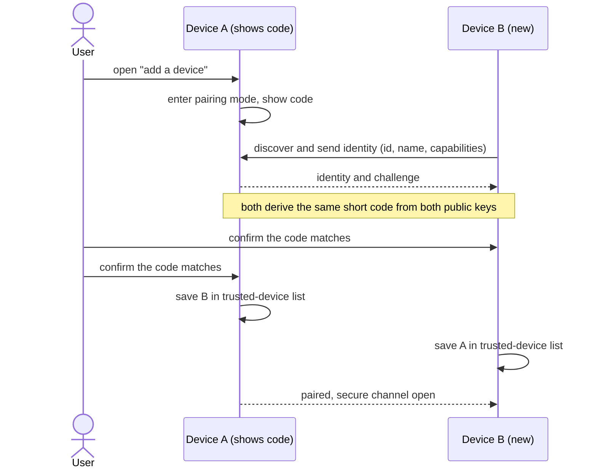

# C1: Device discovery, pairing and trust (outline)

Owner: Mahmoud. Status: outline, 13 Oct 2026. Work starts Sun 18 Oct; draft Sun 25 Oct; final Thu 29 Oct (milestone M2, core designs). Phase 1 deadline: Sun 15 Nov. Phase 1 is design only: no code.
This is the plan for the design, not the design. It lists the questions C1 must answer, what three existing systems do (with sources), and the sequence diagrams to draw. Names follow `B1-architecture-v1.md` (device app, core services, communication layer, local storage).

## What C1 covers, and what it leaves to others
- **C1:** how a device is identified, how devices find each other, how a new device joins (pairing), what "trusted" means, and how trust ends.
- **C11 (Ali):** encryption of the channel, permissions per feature, where data is stored, lost-device protection. C1 supplies the identity and the "remove this device" mechanism; C11 builds on them. The boundary must be agreed with Ali before 25 Oct.
- **C2 (Mohammed):** the AI role. C1 only carries each device's capabilities (for example "can host the AI role") in the device registry.
- **B6 (Ali):** communication library and platforms. C1's design must be possible with the library B6 picks.

## Questions the design must answer

**Identity**
1. What identifies a device: a key pair created at first start? Where is the private key kept on each platform? What happens on reinstall (new identity, re-pair)?
2. What does the user see to tell devices apart (name, icon, short code)? Names are chosen by the device owner and can be faked, so the name alone cannot be trusted.

**Discovery**
3. How do devices find each other on the local network, and what exactly is announced (id, name, address, capabilities)? What can a stranger on the same Wi-Fi learn before pairing?
4. What if discovery does not work: router blocks device-to-device traffic, guest Wi-Fi, firewall, phone hotspot with no router? Is there a manual route (enter an address, scan a QR that carries the address)?
5. How does a device find a known peer again when its address changed, and how fast does it show as online or offline (feeds C3)?

**Pairing**
6. Which method: scan a QR, compare a short code on both screens, type a PIN? Which works when one device has no camera (PC to laptop) or no screen?
7. Who starts it, what does each user tap, how long is the pairing window open, how many wrong tries are allowed?
8. How is an attacker on the same Wi-Fi stopped from pairing as "Mahmoud's iPad"? What exactly does the human check compare?

**Trust**
9. What does pairing grant: everything, or per feature (C11)? Where is the trusted list stored (local storage) and how is it protected?
10. With four devices there are six pairs. Does the user pair every pair, or pair once with one device and the others learn about the new one? If trust spreads, who may vouch for whom, and can one lost device vouch for a stranger?
11. What if a known device shows up with a different key (reinstall, or an impostor)? Refuse and tell the user; how is re-pairing offered safely?

**End of trust**
12. How does the user remove a device (from any other device), and how do the rest learn it? What if the removed device is offline and returns later?
13. What happens to the offline records and shared data of a removed device (C3)?

**Output of C1**
14. Which functional and non-functional requirements does C1 give A8 and A9 (for example "pairing completes in under N steps", "no internet needed")? Which items does it add to B5 (data model: device, key, trust state, capabilities)?

## What existing systems do
Sources were read on 13 Oct 2026 as summaries produced by a fetch tool, not line by line. Anything marked **not verified** must be checked in the primary source before it goes into the report. Samer (A5) covers the same systems for Chapter 2; C1 only needs the discovery, pairing and trust side, so share these links with him instead of both of us collecting them.

### KDE Connect
- **Discovery:** on joining a network a device broadcasts a UDP packet on port 1716 with its identity (device id, protocol version, TCP port); the receiver connects back over TCP. mDNS is an alternative. The user guide lists ports 1714-1764 and says UDP broadcast must not be blocked; devices can be added by IP when discovery fails. [1][2]
- **Trust:** TLS with self-signed certificates. Unpaired devices are accepted with any certificate but may only send pairing packets (similar to SSH's "trust on first use"); a paired device must present the certificate stored at pairing. [1]
- **Pairing:** one side sends a pair request with a timestamp, the other side's user accepts or rejects, both store the other's certificate. [1]
- **Human check:** the pairing prompt can show a short verification key made from a SHA-256 hash over both public keys (first 8 hex characters). Before this was added (2020), a pairing started from the PC side needed no further check, and the on-screen name was attacker-controlled; the advisory describes it and the fix (the popup showed only 8 hex digits, which its author found weak). [1][3]
- **Lesson for us:** pairing needs a human comparison step, not only "accept"; names are not identity.
- **Not verified:** the exact formula of the verification key (the two sources describe it slightly differently), which protocol version is current (documents show 7; a third-party implementation targets 8), and what the app does when a paired device's certificate changes (the protocol page does not say).

### Syncthing
- **Discovery:** local discovery sends an announcement every 30-60 s (recommended) by IPv4 broadcast or IPv6 multicast on port 21027, carrying device id, addresses and a random instance id; global discovery servers and relays exist for the internet case (not relevant to us, we are local only). [4][5]
- **Identity and trust:** a device id is the SHA-256 hash of the device's certificate (self-signed, generated at first start), shown in a long human-readable form with check digits. Both sides present certificates in TLS; after the handshake the id is recomputed and the connection is dropped unless that id is in the configuration. So trust = "this id was added by the user". [5][6]
- **Introducer:** a device marked as introducer automatically adds the devices it knows; trust becomes transitive and removals can be undone while the introducer stays marked. [7]
- **Limits the project itself documents:** local discovery is not protected, so a device can announce itself under another id; long ids are hard to read and type, and shorter ids or PIN-based pairing are proposed. [5]
- **Lesson for us:** identity as hash of a key is simple and strong; pairing by typing a long id is poor for non-technical users; "introducer" is one answer to our question 10, with the risks listed above.
- **Not verified:** how the app prompts the user when an unknown device tries to connect.

### LocalSend
- **Discovery:** multicast UDP at 224.0.0.167, port 53317; a device that hears an announcement replies by HTTP to `/register` (UDP reply as fallback). If multicast fails, a legacy mode scans the local addresses over HTTP. The user can also enter an address by hand. Firewall must allow TCP and UDP 53317, and router client isolation must be off. [8][9]
- **Security:** HTTPS with a certificate generated on each device. The device "fingerprint" is the SHA-256 of that certificate (random text in plain-HTTP mode) and is used to recognise devices and avoid discovering yourself. [8][9]
- **No pairing:** the protocol has no pairing or trust step. The receiver accepts or rejects each transfer, and can require a PIN. [8]
- **Lesson for us:** per-transfer approval is fine for sending a file but not for features that run without the user (clipboard, remote control, offline records). We need persistent trust, which LocalSend does not give.
- **Not verified:** whether the app checks the certificate against the remembered fingerprint on later connections, and how users compare fingerprints.

### What the three have in common (our reading, to confirm in the draft)
All three use a self-signed certificate or key as the identity, and all three discover devices with unauthenticated local broadcast or multicast. So discovery can only say "a device claims to be here"; trust has to come from pairing. Only KDE Connect adds a human check, Syncthing lists it as an open problem, LocalSend skips it. The gap for C1: persistent trust, a human check that works across PC, phone and iPad, a way to add the third and fourth device, and a way to remove a lost one. None of the three, from what was read, covers all of these in one simple flow (to be checked against A5).

## Sequence diagram plan
M2 asks for one sequence diagram per feature; C1 needs four small ones. Draw them in this order. Participants use the B1 names: User, UI, Core services (device registry and trust), Communication layer, Local storage (trusted-device list), and a second device with the same parts.

1. **S1 First pairing of two devices** (main diagram for the report). Device B starts discovery; Device A is in "pairing mode"; they exchange identities over the communication layer; both screens show the same short code (or B scans A's QR); both users confirm; each stores the other's public key and capabilities in the trusted list; the registry marks the device trusted. Alternative branch: wrong code, timeout.
2. **S2 Reconnecting a trusted device.** Discovery announcement, registry looks the id up, mutual key check, session opens, device marked online (feeds C3). Alternative branches: unknown device (refuse, only pairing allowed), known id with a different key (refuse, warn the user).
3. **S3 Adding the third or fourth device.** Two variants side by side, so the team can choose (question 10): pair with every device, or pair with one and let it introduce the new device to the others after the user confirms.
4. **S4 Removing a lost device.** User removes it on one device; that device updates its list; the others learn (online now, or on next contact); the removed device is refused; offline records handling is pointed to C3.

Optional S5, if time allows: discovery fails and the user connects by entering an address or scanning a QR that carries it.

Rough first draft of S1 (steps only, choices still open, will be redrawn in drawio):

## Plan and dependencies
All on paper: documents and diagrams, no code. Platforms: all (decided 13 Oct).
- **18-22 Oct:** answer questions 1-8; read KDE Connect's protocol page in full; agree the C1/C11 boundary with Ali; check B6's communication choice against the questions (can it do discovery, key-based authentication, three channel types?). Needs B6 v0 (15 Oct).
- **Sun 25 Oct (draft):** pairing method and trust model decided (questions 6-11); sequence diagrams S1 and S2 drawn.
- **Thu 29 Oct (final):** S3 and S4, requirements list, final text.
- **Needs from others:** capabilities list from Mohammed (C2) and Ahmed (C9, C10); trusted-device and key fields to Mohammed for B5; the C6 owner (Samer) needs "trusted device" when C6 starts on 25 Oct; C11 (Ali) starts 1 Nov and needs the final C1.

## Sources
1. KDE Connect protocol (device discovery, connection, pairing): https://invent.kde.org/network/kdeconnect-meta/-/raw/master/protocol.md
2. KDE Connect user guide (ports, add by IP): https://userbase.kde.org/KDEConnect
3. Security advisory on KDE Connect, CVE-2020-26164, M. Gerstner, oss-security, 13 Oct 2020 (pairing without verification, spoofable device name): https://www.openwall.com/lists/oss-security/2020/10/13/4 ; follow-up of 30 Nov 2020 (the fingerprint fix and its limits): https://www.openwall.com/lists/oss-security/2020/11/30/1
4. Syncthing local discovery protocol v4: https://docs.syncthing.net/specs/localdisco-v4.html
5. Syncthing device IDs: https://docs.syncthing.net/dev/device-ids.html
6. Syncthing security principles: https://docs.syncthing.net/users/security.html
7. Syncthing introducer: https://docs.syncthing.net/users/introducer.html
8. LocalSend protocol: https://github.com/localsend/protocol/blob/main/README.md
9. LocalSend README (firewall, certificates): https://github.com/localsend/localsend/blob/main/README.md

All were opened on 13 Oct 2026. Source 3 is from 2020 and describes the old behaviour and the first fix; check it against the project's current code before quoting.
