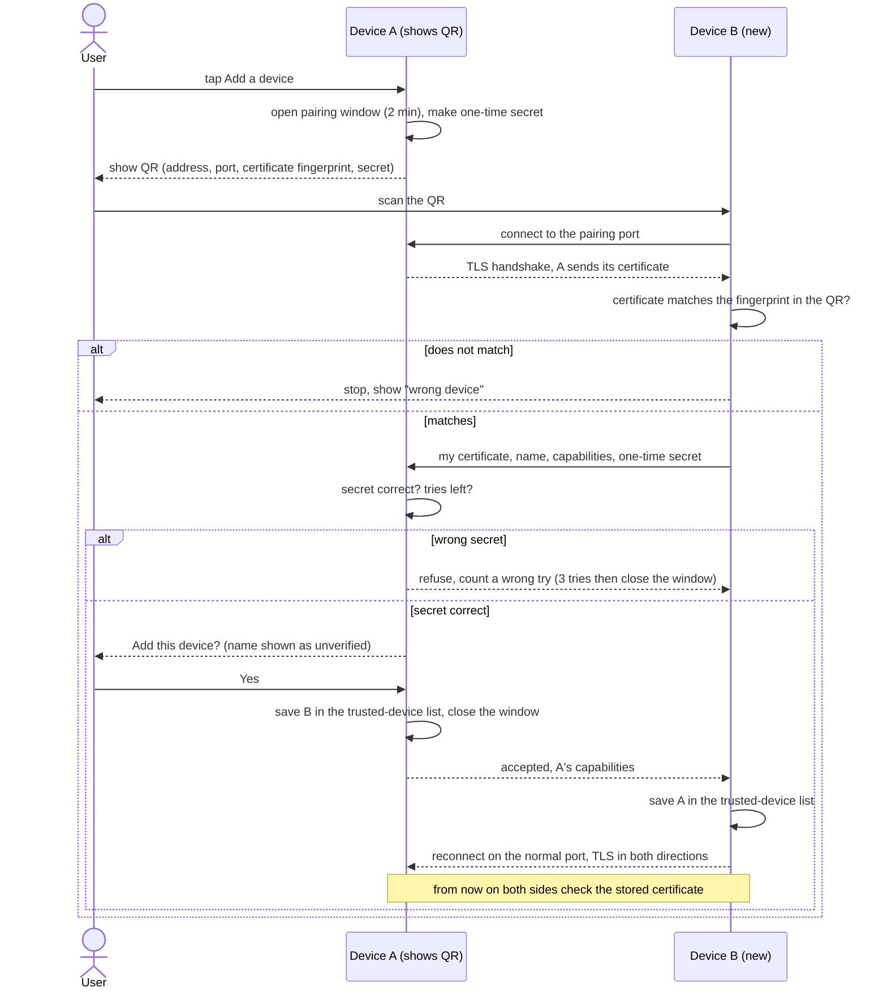

# C1: Device discovery, pairing and trust (v1, draft)

Owner: Mahmoud. Status: first version, draft written 26 Oct 2026 (due Sun 25 Oct, final Thu 29 Oct). **Draft for the owner to read and correct before it goes to the team.** Phase 1 is design only: no code. Names follow `B1-architecture-v1.md`. Technology follows Ali's `B6-technology-v0.md` (PR 37, open): one Flutter app, mDNS/Bonjour discovery, TLS 1.3 in both directions with a self-signed key per device pinned at pairing, SQLite with an encrypted vault, keys in the OS key store.
The questions and the three existing systems (KDE Connect, Syncthing, LocalSend) are in `C1-outline.md`; they are not repeated here.

Marking: **[GUESS]** = my proposal, not checked in a source or tested. **[OPEN]** = the team must decide or check it. Nothing here is verified by a test.

## 1. How it works, in plain steps

**Identity.** On first start each device app makes a key pair and a self-signed certificate. The **device id** is the SHA-256 hash of that certificate (the Syncthing and LocalSend idea). The private key is stored in the OS key store (B6 section 5). The name ("Mahmoud's iPad") is only a label the owner types; it is never used to decide trust. Reinstalling the app makes a new identity, so the device must be paired again. Key type: ECDSA P-256 **[GUESS]** (works with TLS everywhere; B6 does not name one).

**Discovery.** Each running app announces a service over mDNS/Bonjour (library Bonsoir, B6 section 3). The announcement carries only: a short form of the device id, protocol version, port, and a flag "pairing window open". It does not carry the name, the file list or the capabilities **[GUESS]**; those travel only after the secure channel is up, so a stranger on the Wi-Fi learns that "some device of ours is here" and nothing more. Service type name `_xdevice._tcp` is a placeholder **[GUESS]**. iPhone and iPad need the service type declared and the user's Local Network permission (B6, Apple TN3179).

**Pairing (first time, two devices).** Two ways, both end with each device saving the other's certificate:
1. **QR code (preferred).** Device A (user taps "Add a device") opens a pairing window and shows a QR with: its address and port, its **full certificate fingerprint** and a one-time secret. Device B scans it, connects, and checks that A's certificate matches the fingerprint in the QR. Because the fingerprint came through the camera, an attacker on the Wi-Fi cannot swap the key. B proves it saw the QR by sending the one-time secret. The user confirms on A "Add Ali's phone?" (the name is shown but marked unverified).
2. **Code comparison (no camera, e.g. PC and laptop).** Both screens show the same 6-digit code computed from both certificates. The user checks that the codes match and taps "Yes" on both. To stop an attacker grinding keys until the code matches, B first sends a hash of its certificate (commitment) and reveals it only after A has shown its key **[GUESS, my own reasoning, not checked against a source such as ZRTP or Bluetooth pairing: Ali (C11) to confirm]**.
Pairing rules **[GUESS]**: window open 2 minutes, closed by the user at any time, 3 wrong tries then the window closes, only one pairing at a time, and the pairing listener speaks nothing but pairing messages.

**Trust.** A device is trusted if its id is in the trusted-device list in local storage. An entry holds: device id, certificate, label, capabilities (from the device registry, C2/C9/C10 add their flags), date paired, last known address, last seen. Pairing means "may connect" only. What a trusted device may do (clipboard, files, vault, screen) is switched on per feature and decided in C11; clipboard is off by default already (C8) **[GUESS: all features off until enabled]**.

**Normal connection (every later time).** A device hears an announcement, looks the id up, opens TLS in both directions, and each side checks that the other's certificate equals the stored one. Unknown id: refused. The normal port never accepts an unknown certificate; unknown devices can only reach the separate pairing port while its window is open. Known id with a different key: refused, and the user sees "This device changed its identity. Remove it and pair again if it is yours." **[OPEN]** B6 did not check whether Dart's TLS server can verify a self-signed client certificate. Fallback named in B6: a signed challenge inside the channel, or a native layer. The design above works with either.

**Adding the third and fourth device.** Recommendation: **pair with every device** (4 devices = 6 pairings) **[GUESS]**. Convenience on top: after B pairs with A, A offers "Introduce Ali's phone to your other devices?"; each other device then shows a one-tap "Accept?" with the code from method 2. Nobody is trusted silently through a third device (this avoids the Syncthing "introducer" risk in the outline) **[OPEN: owner and team choose; S3 in the outline]**.

**Removing a device (lost or sold).** The user removes it on any device. That device deletes the entry, adds the id to a "removed" list, and sends a signed "remove" message to every online trusted device; offline ones get it the next time they connect (the removed list is exchanged at each connection). A removed device is refused everywhere that has heard. Weak point: until a device hears, it still trusts the lost one **[OPEN, with C11]**. Its offline file records (C3) are deleted from the other devices, after asking the user **[GUESS; OPEN for Mohammed]**.

**If discovery fails** (router isolation, guest Wi-Fi, firewall, hotspot): the QR already carries address and port, so pairing works without mDNS; later connections use "Enter address" in the device settings. Known peers are looked up again by id when the address changes; "online" means a successful TLS check in the last N seconds, N set in C3 **[OPEN]**.

## 2. Sequence diagram (first pairing, QR route)

## 3. Requirements this design creates (for A8 and A9)
Functional:
- FR-C1-1 The app must create a unique key pair and device id at first start and keep the private key in the OS key store.
- FR-C1-2 The app must announce itself on the local network without revealing the name, files or capabilities before pairing.
- FR-C1-3 The app must pair two devices with a QR code, and with a code comparison where there is no camera.
- FR-C1-4 The app must show the pairing prompt with the device name marked unverified.
- FR-C1-5 The app must keep a trusted-device list in local storage and refuse every connection from a device not in it, except to the pairing port during an open window.
- FR-C1-6 The app must refuse a known device that presents a different key and tell the user.
- FR-C1-7 The user must be able to remove a trusted device from any device, and the other devices must learn about it (now or at next contact).
- FR-C1-8 The app must let the user connect by entering an address when discovery fails.
- FR-C1-9 Each device must advertise its capabilities to trusted devices only.
Non-functional:
- NFR-C1-1 Pairing needs no internet and no account.
- NFR-C1-2 Pairing completes in at most 5 user taps and under 1 minute **[GUESS, number to confirm]**.
- NFR-C1-3 A reconnection to a known device must need no user action.
- NFR-C1-4 The pairing window closes by itself after 2 minutes **[GUESS]**.
For B5 (data model): Device (id, certificate, label, capabilities, state: trusted or removed, paired date, last address, last seen) and a removed-ids list.

## 4. Security notes (C11 builds on these)
- An mDNS announcement can be faked, so it proves nothing. Trust comes only from the pinned certificate; a fake announcement fails the TLS check.
- The weak moment is pairing. QR: safe if the QR is not photographed by someone else. Code comparison: needs the commitment step above, otherwise a 6-digit code can be matched by grinding keys **[GUESS, check]**. Past incident to learn from: KDE Connect CVE-2020-26164 (pairing without a human check; outline source 3).
- A stranger on the same Wi-Fi can try to open pairing sessions: the window is closed unless the user opened it, and tries are limited.
- A stolen unlocked device is a trusted device: removal is the only remedy. A stolen private key is a full identity theft, so the key store matters; the Windows key store used by `flutter_secure_storage` is **not checked** (B6).
- Pairing grants no feature by itself; per-feature permissions are C11's job. The boundary with C11 has not been agreed with Ali yet **[OPEN]**.
- Everything stays on the local network (B1 rule 1).

## 5. Fit with B1 and B6, and open questions for the team
- B1 rule 2 ("an unpaired device can only start pairing") is kept by the separate pairing port. B1 decision 6 (key pair, trusted list holds public keys) is confirmed. B6 section 3 ("pinned at pairing (C1)") is now defined here.
- iPhone and iPad answer only while the app is open (B6 section 6), so pairing and re-pairing with them needs their app open.
- **Ali (B6, C11):** can Dart verify a self-signed client certificate? Is the code-comparison design with commitment sound? Where is the line between C1 and C11?
- **Mohammed (C2, C3, B5):** capabilities list and fields for B5; what happens to a removed device's records; how fast "offline" is shown.
- **Samer (C6):** C6 may rely on "trusted device" meaning "TLS-verified id in the list".
- **Ahmed (C9, C10):** which capability flags do you need (share screen, accept control, extra screen)?
- **Team:** pair with every device only, or add the "introduce" convenience?
- **Sources not opened for this draft.** All protocol facts about KDE Connect, Syncthing and LocalSend come from `C1-outline.md` and are still **not verified** there.
