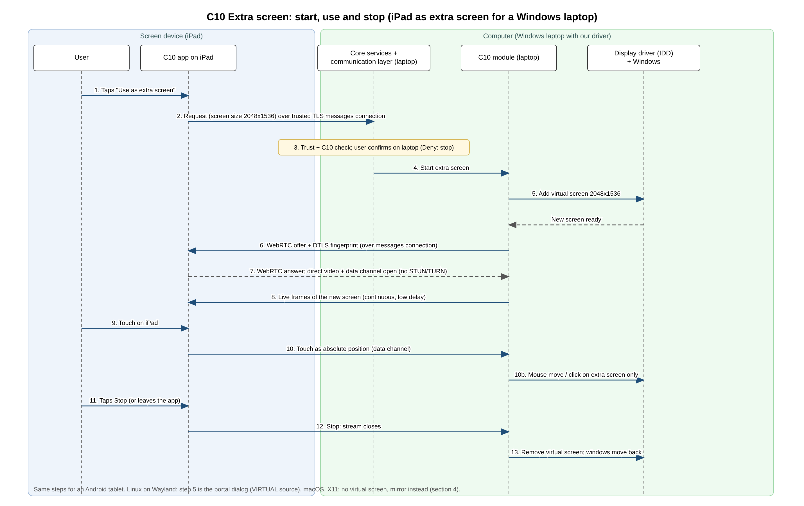

# C10: Extra screen (first version)

Owner: Ahmed. Status: first version, 8 Nov 2026. Phase 1 is design only: no code.
Use another device (for example an iPad or an Android tablet) as a second monitor for a PC or laptop.
Names follow `B1-architecture-v2.md` (device app, feature module, core services, communication layer). "Computer" = the PC or laptop that gets the extra screen; "screen device" = the tablet or phone that shows it. **Not checked** = not confirmed in a primary source or not tested. **[PROPOSAL]** = my suggestion, not agreed by the team.

## 1. Making an extra virtual screen on the computer

| System | How a new (virtual) screen can be made | What it needs |
|---|---|---|
| **Windows** | The **Indirect Display Driver (IDD)** model: "a simple user-mode driver model to support monitors that aren't connected to traditional GPU display outputs", listed for "creating virtual monitors" and "streaming the display output over a network to a remote client". Checked (Microsoft docs). Spacedesk works this way (its own driver). | **A driver.** It is user mode (UMDF), so no kernel code, but it must be installed (administrator) and signed. Microsoft: since Windows 10 1607 new kernel-mode drivers must be "signed by the Dev Portal"; "attestation signing supports Windows Desktop kernel mode and user mode drivers" and needs "an extended validation (EV) code signing certificate" through Partner Center; attestation is "for testing purposes only", retail needs the Hardware Compatibility Program (HLK tests). For development, `bcdedit -set TESTSIGNING ON` lets test-signed drivers load (shows "Test Mode"). Checked (Microsoft docs). That a **user-mode** IDD is bound by the same rule as kernel drivers: searched, not found (the UMDF signing page could not be opened). The cost of an EV certificate: **not checked**. |
| **macOS** | **No public API found.** Apple documents no way for an app to add a display. Tools that do it use `CGVirtualDisplay`, which is **not in Apple's public documentation** (checked 8 Nov: Apple's doc data for it returns 404, while a public class like `CGDisplayStream` returns 200). Spacedesk has a macOS driver in beta (macOS 14.4+) with "Desktop Extension or Desktop Duplication (mirror)" settings; how it creates the screen: searched spacedesk's manual, not found. Apple's own way is Sidecar (iPad only). | A **private API** (not allowed on the Mac App Store, may break with any update). **[PROPOSAL]:** not used in v1; macOS gets mirroring (section 4). |
| **Linux (X11)** | `xrandr --setmonitor` only defines a monitor over **existing** outputs (xrandr man page). Ways to get a new output: the **EVDI** kernel module ("a Linux kernel module that enables management of multiple screens", "compatible with a standard Linux DRM subsystem", so xrandr can drive it; DisplayLink README), or the old `intel` X driver option `VirtualHeads` ("the number of fake outputs to create"). Checked (docs). The `dummy` X driver: man page could not be opened, **not checked**. | A **kernel module** (EVDI, must be built for each kernel; not checked) or a specific X driver. **[PROPOSAL]:** not in v1, mirror instead. |
| **Linux (Wayland)** | The ScreenCast portal has a source type **`VIRTUAL`: "Extend with new virtual monitor"** (next to `1: MONITOR` "Share existing monitors" and `2: WINDOW`; `VIRTUAL` is `4`). The desktop creates the monitor and gives us its picture; the user approves in the system dialog. Checked (xdg-desktop-portal docs). Which desktops offer it: **GNOME** (`xdg-desktop-portal-gnome` handles `SCREEN_CAST_SOURCE_TYPE_VIRTUAL` and asks Mutter for a `virtual_monitor`) and **KDE Plasma** (`xdg-desktop-portal-kde` has "Virtual Output" with a resolution picker); **not** `xdg-desktop-portal-wlr` (Sway and other wlroots desktops: only MONITOR and WINDOW). Checked in the portals' source code (8 Nov); which release first had it: **not checked**. KDE has a bug report about the size being fixed at 1920x1080. | **No driver.** Same portal as C9, so the same dialog. The `persist_mode` option can remember the approval ("until explicitly revoked"). |

Nobody in the team has a Mac or a Linux machine (A10): every macOS and Linux claim here is from the docs only, not tested.

**Result:** a true extra screen is possible on **Windows (with our own driver)** and **Linux on Wayland (through the portal, no driver)**. macOS and Linux on X11 would need a private API or an extra driver.

## 2. What the screen device can do

| Device | Show the stream | Send touch back as mouse | Limits |
|---|---|---|---|
| **iPad** | Yes, while our app is open (WebRTC video, `flutter_webrtc`, B6). | Yes: our app reads the touches and sends them; the **computer** moves the mouse (C9 input, section 3). | **Foreground only**: when the user leaves the app or the iPad locks, iOS suspends the app and the stream stops (B6 section 6). `isIdleTimerDisabled` keeps the screen from sleeping while the app is open (Apple docs, meta text only; full page **not checked**). Apple Pencil pressure and hover: **not used in v1**. An iPad can never be the *computer* side: no public API to add a display or to control it (C9). |
| **iPhone** | Same as iPad. | Same. | Same; small screen. **[PROPOSAL]:** allowed, but not the main case. |
| **Android tablet** | Yes. | Yes, same as iPad. | Receiving needs no special permission. Keep the screen on with `FLAG_KEEP_SCREEN_ON` on our activity; Android docs: if the app "goes into the background, the system allows the screen to turn off normally". Checked. Background is not needed: the user is looking at it. |

## 3. The stream: what is the same as C9, what is different
**Same:** WebRTC as decided in B6 final (choice 3): setup messages over our trusted TLS messages connection, no STUN or TURN, DTLS fingerprint inside that connection, only between trusted devices (C1, C11). Touch and keyboard go on the WebRTC data channel.

**Different from screen sharing:**
- **Continuous and low delay.** It is used like a monitor, so the target is **under 100 ms** from drawing to showing on the same Wi-Fi **[PROPOSAL, to test in Phase 2]**. When Wi-Fi is slow, lower the quality, not the frame rate first (WebRTC already adapts).
- **Resolution comes from the screen device.** The virtual screen is created at the tablet's size (e.g. 2048x1536 for a common iPad, 1920x1200 for a tablet) so there is no scaling. Mirroring (section 4) uses the computer's size and adds black bars.
- **The mouse can reach the extra screen.** In extend mode the OS treats it as a normal monitor; the user drags windows onto it. Touch on the tablet becomes an absolute mouse position on **that screen only** (Wayland: `NotifyPointerMotionAbsolute` on the stream, checked in the RemoteDesktop portal docs; Windows: `SendInput` as in C9).
- **Approval: the user on both devices, every time** (C11 table and SEC-3). The user starts it on the screen device ("Use as extra screen") and confirms on the computer ("iPad wants to be an extra screen: Allow / Deny"). Plus the OS dialog where the OS demands it (Wayland portal, macOS Screen Recording). Nothing is remembered between sessions in v1 (Wayland `persist_mode` stays 0) **[PROPOSAL]**.
- **Stops cleanly.** When the stream stops, the computer **removes** the virtual screen so windows move back and are not lost on an invisible monitor.

## 4. Fallback: mirror when a virtual screen is not possible
If the computer cannot add a screen, the app **mirrors** an existing one (C9 capture, with the same approval on both devices every time, SEC-3). The user is told "Extra screen is not available on this computer; showing a copy of your screen".

| Computer | v1 gets |
|---|---|
| Windows 10/11 | **Extend** if our driver is installed; otherwise **mirror** |
| Linux on Wayland (portal with `VIRTUAL`) | **Extend** |
| Linux on Wayland without `VIRTUAL` (Sway and other wlroots desktops) | **Mirror** |
| Linux on X11 | **Mirror** |
| macOS | **Mirror** (Apple users can use Sidecar for extend) |
| Android, iPhone, iPad as computer | **Not offered** (they are screen devices only) |

Capability flags for C1 / B1 rule 5 **[PROPOSAL]**: a computer advertises `extra-screen: extend` or `extra-screen: mirror`; a device that can show the stream advertises `extra-screen-viewer`. The screen device shows the right button.

## 5. Compared with Spacedesk and Apple Sidecar (A5)

| | Spacedesk | Apple Sidecar | Our C10 |
|---|---|---|---|
| Computer | Windows 10/11 (macOS 14.4+ beta) | Mac, macOS 10.15+ | Windows (extend), Linux (extend or mirror), macOS (mirror) |
| Screen device | Android, iOS, Windows, browser | iPad only (iPadOS 13+) | iPad, iPhone, Android tablet |
| Connection | LAN, no account | Same Apple Account, wireless within 10 m or USB | Our trusted pairing (C1), local network only |
| Touch back | Yes (touch or mouse) | Pencil; more touch from 27 | Touch as mouse; Pencil not in v1 |

**We copy:** the driver approach on Windows (Spacedesk); one-tap start and removing the screen at the end (Sidecar).
**We do differently:** no Apple account needed and mixed brands; the stream uses our pairing and encryption, not an open LAN service (Spacedesk needs a password to allow keyboard input from phones); honest mirror fallback where extend is not possible.

## 6. Starting an extra screen, step by step
Diagram: `diagrams/C10-extra-screen-sequence.drawio` (PNG export next to it). Example: Windows laptop with our driver, iPad as extra screen.

- Steps 1-2: The user taps "Use as extra screen" on the iPad; the request goes over the trusted messages connection to the laptop.
- Step 3: The laptop's core services check the iPad is trusted and C10 is allowed for it (C11), and the user confirms on the laptop (SEC-3). If the user taps Deny, or nobody answers, nothing more happens and the iPad shows "Not allowed".
- Steps 4-5: The C10 module asks the driver for a new screen at the iPad's size; Windows adds it.
- Steps 6-7: WebRTC setup messages (offer, answer, fingerprint) go over the messages connection; the video and data channel open directly.
- Step 8: Frames of the new screen stream to the iPad.
- Steps 9-10: A touch on the iPad goes back on the data channel; step 10b: it becomes a mouse move or click on that screen only.
- Steps 11-13: Stop (either side, or the iPad app leaves the front): the stream closes and the laptop removes the virtual screen.

## 7. Requirements
1. The app must let a trusted device be used as an extra screen only between devices of the same user that are paired (C1) and on the local network (B1 rules 1 and 2).
2. The app must create a virtual screen at the screen device's resolution where the computer allows it (Windows with our driver, Linux Wayland portal `VIRTUAL`).
3. The app must fall back to mirroring an existing screen where a virtual screen cannot be created, and tell the user so.
4. The app must advertise `extra-screen: extend`, `extra-screen: mirror` or `extra-screen-viewer` for each device (B1 rule 5, C1).
5. The app must send the screen as a WebRTC stream set up over the trusted messages connection, with no STUN or TURN servers (B6 choice 3).
6. The app must turn touches on the screen device into mouse events on the extra screen only.
7. The app must remove the virtual screen when the session ends for any reason, so no window is left on a screen nobody sees.
8. The app must keep the screen device awake while it shows the extra screen, and stop the session when the app leaves the foreground on iPhone/iPad.
9. The app must let the user stop the extra screen from either device at any time.
10. The app must ask for the OS permission where the OS demands it (Wayland portal dialog, macOS Screen Recording), and must not use private APIs in v1.
11. The app must ask the user on both devices every time before an extra screen starts (C11 SEC-3), and must never store the frames (C11 SEC-6).

## Open points and who settles them
- Windows driver: for Phase 2 a test-signed driver on our own test PC is enough; a public release needs an EV certificate and Microsoft signing. Mahmoud decides if Phase 2 goes beyond test signing; if not, other Windows PCs get mirror only.
- Test that `VIRTUAL` works on Ubuntu 24.04 GNOME (whoever gets the Linux machine, B6 point 4).
- macOS: test needs a Mac with Xcode (B6 decision 15, still open).
- Delay target (100 ms) and test devices: A10 evaluation plan (Ahmed).
- Per-feature permission for C10 and stream encryption: C11 (Ali). This file answers C11's open point "C10 approval": user on both devices, every time.
- Capability flag names: C1 (Mahmoud).
- WebRTC with no internet at all, app size, and whether capture needs native code (B6 final, still open).

## Sources (opened 8 Nov 2026, read as text)
- Windows IDD model: https://learn.microsoft.com/en-us/windows-hardware/drivers/display/indirect-display-driver-model-overview
- xdg-desktop-portal ScreenCast (`VIRTUAL`, `persist_mode`): https://flatpak.github.io/xdg-desktop-portal/docs/doc-org.freedesktop.portal.ScreenCast.html
- xdg-desktop-portal RemoteDesktop (`NotifyPointerMotionAbsolute`): https://flatpak.github.io/xdg-desktop-portal/docs/doc-org.freedesktop.portal.RemoteDesktop.html
- KDE bug, virtual monitor fixed at 1920x1080: https://bugs.kde.org/show_bug.cgi?id=512620
- xrandr man page: https://man.archlinux.org/man/xrandr.1
- Apple Sidecar (requirements, same Apple Account, wireless within 10 m or USB, Pencil, expanded touch from iPadOS/macOS 27): https://support.apple.com/102597
- Apple `isIdleTimerDisabled`: https://developer.apple.com/documentation/uikit/uiapplication/isidletimerdisabled
- Apple `CGVirtualDisplay`: https://developer.apple.com/tutorials/data/documentation/coregraphics/cgvirtualdisplay.json returns 404 (not public); compare https://developer.apple.com/tutorials/data/documentation/coregraphics/cgdisplaystream.json (200)
- Windows driver signing: https://learn.microsoft.com/en-us/windows-hardware/drivers/install/kernel-mode-code-signing-policy--windows-vista-and-later- ; https://learn.microsoft.com/en-us/windows-hardware/drivers/dashboard/driver-signing-offerings ; https://learn.microsoft.com/en-us/windows-hardware/drivers/dashboard/code-signing-attestation ; https://learn.microsoft.com/en-us/windows-hardware/drivers/install/the-testsigning-boot-configuration-option
- Linux EVDI: https://github.com/DisplayLink/evdi ; intel(4) `VirtualHeads`: https://manpages.debian.org/testing/xserver-xorg-video-intel/intel.4.en.html
- Portal source code (VIRTUAL support): https://github.com/GNOME/xdg-desktop-portal-gnome (`src/screencast.c`), https://github.com/KDE/xdg-desktop-portal-kde (`src/screencast.cpp`), https://github.com/emersion/xdg-desktop-portal-wlr (`src/screencast/`)
- Android keep screen on: https://developer.android.com/develop/background-work/background-tasks/awake/screen-on
- Spacedesk manual: https://manual.spacedesk.net/ ; system requirements: https://manual.spacedesk.net/SystemRequirements1.html ; touch, pen and keyboard input (touch as touch or emulated mouse; keyboard from Android/iOS viewers only with encryption/password, from version 2.2.11): https://manual.spacedesk.net/MouseKeyboardTouchscreenAndPenIn.html
- Team files: `research/A5-existing-systems.md` (main), `B6-technology-final.md` (PR #42), C9 final (`report/C9-screen-sharing.md`, section 3 WebRTC, section 6 requirements; first notes PR #40), `C11-security-privacy.md` (PR #49, table line for C10, SEC-3, SEC-6).
