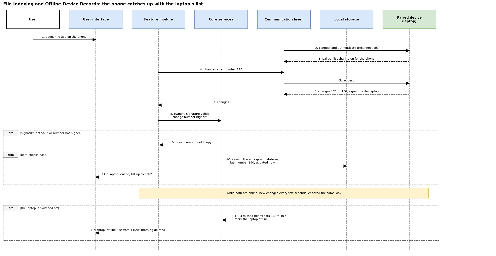

# C3: File indexing and offline records (final)

Owner: Mohammed. Status: final, 8 Nov 2026 (first version 31 Oct; was due Mon 2 Nov).
Changed in this version: the hashes follow Ali's C4 rule (filled only when needed), C4's two new fields and the free space per device are added, preview size and videos agreed with Ali, the list size is measured, the diagram is in draw.io, and requirements, open points and sources are added.
Builds on `C2-ai-node.md` (every device keeps a copy of the other devices' lists), `C4-duplicate-detection.md` (hashes, free space), `B6-technology-final.md` (SQLite, platform limits) and C1 (online and offline detection, removed devices). Names follow `B1-architecture-v2.md`.
Phase 1 is design only: no code. **[PROPOSAL]** = my design choice, to be agreed or tuned. **not checked** = not confirmed in a primary source or by a test.

## 1. What is stored

**Per file** (one row in the device's SQLite file, B6 choice 5; the full data model is in B5):

| Field | Filled | Size | Used by |
|---|---|---|---|
| device id, path, file name, size, last modified date, file type | always | about 150 bytes | everything |
| perceptual hash (32 bytes, photos only) | by the owner while indexing the photo | 32 bytes | C4 "same photo, other size" |
| partial hash (first 4 KB + last 4 KB + size) | **only when needed**: when the file's size occurs more than once (C4, step 2) | 32 bytes | C4 |
| full SHA-256 | **only when needed**: when the file still matches after the partial hash (C4, step 3), or when another feature asks for it (C6 "you already have this file") | 32 bytes | C4, C6 |
| change number, "deleted" mark and date | always | a few bytes | sharing (section 3) |

Hashes are cached with (path, size, modified date): if one of them changes, the cached partial and full hash are cleared and the perceptual hash is made again. This is Ali's rule, agreed on 8 Nov (C4, Open points 1): reading every byte of every file (for example 500 GB on a PC) would cost hours of disk and battery (C4, not measured).

**Per device** (in the device record, C1 registry): the free and total bytes of the storage that holds the scanned files, updated at each scan and each connect (C4 uses it to suggest which device to free); the time of the last scan; and the scan scope (for example "iPhone: photo library only", "Android: photos and videos only, no All files access").

**Size:** about **20 MB per 100,000 files**, measured on 100,000 made-up file names and folders in SQLite 3.42 on a PC, with C4's hashes filled for 30 % of files and the perceptual hash for the photos (8 Nov; real names may be longer; not measured in the Dart package). The search index for C5 adds about 7 MB.

## 2. Scanning: how each device lists its own files

| System | What is scanned by default | Limits |
|---|---|---|
| Windows, macOS, Linux | The user's home folders: Desktop, Documents, Downloads, Pictures, Videos, Music. The user can add folders and external drives, or remove any folder | System and program folders, hidden files and caches are skipped |
| Android | With "All files access": the shared storage (DCIM, Pictures, Download, Documents and the rest) (B6 v0, source 13) | Without that permission: photos and videos only, through the media library (which permission each Android version needs: not checked). The app tells the user what is missing |
| iPhone, iPad | The app's own files, the photo library (if the user allows it), and folders the user picks (B6 final, choice 1) | Nothing else can be seen. Whether a picked folder stays allowed after a restart: not checked |

Files under 64 KB are listed but left out of duplicate checks (C4). Files that exist only in a cloud (for example iPhone photos kept only in iCloud) are listed as "not on this device" and never read (C4; how the app detects this: not checked).

**How often [PROPOSAL]:**
- **First scan:** when the user turns the feature on. It runs in the background at low priority and can be paused, and the list fills step by step ("Scanning: 40,000 files so far").
- **Desktops and laptops:** the app listens to the system's file-change notifications, so changes are recorded within seconds. A quick check at app start and every 6 hours catches anything missed.
- **Phones and tablets:** a quick check each time the app opens (iPhone and iPad run only while the app is open; Android also while the optional "stay connected" mode is on, B6 final, choice 6).
- **Quick check:** compares size and modified date only; no file is read. For a changed photo the perceptual hash is made again; the other hashes wait until C4 needs them.
- **Scan time for 100,000 files** on a phone and on a laptop: not checked, needs a Phase 2 test.

## 3. Sharing the lists between devices

- **Only the owner changes its list.** Every other device holds a read-only copy, so two devices never edit the same list and there are no conflicts to solve.
- **Change numbers.** Every change to a device's own list (file added, changed or deleted, or a hash filled) gets the next number. Each copy remembers the last number it received from that device.
- **On connect:** after the two devices have authenticated (C1, section 1.5), each asks "send me your changes after number N". The answer comes in batches over the messages connection. A first full list (about 20 MB per 100,000 files) goes over the file connection, so it can resume if cut (C6).
- **While both are online:** changes are sent in small batches every few seconds, not one message per file [PROPOSAL].
- **Deleted files:** a deleted file keeps its "deleted" mark for 30 days, so devices that were off learn about it. A device that was away longer gets the full list again instead of the changes [PROPOSAL].
- **Passing copies on [PROPOSAL]:** a device can pass on its copy of a third device's list together with its change number; the receiver keeps whichever copy has the higher number. Example: the phone rarely meets the PC, but both meet the laptop. A trusted device could send a false copy; this is the same risk C1 lists for a trusted device that abuses its trust (item 11) and goes to C11.
- **Feature switch:** sharing the list with a device is off until the user turns it on (B1 v2, rule 6). A device that is not allowed receives nothing.
- **Removed device (C1, section 1.7):** as soon as a device learns of the removal, it deletes the removed device's list; the AI device also deletes the similarity data of those files (C4, section 6).

**Sequence: the phone catches up with the laptop's list.** Editable source: `diagrams/C3-list-sync-sequence.drawio`; image: `diagrams/C3-list-sync-sequence.png`.

In words: the phone opens the app and connects to the laptop (C1). It asks for the changes after the last number it holds (120); the laptop reads its changes 121 to 150 from local storage and sends them. The phone saves them and the time of the update. While both are online, new changes keep coming in small batches. When the laptop goes off, C1 marks it offline after 3 missed heartbeats, and the phone keeps the copy and shows its age.

## 4. Photo previews for the AI device

The lists carry no thumbnails. When the AI device needs a photo, it asks the owner for one **224 × 224** JPEG preview (about 15 KB, estimate), and for a video for **3 frames** (at 10 %, 50 % and 90 % of its length) of the same size; it deletes them after making its vectors. Only while the owner is online, and only if the user has turned on "Allow the AI device to see photo previews" for that device. Details in C2, Q3; agreed with Ali on 8 Nov (C4, Open points 2 and 3).

## 5. Switched-off devices

**What is saved about a switched-off device:** its whole list as last received, the last change number, the time of the last update, the last time it was online (C1 registry), its free space and its scan scope.

**What happens when it goes off:** nothing is deleted. C1 marks it offline after 3 missed heartbeats (about 30 to 40 seconds), and its copy stays as it was.

**How the user sees the age [PROPOSAL]:**
- The device shows as offline in grey, with "List from today 14:20" or "List from 3 days ago".
- A list older than 7 days gets a warning: "This list may be out of date".
- Its files appear in search (C5) and duplicate results (C4) with the device name and an "offline" label; a duplicate that needs a missing hash shows as "possible copy" (C4).
- Actions that need the file itself (open, send, delete) are disabled and say "Turn on *Laptop-1* to use this file".
- Phones and tablets are offline most of the time (app closed), so this is the normal case for them, not an error.

## 6. Requirements

- FR-C3-1 The app must list the files in the folders the user allows, and show the scan scope of each device.
- FR-C3-2 The app must store for each file its path, name, size, modified date, type, a change number and a "deleted" mark, and never its content.
- FR-C3-3 The app must make a perceptual hash for each photo it indexes, and fill the partial and full hash only when another feature needs them (C4).
- FR-C3-4 The app must notice new, changed and deleted files: on desktops through the system's change notifications and a quick check every 6 hours; on phones and tablets at each app start.
- FR-C3-5 The app must re-read a file only when its size or modified date changed.
- FR-C3-6 The app must keep a read-only copy of the list of every trusted device that shares its list with it.
- FR-C3-7 The app must send only the changes after the last change number the other device holds, and the full list only to a device that has none or was away longer than 30 days.
- FR-C3-8 The app must send a list only to trusted devices for which the user turned list sharing on.
- FR-C3-9 The app must keep the list of a switched-off device and show the date of its last update.
- FR-C3-10 The app must delete the list of a removed device as soon as it learns of the removal.
- FR-C3-11 The app must store each device's free and total space and update it at each scan and each connect.
- NFR-C3-1 The first scan must run in the background at low priority and be pausable.
- NFR-C3-2 A list must take no more than about 30 MB per 100,000 files, search index included (measured 27 MB on made-up names).
- NFR-C3-3 Seeing and searching the lists must work with no other device online.

## 7. Open points and who settles them

| # | Point | Who | Status |
|---|---|---|---|
| 1 | Time to scan 100,000 files on a phone and a laptop | Phase 2 test (team) | not checked |
| 2 | Which Android permission gives photos and videos without "All files access" | Phase 2 (team) | not checked |
| 3 | Whether iOS keeps access to a picked folder after the app restarts | Phase 2 (team) | not checked |
| 4 | Passing list copies through a third device | Mahmoud (C1), Ali (C11) | [PROPOSAL], waiting |
| 5 | Whether the main SQLite file (lists, registry) is encrypted on disk | Ali (C11) | B5 assumes not, only the vault |
| 6 | Size measured on made-up names in Python's SQLite, not in the Dart package | Phase 2 | measured once, 8 Nov |

## Sources (opened on the date given)

1. Ali, `C4-duplicate-detection.md`, sections 2, 3, 6 and Open points (pull request 43), opened 8 Nov 2026.
2. Ali, `B6-technology-final.md`, choices 1, 5, 6 and point 2 (pull request 42), opened 8 Nov 2026.
3. Ali, `B6-technology-v0.md`, section 1 and source 13 (Android, Manage all files), opened 31 Oct 2026.
4. Mahmoud, `C1-device-discovery-pairing-trust.md`, sections 1.5 (heartbeat) and 1.7 (removal) (pull request 38), opened 8 Nov 2026.
5. Samer, `research/C6-file-sharing.md`, sections 2 and 3, opened 8 Nov 2026.
6. Own measurement: 100,000 made-up file rows in SQLite 3.42 (Python on Windows), 8 Nov 2026.
