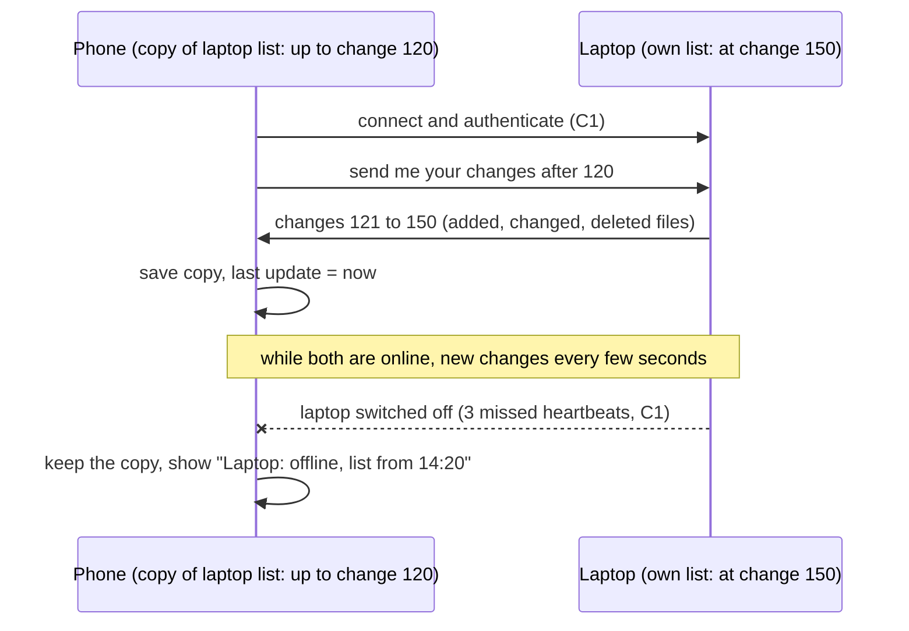

# C3: File indexing and offline records (first version)

Owner: Mohammed. Status: first version, 31 Oct 2026. Final due Mon 2 Nov 2026.
Builds on `C2-ai-node.md` (every device keeps a copy of the other devices' lists), `B6-technology-v0.md` (SQLite, platform limits) and C1 (online and offline detection).
Phase 1 is design only: no code. Names follow B1.

## 1. Scanning: how each device lists its own files

**What is stored per file** (one row in the device's SQLite file, B6 section 5): device id, path, file name, size, last modified date, file type, SHA-256 hash, a change number (section 2), and a "deleted" mark. C4 may add a perceptual hash for photos (B6 proposal); C3 keeps room for it.

**Which folders:**

| System | What is scanned by default | Limits |
|---|---|---|
| Windows, macOS, Linux | The user's home folders: Desktop, Documents, Downloads, Pictures, Videos, Music. The user can add folders and external drives, or remove any folder | System and program folders, hidden files and caches are skipped |
| Android | With "All files access": the shared storage (DCIM, Pictures, Download, Documents and the rest) | Without that permission: photos and videos only, through the media library (not checked which permission each Android version needs). The app tells the user what is missing |
| iPhone, iPad | The app's own files, the photo library (if the user allows it), and folders the user picks | Nothing else can be seen (B6, section 1). Whether a picked folder stays allowed after a restart: not checked |

**How often:**
- **First scan:** when the user turns the feature on. It runs in the background at low priority and can be paused. The list fills step by step, and the device shows "Scanning: 40,000 files so far".
- **After that, on desktops:** the app listens to the system's file-change notifications, so new, changed and deleted files are recorded within seconds. A quick check at app start and every 6 hours catches anything missed (proposal).
- **After that, on phones and tablets:** a quick check each time the app opens (B6 says the app is not running in the background).
- **Quick check:** compare size and modified date only. The hash (SHA-256) is computed again only for files whose size or date changed, because hashing is the slow part. Until the hash is ready, the row is marked "hash pending". Time to hash 100,000 files on a phone: not checked.

## 2. Sharing the lists between devices

- **Only the owner changes its list.** Every other device holds a read-only copy. So two devices never edit the same list, and there are no conflicts to solve.
- **Change numbers.** Every change to a device's own list (file added, changed or deleted) gets the next number: 1, 2, 3 and so on. Each copy remembers the last number it received from that device.
- **On connect:** after two devices trust each other (C1, section 1.5), each one asks "send me your changes after number N". The answer comes in batches over the message channel. A first full list (about 20 MB for 100,000 files, C2) goes over the file-transfer channel, so it can resume if cut.
- **While both are online:** changes are sent in small batches every few seconds, not one message per file.
- **Deleted files:** a deleted file keeps a "deleted" mark for 30 days, so devices that were off learn about it. A device that was away longer than that gets the full list again instead of the changes (proposal).
- **Passing copies on (proposal):** a device can pass on a copy of a third device's list together with its change number. Example: the phone rarely meets the PC, but both meet the laptop, so the phone gets the PC's list through the laptop. The receiver keeps whichever copy has the higher number. A trusted device could send a false copy; this is the same risk C1 lists for trusted devices (item 11) and goes to C11.
- **Feature switch:** sharing the list with a device is off until the user turns it on (B1 v2). A device that is not allowed receives nothing.
- **Removed device (C1, section 1.7):** the other devices delete its list. The AI device also deletes the similarity data for its files.

## 3. Switched-off devices

**What is saved about a switched-off device:** its whole list as last received, the last change number, the time of the last update, the last time it was online (C1 device registry), and how complete its scan was (for example "iPhone: photo library only").

**What happens when it goes off:** nothing is deleted. C1 marks it offline after 3 missed heartbeats (about 30 to 40 seconds), and its copy stays as it was.

**How the user sees the age:**
- The device shows as offline in grey, with "List from today 14:20" or "List from 3 days ago".
- A list older than 7 days gets a warning: "This list may be out of date" (proposal).
- Its files appear in search and duplicate results with the device name and a small "offline" label.
- Actions that need the file itself (open, send, delete) are disabled and say "Turn on *Laptop-1* to use this file".
- Phones and tablets are offline most of the time (app closed), so this is the normal case for them, not an error.

## Still open
- Time to scan and hash 100,000 files on a phone and on a laptop: not checked, needs a test.
- Which Android permission is needed for photos only, without "All files access": not checked.
- Whether iOS keeps access to a folder the user picked after the app restarts: not checked.
- Passing copies on through a third device: needs the agreement of C1 and C11.
- Size of the lists: check with C5 (Samer), who searches them.
