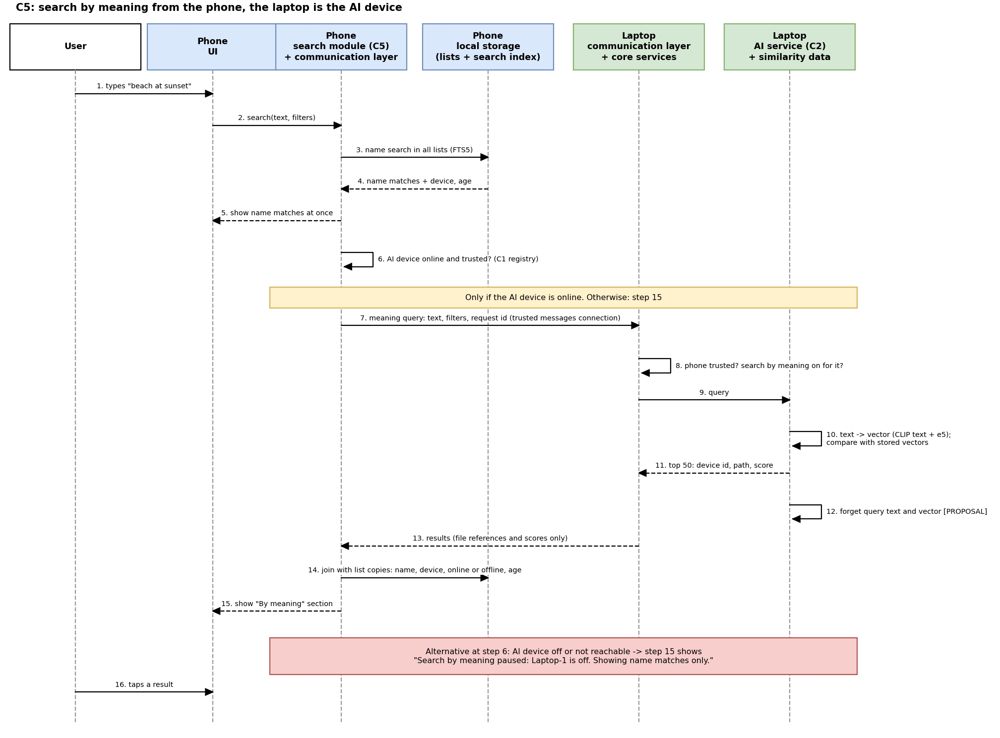

# C5: Unified search (first version)

Owner: Mohammed (moved from Samer on 3 Nov, because it is built on the C3 file lists). Status: first version, 8 Nov 2026.
Builds on `C3-file-indexing.md` (lists and their age), `C2-ai-node.md` (AI device, models), `C4-duplicate-detection.md` (previews), `B6-technology-final.md` (SQLite FTS5, Arabic quality) and `research/C6-file-sharing.md` (send). Names follow `B1-architecture-v2.md`.
Phase 1 is design only: no code. **[PROPOSAL]** = my design choice, to be agreed or tuned. **not checked** = not confirmed in a primary source or by a test.

## 1. What it is

The user searches for a file from any device and finds it on any of their devices, including devices that are switched off (from their last known list, C3). There are two kinds of search, and the user sees both in one screen:

| | **By name** | **By meaning** |
|---|---|---|
| Finds | file names (part of a word is enough), with filters: type, date, device, size | photos from words ("beach at sunset", "عيد ميلاد"), and file names with the same meaning ("invoice" finds "bill_march.pdf") |
| Runs on | the device where the user types, from its own list and its copies of the others (C3) | the AI device (C2), from its similarity data |
| Needs another device on | no | the AI device |
| How | SQLite full-text search (FTS5, built into `package:sqlite3`, B6 final choice 5) | the query becomes a vector (CLIP text encoder for photos, multilingual-e5-small for names, C2) and is compared with the stored vectors |

**Why two separate sections instead of one mixed list [PROPOSAL]:** name matches arrive at once and always work; meaning matches arrive a moment later and only when the AI device is on. Two sections ("Name matches", "By meaning") keep the screen stable and make it clear which part is paused.

## 2. Search by name

- **Index:** each device builds one search index over the names in all the lists it holds (its own and its copies), and updates it when list changes arrive (C3, section 3).
- **Arabic needs the names cleaned first.** I tested FTS5 in SQLite 3.42 (Python on a PC, 8 Nov): with the normal tokenizer, "الفاتورة" does not find "الفَاتُورَة" (the vowel marks stay, even with the "remove diacritics" option), and "فاتورة" does not find "الفاتورة" (the word "ال" is joined to it). So the app stores a **cleaned copy of each name**: vowel marks and tatweel removed, أ إ آ written as ا, ى as ي, ة as ه, and lower case [PROPOSAL]. With the **trigram** tokenizer on the cleaned copy, "الفاتورة", "فاتورة" and "فاتوره" all found both test files, and "port" found "report_v2_final.docx" (tested on 8 Nov). Not tested in the Dart package; whether its bundled SQLite has the trigram tokenizer (SQLite 3.34 or newer): not checked.
- **Short queries:** the trigram index needs at least 3 letters; for 1 or 2 letters the app searches only the start of names [PROPOSAL].
- **Filters:** type (photo, video, document, other), date range, device, size, "only devices that are on".
- **Size:** the index added about 7 MB per 100,000 names in my test (C3, section 1).
- **Speed on a phone with 400,000 names** (four devices): not measured.

## 3. Search by meaning

- **What is sent:** the searching device sends the AI device the query text, the filters and a request id, over the trusted messages connection (C1, B6 final choice 3). Nothing goes to the internet.
- **What comes back:** at most 50 results per kind (photos, names) [PROPOSAL]: device id, path and a score, nothing else. The searching device adds name, size, date, online or offline and age from its own list copies (C3).
- **Is the query kept? [PROPOSAL]** No. The AI device uses the query text and its vector in memory and forgets them when it has answered; it writes no query to disk or to logs. The searching device keeps the last 10 searches only on itself, so the user can repeat them, with a "Clear history" button.
- **What is searched:** only files that already have vectors. Photos on a device whose "Allow the AI device to see photo previews" switch is off are not included, and the app says so ("Photos from *iPad* are not included: previews are off"). New photos on a device that has been off are included after it comes back and sends previews (C2, Q3).
- **Arabic and English (B6 final, point 5):** the text model was **measured** on Arabic by its authors (Arabic Wikipedia search, nDCG@10 71.4). The photo model lists Arabic in its training, but its Arabic quality is **claimed, not measured**. So the app does not promise that Arabic photo search works as well as English; it is a Phase 2 test with our own Arabic queries.

## 4. When the AI device is off

- Search by name works as usual (B1 rule 4).
- The "By meaning" section shows: "Search by meaning paused: *Laptop-1* is off. Showing name matches only." If another capable device is online, it adds "Move the AI role to *PC-2*?" (C2, Q1; the app asks, it never switches by itself).
- A query is not queued for later [PROPOSAL]: the user is looking now, and an old answer later would be surprising.

## 5. What the user sees for each result

- File name, type icon, folder, size, date modified.
- **Device:** its name and kind, and **online** or **offline**. For an offline device, the age of its list: "List from 3 days ago"; older than 7 days: "This list may be out of date" (C3, section 5).
- **Preview:** from the file if it is on this device; for a photo on another online device, one small preview requested from it and not kept (as in C4, section 4); none for an offline device.
- **Actions:**

| Action | File on this device | File on another device that is on | File on a device that is off |
|---|---|---|---|
| Open | opens | the owner sends it here first (C6), then it opens [PROPOSAL] | disabled: "Turn on *Laptop-1* to use this file" |
| Send to... | C6 from here | the owner device sends it to the chosen device (C6) [PROPOSAL, needs C6, open point 1] | disabled |
| Delete | C4 rules: only the owner deletes, after the user confirms and the checks pass | C4 rules: request to the owner | disabled (C4 keeps the request "waiting") |
| Show duplicates | opens the C4 group of this file, if any | same | same, from the last list |

## 6. iPhone and iPad (and Android without "All files access")

- An iPhone or iPad holds copies of the other devices' lists like any device, so it can **search every device's files** by name, and by meaning while the AI device is on.
- Its **own** files in the results are only what the app may see: its own files, the photo library (if allowed) and the folders the user picked (C3, section 2). The device row says so: "iPhone: photo library only".
- Its copies are updated only while the app is open (B6 final, choice 6), so they can be older than a laptop's; the age is always shown.
- "Open" for a file from another device saves it in the app's own storage, with "Save to Files" or "Save to Photos" (C6, section 5).
- An Android phone without "All files access" shows only its photos and videos as its own files, with the same kind of note.

## 7. Sequence: search by meaning from the phone, the laptop is the AI device

Editable source: `diagrams/C5-search-sequence.drawio`; image: `diagrams/C5-search-sequence.png`.

In words: the user types on the phone (1, 2). The phone's search module first searches the names in all its lists and shows the name matches at once (3 to 5). It checks in the device registry that the AI device is online and trusted (6), then sends the query over the trusted messages connection (7). The laptop's core services check that the phone is trusted and allowed to use search by meaning (8). The AI service turns the text into a vector, compares it with the stored vectors (9, 10) and returns at most 50 file references with scores (11); then it forgets the query (12). The phone adds the details from its own list copies and shows the "By meaning" section (13 to 15). If the AI device is off at step 6, only the name matches are shown, with the "paused" message.

## 8. Requirements

- FR-C5-1 The app must search the names of the files of all trusted devices, including switched-off devices, from the lists it holds, with no other device online.
- FR-C5-2 The app must find a name from part of a word of 3 letters or more, ignoring upper and lower case, Arabic vowel marks and the different forms of alef, ya and ta marbuta.
- FR-C5-3 The app must let the user filter results by type, date, device and size.
- FR-C5-4 The app must send a search by meaning only to the AI device, only over the trusted connection, and only if search by meaning is turned on for the searching device.
- FR-C5-5 The AI device must return only file references and scores, and must not store the query text or its vector.
- FR-C5-6 The app must show name matches and meaning matches in two separate sections.
- FR-C5-7 The app must show for each result its device, whether that device is online, and for an offline device the date of its list.
- FR-C5-8 The app must disable Open, Send and Delete for a file on a switched-off device and say which device to turn on.
- FR-C5-9 The app must show "Search by meaning paused" with the name of the AI device when the AI device is off, and keep showing name matches.
- FR-C5-10 The app must say when a device's photos are left out because its preview switch is off.
- FR-C5-11 The app must keep the search history only on the device where it was typed, and let the user clear it.
- NFR-C5-1 Name matches must appear while the user types [PROPOSAL: within 0.5 s for 400,000 names; not measured].
- NFR-C5-2 No query and no result leaves the user's local network.

## 9. Open points and who settles them

| # | Point | Who | Status |
|---|---|---|---|
| 1 | "Send to..." from a third device: the phone asks the laptop to send its file to the tablet. C6 today starts on the sender only | Samer (C6) | [PROPOSAL], to agree |
| 2 | Name search speed for 400,000 names on a phone | Phase 2 test | not measured |
| 3 | Trigram tokenizer and the cleaned names in the Dart package's SQLite | Ali (B6), Phase 2 | tested only in Python's SQLite 3.42 |
| 4 | Arabic quality of photo search by words | Phase 2 test (Ali, B6 point 5) | claimed, not measured |
| 5 | Whether name vectors (e5) are made for all devices' files on the AI device, and their size (about 1.5 KB per name, so about 600 MB for 400,000 names; estimate from 384 numbers per vector, model card not opened) | Ali (B6), me (B5) | estimate |
| 6 | The search screen | D1 (wireframes) | waiting |
| 7 | Whether "search by meaning" is a separate per-device permission or part of "use the AI device" | Ali (C11) | assumed separate switch |

## Sources (opened on the date given)

1. Ali, `B6-technology-final.md`, choices 3, 4, 5, 6 and point 5 (pull request 42), opened 8 Nov 2026.
2. Ali, `C4-duplicate-detection.md`, sections 3 and 4 (pull request 43), opened 8 Nov 2026.
3. Samer, `research/C6-file-sharing.md`, sections 2 and 5 (on main), opened 8 Nov 2026.
4. Mohammed, `C2-ai-node.md` and `C3-file-indexing.md` (pull request 41), 8 Nov 2026.
5. Samer, `research/A5-existing-systems.md` (on main; none of the six apps offers a search across all devices), opened 8 Nov 2026.
6. Own test: SQLite 3.42 FTS5 with the unicode61 and trigram tokenizers on Arabic and English file names (Python on Windows), 8 Nov 2026.
