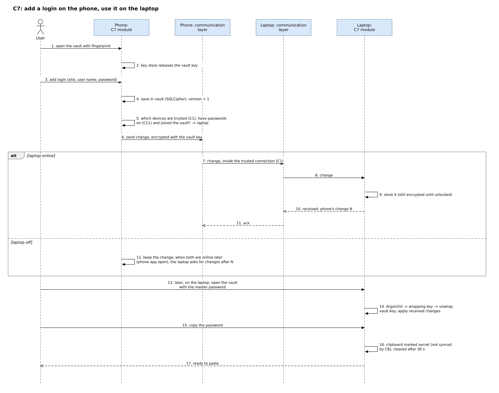

# C7: Password management (first version)

Owner: Ali. Status: first version, 8 Nov 2026. Phase 1 is design only: no code. The professor agreed that C7 stays in the report as a design. Names follow `B1-architecture-v2.md`; technology from `B6-technology-final.md`; trust from C1 v2 (draft); security rules from `C11-security-privacy.md`. **[PROPOSAL]** = a design choice or number to settle in Phase 2. **[NOT CHECKED]** = not confirmed in a primary source or by a test.

## 1. How it works in one paragraph
Each device that the user turns the feature on for keeps the same password vault, encrypted, inside the device app. The vault is opened with one master password (or a fingerprint or face on devices that have it). Changes travel only between trusted devices that joined the vault, on the local network, already encrypted with the vault key, so no server and no internet are involved. The user copies a password, or, on Android, iPhone/iPad and Mac, lets the system's AutoFill fill it in other apps.

## 2. What is stored, and where the accounts come from
- **Stored [PROPOSAL]:** logins (name, website or app, user name, password, note) and secure notes. Not in v1: payment cards, passkeys, one-time codes.
- **Typed in** by the user, with a password generator.
- **Imported from a file (recommended):** a CSV file exported by a browser or another password manager. Chrome imports `.csv` files whose first line has `url`, `username`, `password`, and warns that anyone who uses the device can open such a file [6]. So after import the app offers to delete the file.
- **Read from browsers directly: not recommended.** On Windows, Chrome 127 started "App-Bound Encryption", which ties stored secrets to Chrome so that decryption by another app fails; it covers cookies first, and Google says it may extend it to passwords [7]. Chrome on macOS, Firefox, Safari (iCloud Keychain) and the phone browsers keep their passwords in their own protected stores; reading them is [NOT CHECKED] and would need code per browser and per system.

## 3. The vault
- **File:** a second SQLite file encrypted with SQLCipher (B6 choice 5).
- **Keys [PROPOSAL; this refines B6 choice 5, which said "key from the master password, never stored"]:** at first setup the app creates a random 256-bit **vault key** and gives it to SQLCipher as a raw key, which makes SQLCipher skip its own key derivation [3]. The master password is turned into a **wrapping key** with **Argon2id, 64 MiB of memory, 3 passes, 1 thread, 16-byte random salt**: above OWASP's minimum (19 MiB, 2 passes, 1 thread [1]), and not above 64 MiB because Bitwarden warns about more on iOS [2] (Bitwarden's default is 32 MiB, 6 passes, 4 threads [2]). The wrapping key encrypts the vault key (AES-256-GCM). Each device stores the **wrapped** vault key, the salt and the settings. The master password and the wrapping key are never stored; the plain vault key is never stored **except** in the optional biometric copy below, inside the system key store. Changing the master password only re-wraps the vault key. Argon2id time on our phones (target: under 1 s) and the Dart package for it: [NOT CHECKED].
- **Locks [PROPOSAL]:** when the app closes, when the screen locks, after 5 minutes without use (desktop setting up to 30), and by a "Lock" button. Locking removes the vault key from memory; whether Dart really clears memory is [NOT CHECKED].
- **Fingerprint or face (optional, per device):** a copy of the vault key is kept in the system key store behind biometrics. On iPhone/iPad/Mac, a Keychain item with `biometryCurrentSet`, which Apple invalidates when fingers are added or removed or Face ID is set up again [4]. On Android, a Keystore key that needs strong biometrics (strong-only enforced from Android 11 [11]). Windows Hello and Linux: master password only in v1 [NOT CHECKED]. The master password is asked again after a restart and every 14 days [PROPOSAL].
- **Forgotten master password:** there is no server and no reset. (1) If any device still opens the vault with a fingerprint or face, the user sets a new master password there, and the newly wrapped key goes to the other devices. (2) At setup the app shows a **recovery code** (random, 128 bits) to print or write down; it also wraps the vault key [PROPOSAL]. (3) Without either, the vault is lost. The setup screen says this plainly.

## 4. Syncing between devices
- **Off until the user turns it on** on each device (B1 rule). A device takes part only if it is trusted (C1), the passwords feature is on for it (C11), **and** the user typed the master password there once: a new device receives the wrapped vault key and the salt from a trusted device and opens it with the master password.
- **What travels [PROPOSAL]:** each changed entry, encrypted with the vault key (AES-256-GCM, with the entry id and its version bound to the ciphertext so an old copy cannot be replayed as new), inside the trusted TLS connection. So the vault never leaves a device unencrypted (B1 decision 11).
- **Versions [PROPOSAL]:** every device numbers its own vault changes (1, 2, 3...), like C3's change numbers but one sequence per **writing** device, because every device that joined may edit. Each entry keeps the latest number it has seen from each device. A device that was switched off asks each other device for "changes after the numbers I have". A deleted entry becomes a tombstone kept 90 days; a device away longer than that receives the whole vault again, so deleted entries cannot come back.
- **One rule for two edits of the same entry [PROPOSAL]:** if two changes to an entry do not know about each other (their numbers show neither came after the other), the later edit (by its time) becomes the current entry and the other is kept in the entry's **history**, with a notice "Edited on two devices; previous version saved". Nothing is lost; clocks that differ can pick the "wrong" winner, but the other version stays in the history.
- **Phones and tablets** sync only while the app is open (B6 choice 6). A device whose vault is locked stores received changes still encrypted and applies them at unlock.

## 5. Using passwords in other apps and sites (autofill)

| System | What an app can do | v1 plan |
|---|---|---|
| Android 8+ | Be an **autofill service**: the user picks it in system settings, then it fills logins in other apps; Chrome uses it only when the user chooses "Autofill using another service" in Chrome [8] | Autofill service (native plugin) |
| iPhone/iPad 12+, macOS 11+ | A **Credential Provider extension** for AutoFill (passwords, passkeys, one-time codes); needs Apple's AutoFill entitlement [9] | Extension, native code [NOT CHECKED with Flutter] |
| Windows | Since Nov 2025, third-party managers can plug in for **passkeys**; for passwords in any app nothing like this was found [10] [NOT CHECKED] | Copy |
| Linux | No system autofill API found [NOT CHECKED] | Copy |

**Copy:** the copied password is marked secret with the formats C8 lists, so C8 never syncs it [5]. On iPhone/iPad it is set `localOnly` (not sent to other Apple devices through Handoff) with an `expirationDate` 30 s later [12]. On desktops the app clears the clipboard after 30 s while it runs; on Android the app cannot clear it once in the background, so it relies on the secret mark (Android 13+ also clears the clipboard by itself, C8) [PROPOSAL]. Universal Clipboard from a Mac: [NOT CHECKED]. A browser extension is not in v1.

## 6. Risks and protection

| Risk | Protection | What remains |
|---|---|---|
| Lost device, locked | Vault encrypted; vault key stored only wrapped (Argon2id) or behind biometrics; remove the device and change the vault key (C11 section 5) | Offline guessing of a weak master password on the lost copy |
| Stolen device, unlocked | Auto-lock after 5 min and on screen lock; showing or copying a password asks for fingerprint/face again [PROPOSAL] | What is on screen before the lock |
| Trusted device that misbehaves | Only devices that joined the vault can read; every change keeps a history; tombstones are visible | A device that joined can read every password; remove it and change important passwords |
| Malware on a device | Vault locked most of the time; key store with biometrics on phones | Malware running as the user can read memory while the vault is open, or record the master password; on Windows the key store protects from other users, and by our inference not from other programs of the same user (B6 point 6) |
| Copied vault file | Useless without the master password or recovery code | Offline guessing (slowed by Argon2id) |
| Weak master password | At least 12 characters and a strength meter [PROPOSAL]; Argon2id | A guessable password stays guessable |
| Password leak through the clipboard | Secret mark, never synced (C8); auto-clear or expiry (section 5) | Apps that read the clipboard before it is cleared, mainly on Windows and Linux |

## 7. Compared with Bitwarden (A5)
Like Bitwarden, the vault is encrypted on the device with a key that comes from the master password (Bitwarden: Argon2id or PBKDF2 [2]). Unlike Bitwarden (A5 [5]), there is **no server**: devices sync directly on the local network, so nothing goes to a cloud. **What we give up:** no web vault and no browser extension, no account recovery or emergency access by a server, no sharing with other people, and a new device can join only while a trusted device that has the vault is online.

## 8. Step-by-step: add a login on the phone, use it on the laptop
Editable source: `diagrams/C7-vault-sequence.drawio`; image: `diagrams/C7-vault-sequence.png`.

## 9. Requirements (for A8 and A9)
- FR-C7-1 The app must keep the vault in a separate SQLCipher file whose key is random and stored only wrapped by a key derived from the master password with Argon2id, or behind biometrics in the system key store.
- FR-C7-2 The app must never store or send the master password or the wrapping key, and never send the plain vault key.
- FR-C7-3 The app must lock the vault on app close, on screen lock and after 5 minutes without use.
- FR-C7-4 The app must allow fingerprint or face unlock only through the system key store, and ask for the master password after a restart.
- FR-C7-5 The app must import logins from a CSV file and offer to delete the file afterwards.
- FR-C7-6 The app must sync the vault only with trusted devices that joined the vault and have the feature switched on.
- FR-C7-7 The app must send vault changes only encrypted with the vault key, inside the trusted connection.
- FR-C7-8 The app must keep both versions when the same entry was changed on two devices.
- FR-C7-9 The app must mark copied passwords as secret, never sync them through C8, and clear them or let them expire after 30 seconds where the system allows.
- FR-C7-10 The app must show the recovery code once at setup and say that a forgotten master password cannot be reset.
- FR-C7-11 The app must open the vault with the master password in about 1 second or less on the minimum phone [to test].
- FR-C7-12 The app must not send vault data outside the local network.

## Open points and who settles them
The vault screens (D1, Mahmoud). Removing a device and changing the vault key: settled in C11 section 5. **Phase 2 tests:** Argon2id time on phones and the Dart package; memory clearing in Dart; AutoFill extensions with Flutter; Windows Hello; reading browser stores; Universal Clipboard.

## Sources (opened 8 Nov 2026; source 11 on 21 Oct 2026)
1. OWASP, Password Storage Cheat Sheet (Argon2id minimum configurations): https://cheatsheetseries.owasp.org/cheatsheets/Password_Storage_Cheat_Sheet.html
2. Bitwarden, KDF algorithms (PBKDF2 600,000; Argon2id 32 MiB, 6 iterations, 4 threads; warning above 64 MiB on iOS): https://bitwarden.com/help/kdf-algorithms/
3. Zetetic, "Using random values as SQLCipher keys" (raw key bypasses the KDF): https://www.zetetic.net/blog/2019/06/07/technical-guidance-using-random-values-as-sqlcipher-keys/
4. Apple, `SecAccessControlCreateFlags.biometryCurrentSet`: https://developer.apple.com/documentation/security/secaccesscontrolcreateflags/biometrycurrentset
5. Team files: `B6-technology-final.md` (choices 5 and 6, point 6); `C8-clipboard-sync.md` section 4 (branch `c8-final`); `C3-file-indexing.md` section 2; `research/A5-existing-systems.md` section 4 (Bitwarden); `C11-security-privacy.md`.
6. Google, "Import or export passwords with Chrome": https://support.google.com/chrome/answer/13068232
7. Google Security Blog, "Improving the security of Chrome cookies on Windows" (30 Jul 2024): https://security.googleblog.com/2024/07/improving-security-of-chrome-cookies-on.html
8. Android, "Build autofill services": https://developer.android.com/identity/autofill/autofill-services
9. Apple, `ASCredentialProviderViewController`: https://developer.apple.com/documentation/authenticationservices/ascredentialproviderviewcontroller
10. CyberInsider, "Windows 11 integrates native support for Bitwarden and 1Password" (12 Nov 2025): https://cyberinsider.com/windows-11-integrates-native-support-for-bitwarden-and-1password/
11. `flutter_secure_storage` package page (biometrics: strong-only fully enforced on API 30+): https://pub.dev/packages/flutter_secure_storage
12. Apple, `UIPasteboard.OptionsKey` (`localOnly`, `expirationDate`, `concealed`): https://developer.apple.com/documentation/uikit/uipasteboard/optionskey
