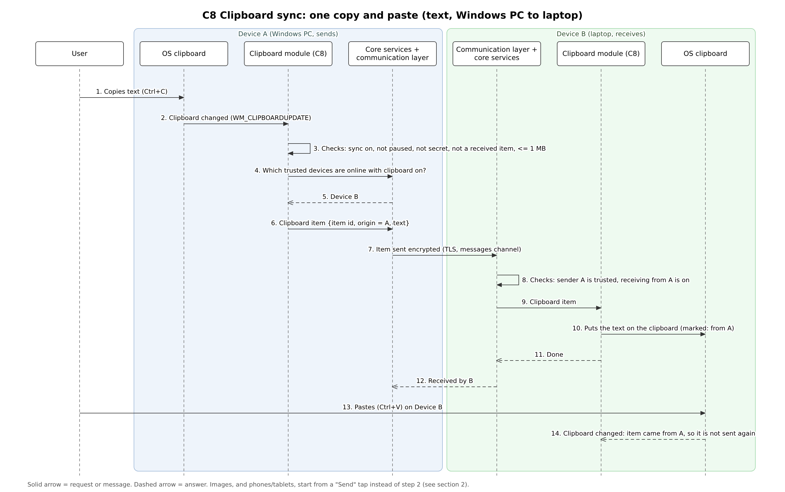

# C8: Clipboard sync (final)

Owner: Ahmed. Status: final, 29 Oct 2026 (first notes 17 Oct). Phase 1 is design only: no code.
Changed in this version: Linux row filled in, macOS and iPhone/iPad rows checked against Apple's own documentation, sequence diagram (section 6) and requirements (section 7) added.
Names follow `B1-architecture-v1.md` (device app, UI, feature module, core services, communication layer, local storage). The numbers below are our first choice and can change after review.

## 1. What is copied, and size limits
- **Text** (plain text, UTF-8) up to **1 MB**. Formatting (bold, colours, links) is dropped in v1; only the text is sent.
- **Images** (PNG or JPEG) up to **10 MB**.
- **Not synced in v1:** files and folders (that is C6, direct file sharing), rich text, and clipboard history. Only the **latest** copied item counts.
- Anything over the limit is not sent; the user sees "Too large to sync. Use file sharing (C6)".

## 2. When it syncs
- **Text: instantly** (automatically) to every trusted device that is online and has clipboard sync on. Sent over the small-messages channel.
- **Images: only when the user asks**, by tapping "Send to other devices", because they are larger. Sent over the file-transfer channel.
- **Phones and tablets: only when the user asks** (a "Send clipboard" button in the app), for both text and images, because the OS does not let a background app read the clipboard (see point 5).
- Receiving: the item is put on the receiving device's clipboard, ready to paste. A received item is **not sent on again** (it carries the id of the device it came from), so two devices do not bounce the same item back and forth.
- Clipboard sync is **off until the user turns it on** once on each device (privacy by default).

## 3. If the other device is switched off
- A switched-off (or unreachable) device **gets nothing and does not catch up later**. Nothing is stored or queued for it: an old clipboard item that appears hours later is surprising and could leak something private.
- A phone or tablet with the app closed counts as "off" (B1 open decision 12). It receives only while the app is open.
- If the user taps "Send" and no device is online, the UI says "No device online to receive it".

## 4. Pausing, and what is never synced
**Pause:** one switch in the UI on each device, with "Pause for 1 hour" or "Pause until I turn it on". The user can also turn off **sending** or **receiving** for a single device in its trusted-device settings (core services, C1).

**Never synced:**
- Anything copied from our own password manager (C7). The C7 module never hands the copied password to C8.
- Anything that another app marks as secret. Password managers mark it like this: Windows formats `ExcludeClipboardContentFromMonitorProcessing`, `Clipboard Viewer Ignore`, `CanUploadToCloudClipboard = 0`, `CanIncludeInClipboardHistory = 0`; macOS `org.nspasteboard.ConcealedType`; Android `ClipDescription.EXTRA_IS_SENSITIVE`. (Formats from CopyQ and Android docs; not checked against every password manager.)
- Anything to or from a device that is not trusted (B1 rule 2). All items are encrypted in transit (C11) and never go to the internet (B1 rule 1).
- Nothing is saved to local storage: the item lives only on the clipboard.

## 5. What each system allows

| System | Read clipboard in background (needed for automatic sending) | Write received item | Notes |
|---|---|---|---|
| **Windows** | Yes. A desktop app can register with `AddClipboardFormatListener` and is told about every change (`WM_CLIPBOARDUPDATE`). Checked (Microsoft docs). | Yes. Not checked in background. | Can see the "secret" formats above. |
| **macOS** | Possible, with a privacy alert. Apple docs: `NSPasteboard.AccessBehavior` (macOS 15.4+) says "the default behavior for the General pasteboard is to ask upon programmatic access"; after the first alert the user can set our app to Ask, Always allow or Always deny in System Settings. Access that is "user originated and paste related" (the user pastes) never shows the alert. Which macOS release turns the alert on for every user: **not checked in Apple docs**. No change notification is listed in the `NSPasteboard` docs; the app has to compare `changeCount` regularly (it "increments each time the pasteboard ownership changes"). | Yes (writing is not covered by the alert in these docs; not checked in background). | The `detectPatterns` / `detectMetadata` methods tell what kind of data is there "without notifying the person", so the UI can say "text ready to send" without an alert. |
| **Android** | **No** since Android 10: only the app in front (or the keyboard app) can read it. Checked (Android docs). Since Android 12 a message is shown each time an app reads the clipboard. Android 13 clears the clipboard automatically after some time. | Yes (not checked in background). | Sending from Android needs the user to open the app and tap "Send clipboard". |
| **iPhone / iPad** | **No.** Apple docs (`UIPasteboard`): since iOS 14 "the system notifies the user when an app gets general pasteboard content that originates in a different app without user intent"; `UIPasteControl` docs: "In iOS 16 and later, programmatic pasting raises a user alert that prompts the user for approval". `UIPasteboard.changedNotification` exists, but that it reaches a suspended app: **not checked in Apple docs**; apps are suspended in the background (B6 section 6). The per-app Ask / Allow / Deny setting (iOS 16.1): **not checked in Apple docs** (articles only). | Only while the app is open (not checked in Apple docs). Write with `localOnly` so Apple's own Universal Clipboard does not copy it on again: the docs say the general pasteboard "automatically transfers its contents to nearby devices that use the same iCloud account". | Sending needs the app open and a tap on our button; a `UIPasteControl` ("Paste") button reads the clipboard "without a user prompt". |
| **Linux (X11)** | **Yes.** X11 has no clipboard permission; the XFIXES extension sends a `SelectionNotify` event "whenever the selection ownership changes", so a background app is told about each copy. Checked (X.Org XFIXES spec). | Yes. On X11 the copied data stays in the app that owns it, so our app must keep running to serve the paste (not checked). | KDE password managers mark secret items with `x-kde-passwordManagerHint = secret`. |
| **Linux (Wayland)** | **Depends on the desktop.** The core Wayland protocol gives the clipboard to an app only around keyboard focus (checked through a summary of the protocol page, not word for word). Clipboard managers use the `ext-data-control-v1` protocol ("allows a privileged client ... to take the role of a clipboard manager"). Supported by KWin 6.7 (KDE), Sway, Hyprland, COSMIC, niri, labwc and others; **not by Mutter (GNOME)**, per the wayland.app support table. So on Ubuntu 24.04 (GNOME on Wayland, B6's suggested test desktop) automatic sending does not work: tap to send only (not tested). | Yes while our window has focus; in background only through `ext-data-control-v1` (not checked). | The older `wlr-data-control` protocol is marked deprecated. |

**Result:** automatic sending works from Windows, Linux on X11 and Linux on KDE/Sway-type Wayland desktops, and from macOS after the user allows it once ("Always allow"). GNOME on Wayland, Android and iPhone/iPad send only on a tap; phones and tablets also receive only while the app is open. Each device advertises a "can sync clipboard in background" capability (B1 rule 5) so the UI offers the right buttons.

## 6. One copy and paste, step by step
Diagram: `diagrams/C8-clipboard-sequence.drawio` (PNG export next to it). Example: text copied on a Windows PC, pasted on a laptop.

- Step 1: The user copies text on Device A.
- Step 2: The OS tells our clipboard module (Windows: `WM_CLIPBOARDUPDATE`).
- Step 3: The module checks: sync is on, not paused, the item is not marked secret, it is not an item we just received, and it is 1 MB or less.
- Steps 4-5: It asks core services which trusted devices are online with clipboard receiving on (here: Device B).
- Steps 6-7: The communication layer sends the item (item id, origin device id, text) to B over the encrypted messages channel.
- Step 8: B's core services check that A is trusted and that receiving from A is on.
- Steps 9-10: B's clipboard module puts the text on B's clipboard, marked as coming from A.
- Steps 11-12: B answers "received" (A can show "Sent to laptop").
- Steps 13-14: The user pastes on B. B's module sees the clipboard change, but the item came from A, so it is not sent again.

Images and phones/tablets follow the same steps, but step 2 is the user's "Send" tap.

## 7. Requirements
1. The app must keep clipboard sync off until the user turns it on, on each device.
2. The app must send copied text of up to 1 MB to every trusted, online device that has clipboard receiving on, without the user doing anything more (where the OS allows it, section 5).
3. The app must send an image (PNG or JPEG, up to 10 MB) only when the user taps "Send to other devices".
4. The app must offer a "Send clipboard" button on every device, and use it as the only way to send on Android, iPhone/iPad and GNOME on Wayland.
5. The app must refuse items over the size limit and show "Too large to sync. Use file sharing (C6)".
6. The app must never send items copied from our password manager (C7) or items another app marks as secret (section 4).
7. The app must send clipboard items only to trusted devices, only over the local network, and only encrypted (B1 rules 1 and 2, C11).
8. The app must check, on the receiving device, that the sender is trusted and that receiving from that sender is on.
9. The app must put a received item on the clipboard, ready to paste, and must not send it on again.
10. The app must not store or queue items for devices that are off or unreachable, and must not save clipboard items to local storage.
11. The app must tell the user "No device online to receive it" when nothing could receive a tapped "Send".
12. The app must let the user pause sync for 1 hour or until turned back on, and turn sending or receiving off per device.
13. The app must advertise whether the device can sync the clipboard in the background (B1 rule 5), so the other devices' UI shows the right buttons.
14. The app must, on iPhone/iPad, write received items as local only, so Universal Clipboard does not copy them on again.

## Open points and who settles them
- Encryption and per-feature permission for clipboard (C11, Ali).
- Phones in the background (B1 decision 12, B6): if B6 finds a way, phones could receive in the background.
- Do the size limits fit the chosen communication library (B6)?

## Sources
Read 17 Oct 2026 (first notes) and 29 Oct 2026 (this version). Apple and Android pages read as text from the official docs; wayland.app read through a summary.
- Android: https://developer.android.com/privacy-and-security/risks/secure-clipboard-handling
- Windows: https://learn.microsoft.com/en-us/windows/win32/dataxchg/using-the-clipboard
- macOS, Apple `NSPasteboard`: https://developer.apple.com/documentation/appkit/nspasteboard
- macOS, Apple `NSPasteboard.AccessBehavior`: https://developer.apple.com/documentation/appkit/nspasteboard/accessbehavior-swift.enum
- macOS, Apple `changeCount`: https://developer.apple.com/documentation/appkit/nspasteboard/changecount
- iOS, Apple `UIPasteboard`: https://developer.apple.com/documentation/uikit/uipasteboard
- iOS, Apple `UIPasteControl`: https://developer.apple.com/documentation/uikit/uipastecontrol
- iOS, Apple `changedNotification`: https://developer.apple.com/documentation/uikit/uipasteboard/changednotification
- Linux X11, XFIXES protocol: https://www.x.org/releases/current/doc/fixesproto/fixesproto.txt
- Linux Wayland, `ext-data-control-v1` and support table: https://wayland.app/protocols/ext-data-control-v1
- Linux Wayland, core `wl_data_device`: https://wayland.app/protocols/wayland#wl_data_device
- GNOME request for data-control support: https://gitlab.gnome.org/GNOME/mutter/-/issues/524
- Secret clipboard formats: https://copyq-de.readthedocs.io/de/stable/security.html
- Replaced by Apple docs above (kept for the record): https://mjtsai.com/blog/2025/05/12/pasteboard-privacy-preview-in-macos-15-4, https://sarunw.com/posts/uipasteboard-privacy-change-ios16/, https://www.macstories.net/linked/ios-and-ipados-16-1-betas-add-per-app-clipboard-access-permissions-to-the-settings-app/ (only source left for the iOS 16.1 per-app setting)
