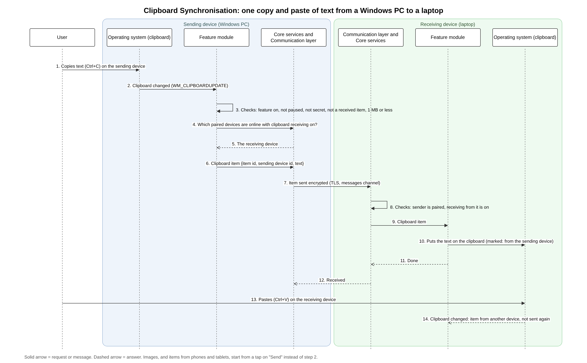

# Clipboard Synchronisation

## 1. What the user sees and gains

Clipboard Synchronisation lets the user copy text on one of their devices and paste it on another, without e-mailing it to themselves or retyping it. When the user copies text on a computer, the text is ready to paste on their other paired devices a moment later. Pictures and anything copied on a phone or tablet are sent with one tap on a "Send" button.

The user stays in control at all times:

- The feature is off until the user turns it on, separately on each device.
- The user can pause it for an hour or until they turn it back on, and can stop sending to, or receiving from, any single device.
- Passwords and other items that apps mark as secret are never sent.
- Items travel only between the user's own paired devices on the local network, always encrypted, and are never stored.

## 2. What is copied, and the size limits

- **Text:** plain text (UTF-8) up to 1 MB. Formatting such as bold, colours and links is dropped in the first release; only the text is sent.
- **Images:** PNG or JPEG up to 10 MB.
- **Not synchronised in the first release:** files and folders (these are sent with Direct File Sharing), rich text and clipboard history. Only the latest copied item counts.
- An item over the limit is not sent, and the user sees "Too large to sync. Use file sharing".

## 3. When an item is sent

- **Text** is sent automatically, at once, to every paired device that is online and has Clipboard Synchronisation turned on. It travels over the channel for small messages.
- **Images** are sent only when the user taps "Send to other devices", because they are larger. They travel over the file-transfer channel.
- **On phones and tablets** both text and images are sent only when the user taps "Send clipboard" in the app, because these systems do not let an app read the clipboard in the background (section 6).
- **On the receiving device** the item is placed on the clipboard, ready to paste. A received item carries the identifier of the device it came from and is not sent on again, so two devices never pass the same item back and forth.

## 4. When the other device is switched off

- A device that is switched off or cannot be reached receives nothing and does not catch up later. Nothing is stored or queued for it, because an old clipboard item that appears hours later would be surprising and could reveal something private.
- A phone or tablet whose app is closed counts as switched off: it receives items only while the app is open.
- If the user taps "Send" and no device is online, the tool shows "No device online to receive it".

## 5. Pausing, and what is never sent

**Pausing.** Each device has one switch with two choices: "Pause for 1 hour" and "Pause until I turn it on". In the settings of each paired device the user can also turn off sending to it or receiving from it.

**Never sent:**

- Anything copied from the tool's own Password Management. The password store never passes a copied password to Clipboard Synchronisation.
- Anything that another app marks as secret. Password managers mark such items with special clipboard formats: on Windows `ExcludeClipboardContentFromMonitorProcessing`, `Clipboard Viewer Ignore`, `CanUploadToCloudClipboard = 0` and `CanIncludeInClipboardHistory = 0`; on macOS `org.nspasteboard.ConcealedType`; on Android `ClipDescription.EXTRA_IS_SENSITIVE`; on Linux with KDE `x-kde-passwordManagerHint = secret`.
- Anything to or from a device that is not paired. Every item is encrypted on its way and never leaves the local network.

Nothing is saved to local storage: an item lives only on the clipboard.

## 6. What each operating system allows

To send automatically, the tool must notice a copy while it runs in the background. To receive, it must write the item to the clipboard.

| Operating system | Reading the clipboard in the background | Writing a received item | Notes |
|---|---|---|---|
| **Windows** | Allowed. A desktop app registers with `AddClipboardFormatListener` and receives a `WM_CLIPBOARDUPDATE` message on every change. | Allowed. | The tool can see the secret formats listed in section 5. |
| **macOS** | Allowed after the user agrees. From macOS 15.4 the system asks the user the first time an app reads the clipboard by program; the user can then set the tool to Ask, Always allow or Always deny in System Settings. A paste started by the user never shows this alert. macOS gives no change notification, so the app compares the pasteboard's `changeCount` at short intervals. | Allowed; writing is not covered by the alert. | The `detectPatterns` and `detectMetadata` methods tell the tool what kind of data is waiting without alerting the user, so the tool can show "Text ready to send" without an alert. |
| **Android** | Not allowed since Android 10: only the app in front, or the keyboard app, can read the clipboard. Since Android 12 the system shows a message each time an app reads it, and Android 13 clears it automatically after some time. | Allowed. | Sending from Android needs the user to open the app and tap "Send clipboard". |
| **iPhone and iPad** | Not allowed. Since iOS 14 the system tells the user when an app reads content copied in another app, and since iOS 16 reading by program shows an alert that asks for approval. Apps are suspended in the background. | Only while the app is open. The item is written as "local only", so that Apple's own Universal Clipboard does not copy it on to the user's other Apple devices. | Sending needs the app open and a tap. A system "Paste" button (`UIPasteControl`) reads the clipboard without an alert. |
| **Linux with X11** | Allowed. X11 has no clipboard permission, and the XFIXES extension tells an app each time the clipboard owner changes. | Allowed. On X11 the copied data stays with the app that owns it, so the tool keeps running to serve the paste. | |
| **Linux with Wayland** | Depends on the desktop. The core Wayland protocol gives the clipboard to an app only while it has keyboard focus. Clipboard managers use the `ext-data-control-v1` protocol, which KDE (KWin 6.7), Sway, Hyprland, COSMIC, niri, labwc and others support, but GNOME does not. On Ubuntu 24.04, which uses GNOME on Wayland, the user therefore taps to send. | Allowed while the tool's window has focus; in the background only through `ext-data-control-v1`. | The older `wlr-data-control` protocol is deprecated. |

**Result.** Automatic sending works from Windows, from Linux on X11, from Linux on Wayland desktops such as KDE and Sway, and from macOS once the user chooses "Always allow". GNOME on Wayland, Android, iPhone and iPad send only when the user taps; phones and tablets also receive only while the app is open. Each device tells the other devices whether it can read the clipboard in the background, so every device shows the right buttons.

## 7. One copy and paste, step by step

The diagram shows text copied on a Windows PC (the sending device) and pasted on a laptop (the receiving device).

1. The user copies text on the sending device.
2. The operating system tells the feature module that the clipboard has changed (on Windows with `WM_CLIPBOARDUPDATE`).
3. The feature module checks that the feature is on and not paused, that the item is not marked secret, that it is not an item just received, and that it is 1 MB or smaller.
4. and 5. The feature module asks the core services which paired devices are online and have clipboard receiving on; here, the laptop.
6. and 7. The communication layer sends the item (its identifier, the identifier of the sending device and the text) to the laptop over the encrypted messages channel.
8. The laptop's core services check that the sending device is paired and that receiving from it is on.
9. and 10. The laptop's feature module places the text on the clipboard and marks it as coming from the sending device.
11. and 12. The laptop confirms receipt, so the sending device can show "Sent to laptop".
13. and 14. The user pastes on the laptop. The laptop's feature module sees the clipboard change, but the item came from another device, so it is not sent again.

Images, and items from phones and tablets, follow the same steps, except that step 2 is the user's tap on "Send".

## 8. Requirements

1. The tool must keep Clipboard Synchronisation off until the user turns it on, on each device.
2. The tool must send copied text of up to 1 MB to every paired, online device that has clipboard receiving on, without any further action by the user, where the operating system allows it (section 6).
3. The tool must send an image (PNG or JPEG, up to 10 MB) only when the user taps "Send to other devices".
4. The tool must offer a "Send clipboard" button on every device and use it as the way to send on Android, iPhone, iPad and GNOME on Wayland, where reading the clipboard in the background is not allowed.
5. The tool must refuse items over the size limit and show "Too large to sync. Use file sharing".
6. The tool must never send items copied from its own Password Management, or items that another app marks as secret.
7. The tool must send clipboard items only to paired devices, only over the local network and only encrypted.
8. The tool must check, on the receiving device, that the sender is paired and that receiving from that sender is on.
9. The tool must place a received item on the clipboard, ready to paste, and must not send it on again.
10. The tool must not store or queue items for devices that are switched off or unreachable, and must not save clipboard items to local storage.
11. The tool must show "No device online to receive it" when no device could receive an item the user sent with "Send".
12. The tool must let the user pause the feature for one hour or until it is turned back on, and turn sending or receiving off for each device.
13. The tool must tell the other devices whether this device can read the clipboard in the background, so that they show the right buttons.
14. The tool must, on iPhone and iPad, write received items as "local only", so that Universal Clipboard does not copy them on again.

## 9. Limits and points still to verify

The following points come from the documentation alone and have not yet been verified in a test or a primary source:

- macOS: in which release the clipboard alert is turned on for every user.
- macOS: whether there is any way to keep a received item out of Universal Clipboard; Apple's `NSPasteboard` documentation lists none.
- iPhone and iPad: whether `UIPasteboard.changedNotification` reaches a suspended app; the per-app Ask, Allow and Deny setting of iOS 16.1 (described only in articles); which value of the `localOnly` option keeps an item out of Universal Clipboard, since Apple's wording is unclear.
- Writing a received item while the app is in the background, on every system.
- Linux with X11: that the tool must keep running to serve a paste.
- Linux with Wayland: the core protocol rule, read through a summary of the protocol page; writing in the background through `ext-data-control-v1`; tap-to-send on Ubuntu 24.04 with GNOME.
- That every password manager uses the secret clipboard formats listed in section 5.

## 10. Open points

| Point | Settled by |
|---|---|
| Encryption and the per-feature permission for Clipboard Synchronisation | Security and Privacy design |
| Phones in the background: if a way is found, phones could also receive in the background | Architecture and Technology Choices |
| Whether the size limits fit the chosen communication library | Technology Choices |

## References

Pages were read on 17 and 29 October 2026. Apple and Android pages were read from the official documentation; the wayland.app page was read through a summary.

1. Android Developers, "Secure clipboard handling": https://developer.android.com/privacy-and-security/risks/secure-clipboard-handling
2. Microsoft, "Using the Clipboard": https://learn.microsoft.com/en-us/windows/win32/dataxchg/using-the-clipboard
3. Apple, `NSPasteboard`: https://developer.apple.com/documentation/appkit/nspasteboard
4. Apple, `NSPasteboard.AccessBehavior`: https://developer.apple.com/documentation/appkit/nspasteboard/accessbehavior-swift.enum
5. Apple, `changeCount`: https://developer.apple.com/documentation/appkit/nspasteboard/changecount
6. Apple, `UIPasteboard`: https://developer.apple.com/documentation/uikit/uipasteboard
7. Apple, `UIPasteControl`: https://developer.apple.com/documentation/uikit/uipastecontrol
8. Apple, `UIPasteboard.changedNotification`: https://developer.apple.com/documentation/uikit/uipasteboard/changednotification
9. X.Org, XFIXES protocol: https://www.x.org/releases/current/doc/fixesproto/fixesproto.txt
10. wayland.app, `ext-data-control-v1` and its support table: https://wayland.app/protocols/ext-data-control-v1
11. wayland.app, core `wl_data_device`: https://wayland.app/protocols/wayland#wl_data_device
12. GNOME, request for data-control support in Mutter: https://gitlab.gnome.org/GNOME/mutter/-/issues/524
13. CopyQ documentation, secret clipboard formats: https://copyq-de.readthedocs.io/de/stable/security.html
14. Earlier articles, replaced by Apple's documentation above: https://mjtsai.com/blog/2025/05/12/pasteboard-privacy-preview-in-macos-15-4 ; https://sarunw.com/posts/uipasteboard-privacy-change-ios16/ ; https://www.macstories.net/linked/ios-and-ipados-16-1-betas-add-per-app-clipboard-access-permissions-to-the-settings-app/ (the only source for the per-app setting of iOS 16.1)
15. Project report: Architecture (rules on trust, the local network and device capabilities, and the open point on phones in the background); Technology Choices (background limits on phones); Security and Privacy; Direct File Sharing; Password Management.
