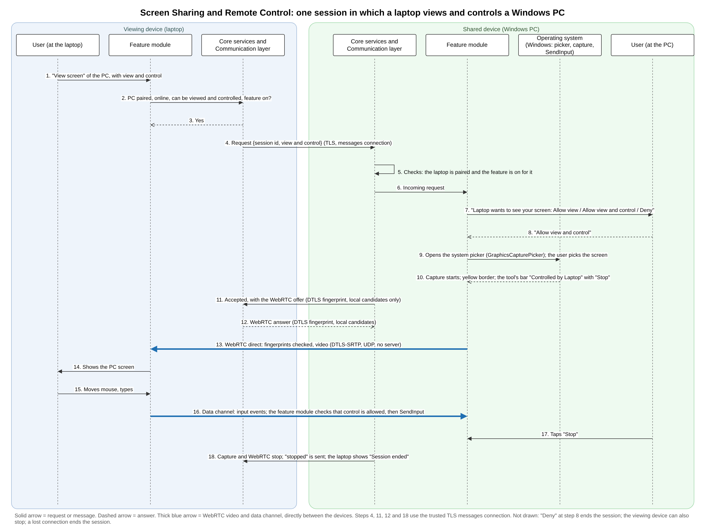

# Screen Sharing and Remote Control

## 1. What the user sees and gains

Screen Sharing and Remote Control lets the user see the screen of one of their devices on another device and, where the system allows it, use that device's mouse and keyboard from a distance. For example, the user can sit at a laptop and work on the desktop PC in another room, or look at a phone's screen on a large monitor.

Two devices take part. The **shared device** is the one whose screen is shown. The **viewing device** is the one that watches and, if allowed, controls.

The user stays in control at all times:

- A session starts only when a person at the shared device accepts it, every time. Nobody can watch a device that nobody is sitting at.
- Viewing and control are asked for separately: "Allow view", "Allow view and control" or "Deny".
- While a session runs, the shared device always shows a bar such as "Being viewed by Laptop" or "Controlled by Laptop", with a **Stop** button that ends the session at once.
- Only the picture is sent, never sound, and nothing is recorded or stored.
- The stream travels only between the user's own paired devices on the local network, encrypted, with no server in between.

## 2. What each operating system requires

Each system has its own rules for (a) capturing the screen and (b) accepting mouse and keyboard input from another device.

| Operating system | (a) Capturing the screen | (b) Accepting mouse and keyboard from another device |
|---|---|---|
| **Windows** | `Windows.Graphics.Capture`: the user picks the screen or window in a secure system picker (`GraphicsCapturePicker`), and the system draws a yellow border around what is being captured. The older Desktop Duplication API has no picker and no border, and cannot capture the secure desktop. The tool uses the picker, so the user always sees the border. | No permission is needed. `SendInput` injects input, but only into programs at the same or a lower integrity level, so windows that run as administrator cannot be controlled. User Account Control prompts appear on the secure desktop, which only Windows itself can access, so the person at the PC must answer them. |
| **macOS** | The **Screen & System Audio Recording** permission, which the user turns on for each app in System Settings. After the first approval the app must be restarted before it can capture. From macOS 14 the system picker `SCContentSharingPicker` is Apple's recommended way to choose what is shared. | The **Accessibility** permission. The system alerts the user when an app tries to control the Mac, and the user must grant access in Privacy & Security. |
| **Linux** | On X11 there is no permission beyond being allowed to connect to the display, so no dialog is shown. On Wayland the system shows a dialog each time, through the ScreenCast portal of xdg-desktop-portal. | On X11 the XTEST extension creates input events "almost as if a cooperative user had moved the pointing device or pressed a key", with no access control beyond the connection. On Wayland the same kind of dialog is shown, through the RemoteDesktop portal. |
| **Android** | **MediaProjection**: the user must agree before each session, and each approval can be used once. A foreground service of type `mediaProjection` is required. From Android 14 the user can share one app instead of the whole screen. The session ends when the screen locks, when the user taps the system's status bar chip, or when another projection starts. | An **accessibility service** that the user turns on in Settings. It performs taps and swipes with `dispatchGesture` (from Android 7, the minimum version of the tool) "as if it were performed directly on the screen by a user". Google Play requires a prominent disclosure inside the app and a clear action by the user to agree. The Play policy forbids apps that act on their own and allows fixed, rule-based automation; control in this tool is always done live by a person. |
| **iPhone and iPad** | From iOS 15 to iOS 26: only a broadcast that the user starts from the system broadcast button (`RPSystemBroadcastPickerView`, ReplayKit). From iOS 27, ScreenCaptureKit replaces ReplayKit for screen streaming, needs no broadcast extension, offers the system picker `SCContentSharingPicker` and allows capture while the app is in the background. The tool uses ReplayKit on iOS 15 to 26 and ScreenCaptureKit from iOS 27. The `flutter_webrtc` library supports both. | **Not possible.** No public way exists to inject touches or keys. An iPhone or iPad can only be viewed, or act as the viewing device. |

**Signs that the system itself shows on the shared device:**

- Windows: a yellow border around the captured screen or window.
- Android 15 QPR1 and later: a large status bar chip, which the user can tap to stop.
- macOS: Apple's menu bar shows privacy indicators, but its documentation describes no indicator for screen recording, so the tool relies on its own bar (section 5).
- iPhone and iPad: no sign is described in Apple's developer pages.

**Result.** Every system can be viewed after the user on the shared device approves. Control works on Windows, macOS, Linux and Android (on Android only after the user turns on the accessibility service). iPhone and iPad can be viewed but not controlled. Each device tells the others whether it can be viewed and whether it can be controlled, so the viewing device offers only what is possible.

## 3. Why the video has its own connection

Video is large and never stops. If it shared the encrypted connection used for messages, one large frame could hold up a clipboard item or a "Stop" command behind it. The design therefore keeps live streams on their own connection. The request, the answer, "Stop" and the setup messages for the stream stay on the normal messages connection, with the same trust as every other message. Mouse and keyboard events travel with the stream (section 4).

## 4. How the stream is sent: WebRTC

The Technology Choices chapter decided that live streams use **WebRTC**, set up over the tool's existing trusted messages connection. This design follows that decision.

**Why WebRTC.** WebRTC already provides what a live stream needs and would otherwise have to be built: video compression; sending over UDP, so that a lost packet does not freeze the picture (the encrypted messages connection runs over TCP, which waits for every lost packet); lower quality when the Wi-Fi is slow; and a data channel for mouse and keyboard events. The `flutter_webrtc` library supports screen capture on all five systems, and the experience of the RustDesk project shows that a home-made stream is a large amount of work.

**How it keeps the tool's rules:**

- **Who may start a session.** The setup messages (the offer, the answer and the network candidates) travel only over the trusted messages connection. Only a paired, authenticated device can therefore start a session, and only after the user on the shared device accepts (section 5).
- **Encryption.** WebRTC encrypts with its own DTLS key. The fingerprint of that key is sent inside the setup messages, over the trusted connection. The WebRTC standard reports the connection as "connected" only after it has checked that the other side's certificate matches this fingerprint, and reports a `fingerprint-failure` otherwise. Trust therefore still comes from pairing.
- **No internet.** No STUN or TURN servers are used, and in the WebRTC standard the server list is empty by default. Only local-network candidates are used, and devices on the same network connect directly. If two devices cannot reach each other directly (for example on a guest Wi-Fi that separates devices), there is no relay, and the tool shows "Cannot start the stream on this network".
- **Control events** travel on a WebRTC data channel (reliable and in order) beside the video, with the same low delay and the same encryption. The shared device accepts them only if its user chose "Allow view and control" for this session.

**Stream settings (to be tuned in Phase 2).** Video only, without sound, in the first release; at most the size of the shared screen and at most 1920 × 1080; up to 30 frames per second. Targets: the picture appears within 5 seconds after the user accepts; the delay from screen to viewer is under 200 ms on the same Wi-Fi; "Stop" ends capture within 1 second. These targets have not been measured yet.

**What is given up.** WebRTC makes the app larger and adds a second layer of encryption. WebRTC without any internet connection, and the size it adds, are tested in Phase 2.

**Fallback.** If WebRTC fails the Phase 2 tests, the tool sends compressed frames (for example JPEG) over its own encrypted connection. This is simpler, but slower and with more delay.

## 5. What is shared, when, and what the user sees

- **What is shared.** Only the screen picture, never sound, in the first release. The user of the shared device picks the whole screen or one window or app in the system picker, where the system has one (Windows, macOS 14 and later, Android 14 and later, Linux on Wayland, iOS 27 and later). Control is a separate choice and is off by default.
- **When.** Only between paired devices, only if Screen Sharing and Remote Control is turned on for the viewing device, and only when the user on the shared device accepts the request, every time: "Laptop wants to see your screen: Allow view / Allow view and control / Deny". There is no unattended access in the first release. "Allow view and control" is not offered when the shared device cannot be controlled (iPhone, iPad, or Android without the accessibility service).
- **When a device switches off, sleeps, locks or leaves the network.** The stream stops and the viewing device shows "Connection lost" over the last picture. Nothing is recorded, queued or stored. The viewing device tries again for 30 seconds; after that a new request and a new approval are needed. Android ends capture when the screen locks. The tool cannot switch a device on from a distance.
- **What the user sees on the shared device.** The system's own sign where there is one (section 2), and the tool's own bar, always on top: "Being viewed by Laptop" or "Controlled by Laptop", with a **Stop** button. On Android, Stop is also on the notification. Stop works at once. The local mouse and keyboard keep working during control.

## 6. One session, step by step

The diagram shows a laptop (the viewing device) that views and controls a Windows PC (the shared device).

1. On the laptop, the user chooses "View screen" for the PC and asks for view and control.
2. and 3. The laptop's feature module asks the core services whether the PC is paired and online, whether it can be viewed and controlled, and whether the feature is on. The answer is yes.
4. The request (a session identifier and "view and control") goes to the PC over the trusted messages connection.
5. The PC's core services check that the laptop is paired and that the feature is turned on for it.
6. and 7. The PC's feature module shows its user "Laptop wants to see your screen: Allow view / Allow view and control / Deny".
8. The PC's user chooses "Allow view and control".
9. and 10. The system picker opens (on Windows, `GraphicsCapturePicker`) and the user picks the screen. Capture starts, Windows draws its yellow border, and the tool's bar shows "Controlled by Laptop" with Stop.
11. and 12. The PC sends "accepted" and the WebRTC offer, with its DTLS fingerprint and local candidates only, over the messages connection. The laptop answers in the same way.
13. The WebRTC connection opens directly between the two devices. Each side checks that the DTLS fingerprint matches the one in the setup messages. The video flows encrypted over UDP, with no server.
14. The laptop shows the PC's screen.
15. and 16. The laptop's user moves the mouse or types. The events travel on the data channel; the PC's feature module checks that control was allowed in this session and passes them to Windows (`SendInput`).
17. and 18. The PC's user taps Stop. Capture and WebRTC stop at once, "stopped" is sent over the messages connection, and the laptop shows "Session ended".

Not drawn: if the PC's user chooses **Deny** at step 8, the PC answers "denied" and nothing is captured. If the viewing device stops, the same as steps 17 and 18 happens from the other side. If the connection is lost, both sides end the session as described in section 5.

Other systems follow the same steps; only the picker and the input call change (section 2). When an iPhone or iPad is the shared device, step 9 is the system broadcast button (iOS 15 to 26), and "Allow view and control" is not offered.

## 7. Requirements

1. The tool must keep Screen Sharing and Remote Control off until the user turns it on, for each device.
2. The tool must start a session only between paired devices, and only after the user on the shared device accepts that request; there is no unattended access.
3. The tool must ask for viewing and for control separately ("Allow view / Allow view and control / Deny") and must not offer control on a device that cannot be controlled (iPhone, iPad, and Android without the accessibility service).
4. The tool must let the user of the shared device choose the whole screen or one window or app through the system picker, where the system has one (Windows, macOS 14 and later, Android 14 and later, Linux on Wayland, iOS 27 and later).
5. The tool must tell the other devices whether a device can be viewed and whether it can be controlled.
6. The tool must send the stream with WebRTC, set up only over the trusted messages connection, with no STUN or TURN server and only local-network candidates.
7. The tool must check that the WebRTC DTLS fingerprint matches the one received over the trusted connection, and must end the session if it does not.
8. The tool must send the request, the answer, Stop and the WebRTC setup messages on the messages connection, and the video on its own connection.
9. The tool must accept mouse and keyboard events only from the viewing device of the current session, and only if the user allowed control for that session.
10. The tool must show on the shared device, for the whole session, a bar that is always on top with "Being viewed by ..." or "Controlled by ..." and a Stop button.
11. The tool must end capture and the stream within 1 second after Stop is tapped on either device.
12. The tool must keep the local mouse and keyboard working during remote control.
13. The tool must share only the picture, never sound, in the first release.
14. The tool must not record, store or queue screen pictures.
15. The tool must stop the session when either device switches off, sleeps, locks or leaves the network, show "Connection lost", and ask for a new approval after 30 seconds.
16. The tool must show "Cannot start the stream on this network" when the two devices cannot reach each other directly.
17. The tool must, on Android, show the disclosure that Google Play requires before the user turns on the accessibility service for control.

## 8. Limits and points still to verify

No member of the team has a Mac, an iPhone build environment or a Linux machine, so the macOS, iPhone, iPad and Linux points below come from the documentation and the design review. The following points have not yet been verified in a test or a primary source:

- Windows: whether the lock screen behaves like the secure desktop (assumed so).
- macOS: whether the system asks for screen recording permission again from time to time, and whether posting mouse and keyboard events (`CGEvent.post`) needs exactly the Accessibility permission; Apple's pages for `CGRequestPostEventAccess` and `CGPreflightPostEventAccess` have no description.
- Linux on X11: that nothing beyond the connection rule is asked before reading the screen (this is the reading of the X.Org security page).
- Android: whether Google Play accepts an accessibility service used for remote control, and typing text through it.
- Android before 15 QPR1, macOS, iPhone and iPad: what sign the system shows during capture.
- iPhone and iPad: the memory and time limits of a broadcast extension.
- WebRTC: that `flutter_webrtc`, built on Google's WebRTC library, checks the fingerprint as the standard says, and whether it hides local addresses behind `.local` (mDNS) names.
- The start time, delay and Stop targets in section 4.

## 9. Open points

| Point | Settled by |
|---|---|
| WebRTC with no internet at all, the app size it adds, and whether screen streaming needs native code | Technology Choices; Phase 2 test |
| Fingerprint check and `.local` candidates in `flutter_webrtc` | Technology Choices; Phase 2 test |
| Names of the capability flags: "can be viewed", "can be controlled", "can view", and "view needs the broadcast button" (iPhone and iPad, iOS 15 to 26) | Device Discovery, Pairing and Trust |
| macOS: the permission for posting events, and repeated screen recording approval | Phase 2 test on a Mac, if one becomes available |
| iPhone and iPad: the system sign during a broadcast and the limits of the broadcast extension | Phase 2 test on an iPhone, if a Mac becomes available |
| Google Play acceptance of the accessibility service, and typing text on Android | Phase 2 |
| Start time, delay and Stop time | Phase 2 test (Evaluation Plan) |

## References

Pages were read on 29 October and 8 November 2026. Apple developer pages were read from Apple's documentation data; Apple Support, Microsoft, X.Org and Google Play pages were read through a page reader.

1. Microsoft, "Screen capture": https://learn.microsoft.com/en-us/windows/apps/develop/media-authoring-processing/screen-capture
2. Microsoft, `SendInput`: https://learn.microsoft.com/en-us/windows/win32/api/winuser/nf-winuser-sendinput
3. Microsoft, Desktop Duplication API and `DuplicateOutput`: https://learn.microsoft.com/en-us/windows/win32/direct3ddxgi/desktop-dup-api and https://learn.microsoft.com/en-us/windows/win32/api/dxgi1_2/nf-dxgi1_2-idxgioutput1-duplicateoutput
4. Microsoft, "How User Account Control works": https://learn.microsoft.com/en-us/windows/security/application-security/application-control/user-account-control/how-it-works
5. Apple, ScreenCaptureKit (iOS 27, replacement of ReplayKit, background modes): https://developer.apple.com/documentation/screencapturekit
6. Apple, `SCContentSharingPicker`: https://developer.apple.com/documentation/screencapturekit/sccontentsharingpicker
7. Apple, "Capturing screen content in macOS" (restart after permission): https://developer.apple.com/documentation/screencapturekit/capturing-screen-content-in-macos
8. Apple, `CGRequestPostEventAccess` and `CGEvent.post(tap:)`: https://developer.apple.com/documentation/coregraphics/cgrequestposteventaccess() and https://developer.apple.com/documentation/coregraphics/cgevent/post(tap:)
9. Apple, `AXIsProcessTrusted`: https://developer.apple.com/documentation/applicationservices/1460720-axisprocesstrusted
10. Apple Support, "Control access to screen and system audio recording on Mac": https://support.apple.com/guide/mac-help/control-access-screen-system-audio-recording-mchld6aa7d23/mac
11. Apple Support, "Allow accessibility apps to access your Mac": https://support.apple.com/guide/mac-help/allow-accessibility-apps-to-access-your-mac-mh43185/mac
12. Apple Support, "What's in the menu bar on Mac?" (privacy indicators): https://support.apple.com/guide/mac-help/use-the-menu-bar-mchlp1446/mac
13. Apple Support, "Take a screen recording on iPhone" (the body could not be read): https://support.apple.com/guide/iphone/take-a-screen-recording-iph52f6e1987/ios
14. Apple, ReplayKit, `RPSystemBroadcastPickerView`, `RPBroadcastSampleHandler`, `RPScreenRecorder`, `RPBroadcastController`: https://developer.apple.com/documentation/replaykit and https://developer.apple.com/documentation/replaykit/rpsystembroadcastpickerview
15. Android Developers, "Media projection" (consent, status bar chip, stop on lock): https://developer.android.com/media/grow/media-projection
16. Android Developers, `AccessibilityService.dispatchGesture`: https://developer.android.com/reference/android/accessibilityservice/AccessibilityService
17. Google Play, Accessibility API policy: https://support.google.com/googleplay/android-developer/answer/10964491
18. X.Org, XTEST protocol and Xsecurity: https://www.x.org/releases/current/doc/xextproto/xtest.html and https://www.x.org/releases/current/doc/man/man7/Xsecurity.7.xhtml
19. xdg-desktop-portal, RemoteDesktop portal: https://flatpak.github.io/xdg-desktop-portal/docs/doc-org.freedesktop.portal.RemoteDesktop.html
20. W3C, WebRTC 1.0 (`RTCDtlsTransportState`, `fingerprint-failure`, `iceServers`), editor's draft source: https://github.com/w3c/webrtc-pc/blob/main/webrtc.html
21. `flutter_webrtc` package, README and wiki page "iOS Screen Sharing": https://pub.dev/packages/flutter_webrtc , https://github.com/flutter-webrtc/flutter-webrtc and https://github.com/flutter-webrtc/flutter-webrtc/wiki/iOS-Screen-Sharing
22. RustDesk, remote control on Android and iOS: https://rustdesk.com/blog/rustdesk-remote-control-android-ios
23. LogMeIn, macOS permissions for a remote-control host (source of the claim that macOS asks again): https://support.logmeininc.com/pro/help/why-cant-i-connect-to-my-mac-running-on-macos-ventura-and-sonoma
24. Project report: Technology Choices, final version (choice of WebRTC and its open tests); Security and Privacy (approval every time, no stored frames); Device Discovery, Pairing and Trust (authenticated connection, capability flags); Architecture (rules on trust, the local network and device capabilities, and the open point on a Mac for Apple builds).
