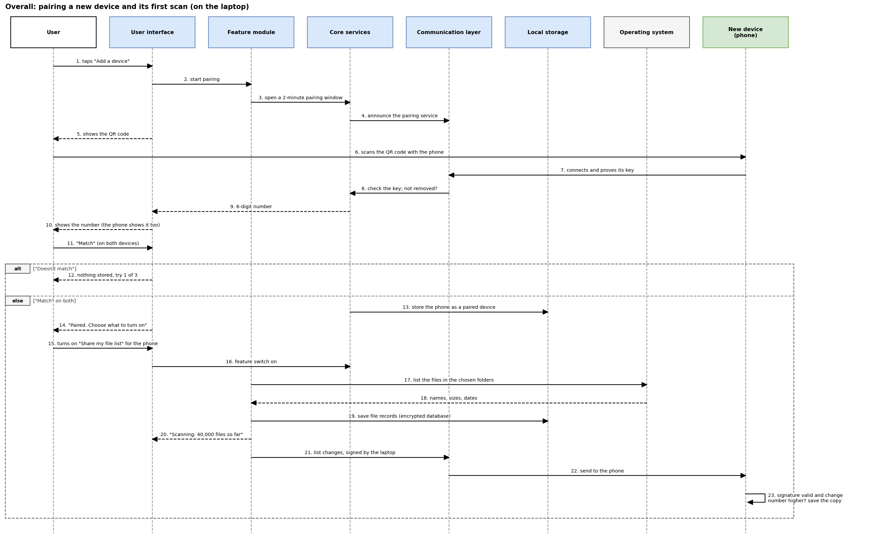
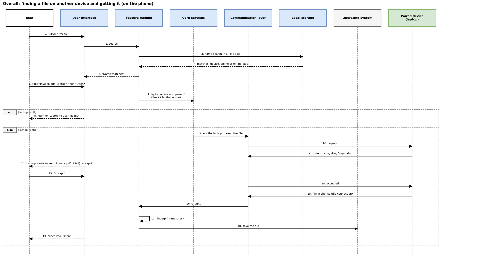
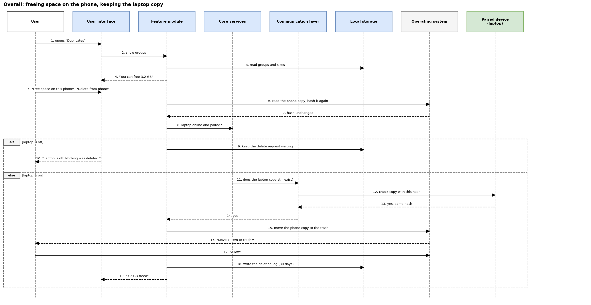

# Overall Sequence Diagrams

## Introduction

The three diagrams below follow complete tasks across several features and devices, step by step. Each uses the same lanes in the same order: User, User interface, Feature module, Core services, Communication layer and Local storage of the device the user is holding, then the Operating system and the other device involved. A solid arrow is a request or a message, a dashed arrow is an answer, and an "alt" box shows what happens when a check fails or a device is off. The three tasks are the same as the three user flows.

## 1. Pairing a new device and its first scan

**Figure: pairing a new device and its first scan.** Source file: `diagrams/overall-1-pairing-first-scan-sequence.drawio`.

The user taps "Add a device" on the laptop, which opens a pairing window for two minutes and shows a QR code. The user scans the code with the phone, and the phone connects to the laptop and proves that it holds its own key. The laptop's core services check the key and make sure the phone has not been removed before. Both devices then show the same 6-digit number, and the user taps "Match" on both; if the numbers differ, nothing is stored and the user can try again. Once paired, the laptop stores the phone in its device registry and asks the user what to turn on. When the user turns on "Share my file list", the laptop asks the operating system for the names, sizes and dates of the files in the chosen folders and saves them in its encrypted database. Finally, the laptop sends its list to the phone, signed with its key, and the phone keeps the copy only after checking the signature and the change number.

## 2. Finding a file on another device and getting it

**Figure: finding a file on another device and getting it.** Source file: `diagrams/overall-2-find-and-get-file-sequence.drawio`.

The user types "invoice" on the phone. The phone searches the names in all the file lists it holds, including the laptop's, and shows the name matches at once, each with its device and whether that device is on. The user opens a file that is stored on the laptop. The phone's core services first check that the laptop is on, paired, and allowed to share files; if the laptop is off, the user sees "Turn on Laptop to use this file" and nothing else happens. Otherwise, the phone asks the laptop to send the file, and the laptop offers it with its name, size and fingerprint. The user taps "Accept", and the file arrives in chunks over the file connection. The phone checks the fingerprint before it saves the file and shows "Received. Open".

## 3. Freeing space on the phone while keeping the laptop copy

**Figure: freeing space on the phone, keeping the laptop copy.** Source file: `diagrams/overall-3-free-space-sequence.drawio`.

The user opens "Duplicates" on the phone, which reads the duplicate groups from its database and shows how much space can be freed. The user chooses "Free space on this phone" and confirms "Delete from phone". The phone reads its own copy of the file again to make sure it has not changed since the scan. It then checks that the laptop is on and paired; if the laptop is off, the request waits and the user sees "Laptop is off. Nothing was deleted." If the laptop is on, the phone asks it whether its copy still exists with the same hash, and continues only when the laptop answers yes, so that the last copy of a file is never deleted. Android then shows its own message, "Move 1 item to trash?", and the file goes to the trash only when the user taps "Allow". The phone writes the deletion to its log for 30 days and shows the space that was freed.

## Summary

All three tasks share the same safeguards: the user confirms every important step, another device is used only after it has been checked as paired, and a switched-off device stops the task with a clear message instead of a silent failure.
